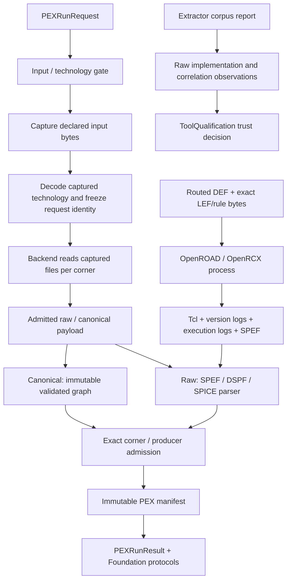

# PEXEngine Design Contract

## Related Designs

The public native electrical input contract is owned by [PEXCore](Sources/PEXCore/DESIGN.md),
whose [ElectricalModel](Sources/PEXCore/ElectricalModel/DESIGN.md) child owns SI units,
exact-corner admission, calibration identity and applicability. Runtime resolution
validates supplied models before backend execution; request hashing retains their
complete encoded meaning. This does not establish native extraction or process trust.
The [PEXNative](Sources/PEXNative/DESIGN.md) child now provides a bounded numeric
graph, explicit terminal electrodes and scoped canonical projection from captured
layout facts. [NativeBackend](Sources/PEXAdapters/NativeBackend/DESIGN.md) now
executes these actual contracts through explicit PEXExtracting registration with
measured native backing-image identity, physical-topology evidence and atomic
failure/cancellation. Default API/CLI execution now consumes typed captured native references and exact corners.
Standard export preserves scoped electrical identity in its declared portable profile;
unrepresentable required output fails the run while retaining canonical/topology evidence.
Captured retry after removal of original files is verified. Production dependency adoption
and independent physical process qualification remain separate gaps.

| Design | Relationship | Contract Used | Summary | Cautions |
|---|---|---|---|---|
| [LSI](../DESIGN.md) | parent | Platform ownership and evidence | Native extraction owner | External completion is not native completion |
| [PEXCore](Sources/PEXCore/DESIGN.md) | child | Typed request, technology and electrical values | Public extraction inputs | Native model admission is mandatory |
| [PEXNative](Sources/PEXNative/DESIGN.md) | child | Bounded native numeric graph | Layout-backed calculation | Run composition and process qualification remain separate |
| [PEXAdapters](Sources/PEXAdapters/DESIGN.md) | child | Concrete backend execution | Native/external composition | Process trust remains independent |
| [PEXParsers](Sources/PEXParsers/DESIGN.md) | child | Scoped standard identity and portable export profile | SPICE/SPEF semantics | Unsupported topology fails required output |
| [PEXCLICore](Sources/PEXCLICore/DESIGN.md) | child | Explicit native CLI input and corners | Developer operation | Typed reference URLs must be local |
| [PEXRuntime](Sources/PEXRuntime/DESIGN.md) | child | Shared bounded native reference loading, typed config mapping, captured execution and output dispatch | Config intake and run lifecycle | Referenced URLs retain Core meaning; physical process qualification remains independent |
| [PEXPersistence](Sources/PEXPersistence/DESIGN.md) | child | Immutable input/output capture and reload | Run artifact owner | Integrity does not qualify process physics |
| [CircuiteFoundation](../CircuiteFoundation/DESIGN.md) | depends on | ArtifactID, evidence, provenance | Shared content identity | Identity is separate from availability |
| [ToolQualification](../ToolQualification/DESIGN.md) | used by | Raw measured observations | Independent trust decision | PEX does not self-qualify a process |

## Purpose and Scope

PEXEngine validates extraction requests, resolves technology and process
profiles, executes one or more extraction backends, admits raw or canonical
outputs, validates the IR, and retains immutable run artifacts
and lineage.
This package is a direct child of the LSI system; its public Core child is linked above.

## Architecture

## Foundation integration

`PEXExecuting` refines `CircuiteFoundation.Engine` with
`PEXRunRequest`/`PEXRunResult`; `DefaultPEXEngine.execute` delegates to the
existing run path. Retry and lineage APIs remain PEX-specific.

`PEXRunResult` directly maps available `PEXArtifactManifest` records to
Foundation `ArtifactReference` values, publishes `EvidenceManifest`, and
converts warnings and extractor diagnostics to `DesignDiagnostic`. Its
provenance is derived from the retained backend identity, inputs, and run
timestamps, so no caller-side projection can invent execution identity.

`PEXRunRequest.designObjectReference()` provides a stable top-cell identity;
corner IDs and parasitic nodes remain PEX domain concepts.

## Responsibilities and Boundaries

### Native composition requirements and current gaps

The numeric graph and explicit native backend execution have separate behavioral
proofs. The table distinguishes established composition from remaining production adoption
and exact source-binding requirements.

| Boundary | Current implementation fact | Owner and required change | Completion evidence |
|---|---|---|---|
| Standard layout to geometry | `IRLayoutConverter` preserves signed custom extensions imported from OASIS/GDS bytes; imported text remains labels, not physical pin contacts | LayoutIO retains admitted standard semantics; native input preparation supplies explicit exact terminal bindings rather than inferring contact from text | Standard-byte round-trip and native geometry tests, including unequal extensions and repeated occurrences |
| Geometry to numerical state | ConductorCapture preserves admitted orthogonal paths; PEXNative exposes numerical operators, explicit electrode contacts and exact scoped canonical projection | [ConductorCapture](../semiconductor-layout/Sources/LayoutVerify/ConductorCapture/DESIGN.md) owns exact footprint coordinates and their units; [PEXNative](Sources/PEXNative/DESIGN.md) composes its lower contracts into a retained canonical graph, separately from backend execution | Analytical path coverage and terminal resistance; pin regions and net labels do not short islands; bounded failure/cancellation |
| Backend to canonical result | [BackendExecution](Sources/PEXCore/BackendExecution/DESIGN.md) admits raw files or a validated immutable canonical graph; [PEXRuntime](Sources/PEXRuntime/DESIGN.md) dispatches both through persistence and retains verified evidence on failure; defaults register native/Magic/OpenRCX | [NativeBackend](Sources/PEXAdapters/NativeBackend/DESIGN.md) implements explicit native execution with measured backing-image identity and retained physical topology; default API/CLI registration, required-output failure and captured retry are verified on macOS CPU | Actual GDS/OASIS public API tests prove analytical RC, measured identity/reload and failure/cancellation; actual executable CLI/captured retry and standard-profile failure retention are verified |
| Input identity to resume | [NativeInput](Sources/PEXCore/NativeInput/DESIGN.md) supplies explicit configuration/calibration locations and budgets; [NativeInputCapture](Sources/PEXPersistence/NativeInputCapture/DESIGN.md) retains bounded bytes and exact content IDs; Runtime checks selected model coverage | [InputPreparation](Sources/PEXNative/InputPreparation/DESIGN.md) admits configuration; NativeBackend consumes captured standard/configuration/calibration bytes and checks direct-call calibration content too; capture does not qualify calibration physics | Public run/retry/reload fixtures verify source mutation/removal, required captured-input missing/tamper rejection and location-independent content identity |
| Source to physical terminals | `PEXSourceConnectivityChecker` permits leaf-name aliases and reports source-only nodes without failing | Source binding must preserve exact occurrence and terminal identities; name coverage alone cannot establish physical connectivity | Repeated leaf names, missing bindings, opens and shorts cannot yield a proven same-design result |

Each lower contract is designed and behaviorally verified before its composing
contract is finalized. The existing source-connectivity report is not proof of
native electrode conditions. Calibration byte retention is not physical
qualification; independent correlation and ToolQualification still own trust.

| Concern | Owner |
|---|---|
| Extraction, parsing, IR, corners, retry, lineage | PEXEngine |
| Shared evidence/artifact/provenance contracts | CircuiteFoundation |
| Project state, flow gates, human approval | Xcircuite / DesignFlowKernel |

Foundation evidence is an interchange boundary, not a replacement for the
PEX manifest or the canonical parasitic IR.

## Contracts and Invariants

### OpenRCX execution contract

`OpenRCXPEXAdapter` directly implements `PEXExtracting`. It does not convert
GDSII/OASIS to DEF or infer PDK views. The request must supply routed DEF,
technology LEF, one or more library LEFs, and the selected corner's OpenRCX
rules. The orchestrator captures every declared view into the immutable run
before execution; resume resolves and verifies those captured bytes.

The process boundary is `TimedProcessRunning`, which owns timeout,
cancellation, and process-tree cleanup. PEX retains the generated Tcl driver,
version-probe stdout/stderr, extraction stdout/stderr, and any non-empty SPEF
present at failure. A zero-byte SPEF is not an artifact and cannot produce a
successful run.

Before an external extraction starts, the backend hashes the selected
executable and observes its semantic version. It hashes the executable again
after the process completes and rejects any change. The resulting
`PEXBackendExecutionIdentity` retains the producer identifier/version/build,
external invocation, sanitized-environment digest, and platform fingerprint.
All successful corners must report the same producer, code-image digest and
invocation mode/entrypoint;
otherwise the orchestrator rejects the run instead of merging inconsistent
evidence. Per-corner environment fingerprints may differ because corner decks
and output paths are invocation inputs. The manifest retains every corner invocation, while
`ExecutionProvenance` carries the primary invocation and exact input artifacts.

## Correlation contract

`PEXExtractorCorrelationBuilder` consumes the canonical bytes of one
`PEXExtractorCorpus` and two canonical `PEXExternalExtractorCorpusReport`
values. It derives all SHA-256 identities internally. Both reports must name
different backend IDs, cover the exact corpus case set, preserve coverage tags,
and repeat every corpus expectation and tolerance exactly. The comparison is
passing only when both observations and their difference are within the
declared absolute tolerance. The CLI persists canonical correlation bytes once
and refuses overwrite.

## Observation boundary

`PEXExternalExtractorCorpusReport` names the executing implementation with
`extractorBackendID`. A report records one backend's retained regression corpus;
it does not claim that backend is an oracle.

PEXEngine loads and verifies corpus artifacts, correlates case sets against
common physical bounds, and emits canonical `ArtifactReference` values with raw
measurements. It does not assign trust, accept a tool for production, approve a
flow gate, or authorize release. Those decisions belong to `ToolQualification`,
`DesignFlowKernel`, and `ReleaseEngine`, respectively.

| Observation | Meaning |
|---|---|
| Same implementation or executable digest | Not an independent comparison |
| Missing or changed artifact bytes | Integrity finding |
| Magic primary and Magic comparison | Regression observation only |
| Independent implementations and correlated reports | Input for ToolQualification evaluation |

## Runtime Flows

### Captured input execution contract

`PEXPersistence.PEXArtifactRecorder.capturedRequest` is the common boundary
for initial execution and request recording. It requires available layout,
netlist, JSON technology and declared process-file artifacts. All corresponding
execution paths point into the run directory and are verified against their
recorded byte count and SHA-256. `PEXArtifactStore.loadRequest` restores those
same file-role associations for retry. `PEXProcessProfileReference.mapInputPaths`
owns traversal of primary deck, corner decks and required views; neither
caller guesses which profile fields represent files.

The orchestrator resolves technology from captured JSON, computes the request
hash before any backend callback, and executes the captured request. Source
mutation or removal after capture must not change layout, netlist, selected
technology, primary/corner deck, required view or request identity. The hash
uses process identity and semantic file roles with content digests; temporary
capture locations are availability, not process identity. `pdkRoot` remains an
explicit backend discovery context; capturing declared files does not qualify
undeclared transitive includes or arbitrary files read by an external tool.

## Verification and Change Impact

Electrical model admission changes affect inline/JSON resolution, direct native model
selection and request identity. The local suites in the Core child establish those
contracts; captured execution and persistence evidence below protects upper composition.
External-deck metadata can still describe an external backend without a native model.
Native extraction, calibration byte availability and process trust remain separate work.

| Invariant | Behavioral evidence owner |
|---|---|
| Initial execution consumes recorded bytes despite changed/deleted originals | `PEXRuntimeTests/PEXCapturedInputExecutionTests` |
| Canonical output bypasses parsing; exact producer/corner failure retains observed identity and earlier verified artifacts | `PEXRuntimeTests/PEXCanonicalExecutionTests` |
| Technology values are decoded after capture | Same runtime suite, readiness callback changes source JSON before capture |
| Missing or tampered captured inputs fail before execution/reconstruction | `PEXPersistenceTests` and `PEXRuntimeTests/PEXNativeInputCaptureTests` |
| Process-role content affects identity; file relocation does not | `PEXCoreTests/PEXRequestHashTests` |

This change has no shared mutable storage: the orchestrator's registries and
resolver are immutable actor-owned properties; capture/profile/hash values
are immutable `Sendable` values and all intermediate mutation is call-local.
No target-dependent synchronization branch is introduced. Verification is
macOS native; no WASM or Embedded runtime result is inferred.
