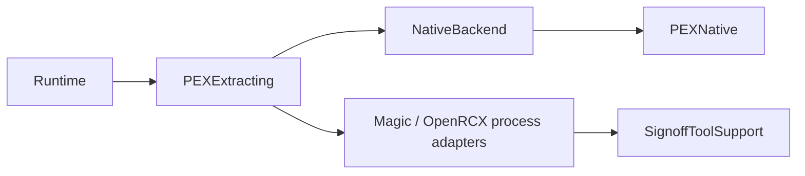

# PEXAdapters

## Purpose and Scope
Host backend implementations of PEXExtracting. Parent: [PEXEngine](../../DESIGN.md). Child: [NativeBackend](NativeBackend/DESIGN.md). Existing Magic/OpenRCX are platform process adapters.

## Responsibilities and Boundaries
Owns concrete backend execution and observed identity. Core owns contracts; Runtime owns orchestration; Persistence owns retained artifact identity. Backends provide observations, not process trust.

## Related Designs
| Design | Relationship | Contract Used | Summary | Cautions |
|---|---|---|---|---|
| [PEXEngine](../../DESIGN.md) | parent | Extraction ownership | Backend module | Default registration is explicit |
| [NativeBackend](NativeBackend/DESIGN.md) | child | Actual native execution | Local CPU backend | Qualification remains independent |
| [PEXCore](../PEXCore/DESIGN.md) | depends on | PEXExtracting | Typed output and failure | No invented raw file for canonical output |
| [PEXRuntime](../PEXRuntime/DESIGN.md) | used by | Adapter invocation | Captured request lifecycle | Results retain truthful provenance |

## Architecture

## Contracts and Invariants
Successful adapters publish admitted actual outputs with measured implementation identity. Failed operations retain observed identity and complete generated evidence. No mock/CPU/external fallback is silently selected.

## Verification and Change Impact
PEXAdaptersTests owns backend behavior; PEXRuntimeTests owns public run composition and evidence retention. Shared-state changes are checked at their owner. Default registration and external process qualification remain separate verification boundaries.
