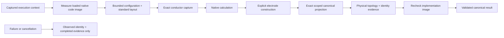

# NativeBackend

## Purpose and Scope
Composes captured standard layout and admitted configuration through actual native geometry, RC, electrodes and canonical projection. Parent: [PEXAdapters](../DESIGN.md). No children. Default registration and standard exporters are separate work.

## Responsibilities and Boundaries
Owns backend invocation, measured image stability, bounded input loading, asynchronous cancellation delivery into synchronous calculation and retained typed physical-topology evidence. Persistence and run orchestration consume the existing PEXExtracting result/failure contracts. Process calibration identity is required but never self-qualified.

## Related Designs
| Design | Relationship | Contract Used | Summary | Cautions |
|---|---|---|---|---|
| [PEXAdapters](../DESIGN.md) | parent | Backend ownership | Native CPU implementation | No external fallback |
| [PEXNative](../../PEXNative/DESIGN.md) | depends on | Input preparation, numerical/electrode/projection contracts | Actual calculation | Preserve complete operators and opens/shorts |
| [CodeImage](../../PEXNative/CodeImage/DESIGN.md) | depends on | Actual loaded implementation backing identity | SHA-256 and UUID observation | Not relocated memory attestation |
| [NativeInputCapture](../../PEXPersistence/NativeInputCapture/DESIGN.md) | depends on | Bounded captured configuration/calibration | Exact run inputs | Content identity is not physical qualification |
| [PEXRuntime](../../PEXRuntime/DESIGN.md) | used by | Typed canonical result and retained failure artifacts | Public run lifecycle | Required output exporters remain separately owned |

## Architecture

## Contracts and Invariants
No success fallback exists. Unsupported formats/options fail explicitly. Initial implementation admits exact GDS/OASIS, full RC with coupling, and no operator threshold reduction; other modes remain unsupported until meaningfully implemented. Exact selected model calibration IDs must be present and hash/count verified even for direct adapter invocation. Native evidence preserves occurrence indices/source paths, physical component footprint membership, pin incidence, opens/shorts, numeric node-to-canonical references, explicit electrode contacts and operator identity mapping. Imported transient UUIDs are observations, not semantic request identity. The canonical IR retains every native operator.
The runtime compiler identity is explicitly unavailable, not inferred from the numerical law; verification build provenance records the actual toolchain. The producer build is the measured native backing-file digest, invocation is in-process, and before/after image observations must agree. Caller executable/environment overrides are rejected because no external process is invoked. Failure retains the actual measured identity and already completed artifacts, with no partial canonical result.

## State, Ownership, and Lifecycle
All geometry/numerical/projection state is call-local immutable publication. A short Mutex protects cancellation/stage observations shared between one calculation child and one async monitor. No callback, I/O or await occurs under its lock. A structured task group cancels and joins the monitor on calculation termination, and cancels/joins calculation on callback cancellation/error. Lower phases inspect the same flag plus Task cancellation; no detached task or continuation escapes. Native/MacOS storage and accesses are identical; this host target is not WASM/Embedded-qualified.

| Logical state | Native macOS storage/isolation | Read/mutation entry | Shutdown/release | WASM/Embedded |
|---|---|---|---|---|
| Cancellation + monitor reason + phase | Mutex<State> | withLock accessors/cancel/enter | Task group joins both users before call-local owner release | Host-only adapter; not compiled or runtime-qualified |
| Numerical state | Call-local immutable publication | Lower native component APIs | Retained by result/evidence owner | No additional target claim |

## Failure, Concurrency, and Constraints
Observed byte ceilings and polling duration are retained in topology and terminal evidence independently of physical model identity. Inputs use explicit positive byte ceilings; lower work ceilings come unchanged from configuration. One async monitor awaits the caller check and sleeps between checks; cancellation/error is propagated and always joined. The polling interval is an adapter-owned configurable duration; its latency excludes unbounded caller callback time and uninterruptible standard decoding/hash/encoding segments. The schema/evidence remains complete at admitted record ceilings; encoded evidence has an additional byte admission ceiling, not an independent bound on JSONEncoder allocation. Artifact publication is atomic. Failure evidence is a small terminal record, written without numerical/GPU allocation. Evidence persistence failure remains explicit rather than silently omitting the required artifact.

## Verification and Change Impact
NativePEXAdapterTests exercises actual standard bytes through direct PEXExtracting and public DefaultPEXEngine, analytical RC, actual image identity/reload, missing/bad configuration/calibration, lower budget failure, expected identity mismatch, physical opens/shorts and asynchronous cancellation/monitor teardown. Changes affect runtime provenance and artifact decoding; standard exporters/default CLI/resume integration remain B3.3.4.4/B3.3.4.5-owned.
