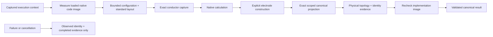

# NativeBackend

## Purpose and Scope
Composes captured standard layout and admitted configuration through actual native geometry, RC, electrodes and canonical projection. Parent: [PEXAdapters](../DESIGN.md). Child: [RoutedInputPreparation](RoutedInputPreparation/DESIGN.md). Default registration and standard exporters are separate work.

## Responsibilities and Boundaries
Owns backend invocation, measured image stability, bounded input loading, asynchronous cancellation delivery into synchronous calculation and retained typed physical-topology evidence. Persistence and run orchestration consume the existing PEXExtracting result/failure contracts. Process calibration identity is required but never self-qualified.

## Related Designs
| Design | Relationship | Contract Used | Summary | Cautions |
|---|---|---|---|---|
| [PEXAdapters](../DESIGN.md) | parent | Backend ownership | Native CPU implementation | No external fallback |
| [PEXNative](../../PEXNative/DESIGN.md) | depends on | Input preparation, numerical/electrode/projection contracts | Actual calculation | Preserve complete operators and opens/shorts |
| [CodeImage](../../PEXNative/CodeImage/DESIGN.md) | depends on | Actual loaded implementation backing identity | SHA-256 and UUID observation | Not relocated memory attestation |
| [NativeInputCapture](../../PEXPersistence/NativeInputCapture/DESIGN.md) | depends on | Bounded captured configuration/calibration | Exact run inputs | Content identity is not physical qualification |
| [LayoutIO](../../../../semiconductor-layout/Sources/LayoutIO/DESIGN.md) | depends on | Source-bound integer DBU endpoints and center admission | Standard import/export supplies geometry and source ports | PEX uses imported geometry without reconstructing source rectangles from floating-point centers |
| [PEXRuntime](../../PEXRuntime/DESIGN.md) | used by | Typed canonical result and retained failure artifacts | Public run lifecycle | Required output exporters remain separately owned |

## Architecture

## Contracts and Invariants

The additive routed-law composition is specified by
[RoutedInputPreparation](RoutedInputPreparation/DESIGN.md). It uses an explicit
`routedOpenRCXV1` configuration kind and DEF/LEF source inputs. The existing
`maskGeometry` branch retains its own configuration version and analytical-law
admission. The routed branch must not call the old analytical-model selector or
reuse mask numerical evidence as routed evidence. Routed schema 3 selects only `unionSheetAreaBoundaryV1`, an explicit positive
mesh span and source-derived area/boundary ground calibration. It composes
`UnionSheetRoutedPEXCalculator` through the new `NativeRoutedPEXCalculating`
requirement with exact source preparation. The old overload and deprecated pinned
comparison calculator are never fallback paths. Public routed admission requires the owned structural
source decoder and complete DEF/source semantic join; rule-query
evaluation or terminal-name coverage alone is insufficient.
The default adapter constructor uses a statically admitted positive policy. Configurable construction validates all byte ceilings and polling duration. PEXDefaultBackends registers this actual adapter without requiring CLI callers to construct a private registry. Backend selection remains explicit; registration does not assign process trust.

No success fallback exists. Unsupported formats/options fail explicitly. Initial implementation admits exact GDS/OASIS, full RC with coupling, and no operator threshold reduction; other modes remain unsupported until meaningfully implemented. Exact selected model calibration IDs must be present and hash/count verified even for direct adapter invocation. Native topology version 3 retains the exact LayoutVerify-owned electrical context; configuration version 3 binds the same interpretation and explicit durable net selectors through captured content identity before publication. [InputPreparation](../../PEXNative/InputPreparation/DESIGN.md) resolves selectors after actual standard import and capture; this adapter passes only prepared snapshot-local bindings to projection. Legacy topology and configuration versions fail decoding. Native evidence preserves occurrence indices/source paths, physical component footprint membership, pin incidence, opens/shorts, numeric node-to-canonical references, explicit electrode contacts and operator identity mapping. Imported transient UUIDs are observations, not semantic request identity. The canonical IR retains every native operator.
The runtime compiler identity is explicitly unavailable, not inferred from the numerical law; verification build provenance records the actual toolchain. The producer build is the measured native backing-file digest, invocation is in-process, and before/after image observations must agree. Caller executable/environment overrides are rejected because no external process is invoked. Failure retains the actual measured identity and already completed artifacts, with no partial canonical result.
Mask producer version remains `3.1.0`; routed producer version is `4.0.0`. The algorithm-environment fingerprint binds the
explicit input kind and numerical law: mask geometry retains
`native-device-aware-contact-admission-v3`; routed inputs select
`native-union-sheet-area-boundary-v1`. Its environment digest also binds the
positive mesh span and complete selected source and ground calibration values, full source references
and the prepared conductor input (including per-corner selection and source ranges). The backing-image digest remains measured
from the executing image. A prior mask execution identity cannot qualify routed
execution. The captured model and canonical `nativeLaw`
select either `analyticalRectilinearV1` or `singlePlaneCoplanarGroundV1`, with no old
law alias or automatic selection. Algorithm changes invalidate prior execution
identity. The screened law's source-derived fringe multiplier is an approximation
and does not confer foundry qualification.

The result carries a constructor-validated Core physical-topology summary from the same projection used for retained topology evidence. Direct adapter completion can include opens/shorts/uncontacted ports as an inspectable diagnostic graph. Public Runtime same-design admission requires a satisfied summary and exact source coverage; no warning/disabled policy bypasses native physical admission.

## State, Ownership, and Lifecycle
All geometry/numerical/projection state is call-local immutable publication. A short Mutex protects cancellation/stage observations shared between one calculation child and one async monitor. No callback, I/O or await occurs under its lock. A structured task group cancels and joins the monitor on calculation termination, and cancels/joins calculation on callback cancellation/error. Lower phases inspect the same flag plus Task cancellation; no detached task or continuation escapes. Native/MacOS storage and accesses are identical; this host target is not WASM/Embedded-qualified.

| Logical state | Native macOS storage/isolation | Read/mutation entry | Shutdown/release | WASM/Embedded |
|---|---|---|---|---|
| Cancellation + monitor reason + phase | Mutex<State> | withLock accessors/cancel/enter | Task group joins both users before call-local owner release | Host-only adapter; not compiled or runtime-qualified |
| Numerical state | Call-local immutable publication | Lower native component APIs | Retained by result/evidence owner | No additional target claim |

## Failure, Concurrency, and Constraints
Observed byte ceilings and polling duration are retained in topology and terminal evidence independently of physical model identity. Inputs use explicit positive byte ceilings; lower work ceilings come unchanged from configuration. One async monitor awaits the caller check and sleeps between checks; cancellation/error is propagated and always joined. The polling interval is an adapter-owned configurable duration; its latency excludes unbounded caller callback time and uninterruptible standard decoding/hash/encoding segments. The schema/evidence remains complete at admitted record ceilings; encoded evidence has an additional byte admission ceiling, not an independent bound on JSONEncoder allocation. Artifact publication is atomic. Failure evidence is a small terminal record, written without numerical/GPU allocation. Evidence persistence failure remains explicit rather than silently omitting the required artifact.

## Verification and Change Impact
NativePEXAdapterTests exercises actual standard bytes through direct PEXExtracting and public DefaultPEXEngine, analytical RC, actual image identity/reload, missing/bad configuration/calibration, lower budget failure, expected identity mismatch, physical opens/shorts and asynchronous cancellation/monitor teardown. Changes affect runtime provenance and artifact decoding; Default API/CLI, scoped standard export, required-output failure/reload and captured same-input retry are composed and verified in NativePEXAdapterTests and PEXParsers/PEXCLICore owners. These are macOS CPU observations, not process physics or target qualification.

The Layout source-grid compatibility boundary preserves the existing PEX configuration, source selectors, physical admission and persistence contracts. `publicSourcePortIntegerGridSurvivesStandardExportAndNativeReload` imports a source-declared DEF port with endpoints (-120, -1260) and (2960, -580) at 2000 DBU/micrometer, exports actual GDSII/OASIS, and requires integer-derived pin geometry, native analytical capacitance/contact/topology and public artifact reload without supplemental pins. The affected lower-revision replay additionally runs the existing same-standard-byte source projection, captured-input API retry and actual same-executable CLI retry. Unchanged PEX behavior retains its prior evidence; this boundary does not claim a new physical qualification.

The shared Layout dependency also includes the `LayoutDRCService` exact-only typed capture-failure diagnostic classification needed by Physical's NativeDRC consumer. PEX calls the public conductor capture owner directly; this dependency advance changes no PEX geometry kernel, source-port, RC law, configuration or artifact schema contract. The limited compatibility boundary reuses `publicRunCalculatesAnalyticalRCAndReloadsObservedIdentity` for GDSII/OASIS capture and reload, `nonrectangularCutAndOutOfRangeDimensionsFailExplicitly` for unsupported geometry/model refusals, `failedLowerBudgetKeepsImageAndTerminalEvidenceWithoutCanonicalOutput` for public resource refusal and `sameExecutableRetriesCapturedInputsAfterTransientPublicationFailure` for actual CLI replay. Prior source-port and unchanged native behavioral evidence remains applicable.

### Independent ground-capacitance correlation
`NativeMagicGroundCapacitanceCorrelationTests` compares actual native full-RC execution with actual Magic capacitance extraction over identical captured GDSII bytes. Four isolated Sky130 nominal metal1 rectangles (10×10, 20×5, 20×10 and 100×1 micrometers), plus two 10×1 micrometer strip pairs at 1 and 2 micrometer gaps, separate area, exposed perimeter, aspect ratio, coplanar coupling and ground-fringe screening. Both runs retain the exact standard input, source netlist, configuration and technology-source calibration artifact. The native coefficients are translated from the installed nominal extraction style; the entire nonempty source deck is hash-verified calibration evidence, not a qualification certificate. Actual producer/image identity, captured model, raw Magic process log/output and native topology are attached to each comparison.

Admission requires agreement within the observed SPICE decimal quantization plus an operation-count-derived floating-point accumulation budget. No coefficients are fitted to the output. Native C-only/R-only requests remain unsupported; the shared observables are ground and coplanar capacitance from the admitted full-RC result. This establishes independent implementation correlation for these finite single-plane fixtures only. Foundry qualification, vias, multilayer screening, electromagnetic accuracy, other processes/corners and external terminal resistance remain unqualified.

`NativePEXTopologyEvidence.artifactFileName` owns the retained `native-topology.json` process-evidence filename. Consumers select exactly one record per corner using this public filename contract, then decode the public version-3 topology type with required `electricalContext`; missing, duplicate, or legacy records fail admission.

The ideal substrate reference is explicitly named `0` for native standard output and `VSUBS` by the installed Magic deck. This naming correspondence preserves the ground-capacitance observable; a native model naming `VSUBS` cannot pass the required SPEF implicit-reference export and is not reported as a successful public run.

Terminal resistance retains the existing independent Kirchhoff evidence at [ElectrodeConstruction](../../PEXNative/ElectrodeConstruction/DESIGN.md). A minimal installed-Magic probe produced aliased duplicate resistor networks from painted ports; reimporting its exact standard GDSII through the current extraction driver produced no resistor network. This prevents a matched external terminal-resistance claim on that public path. Raw GDSII, `.ext`, `.res.ext`, SPICE and process logs are retained with the correlation verification; they are not repaired or fitted into agreement.

### Routed execution composition

A routed calculation uses the same structured calculation/monitor lifetime as the
mask branch. Each execution context retains every explicitly requested corner ID;
direct single-corner contexts declare that one corner. Runtime validates the entire
requested matrix from captured configuration before adapter invocation, without
selecting an analytical electrical model. Per-corner preparation binds all required
technology views and selects only that corner's explicit original source rule law.

Successful Native routed calculation guarantees admitted terminal incidence, no
cross-net conductor shorts and connected signal-net electrical graphs. Only that
success permits a zero-defect Core topology summary; exceptions do not manufacture
zero observations. Native input, result and source manifest are required process
evidence named `native-routed-input.json`, `native-routed-result.json` and
`native-routed-source.json`. The source manifest binds full references, compiled
source model/profile, numerical limits, policy, measured image and execution
identity. Its decoded values declare observations, not process qualification.
Evidence publication/image stability/cancellation checks remain required before
canonical success. Raw finite evidence caps bound output bytes, not JSONEncoder
allocation or total RSS.

The structural source codec owns Verilog syntax and alias/constant interpretation.
The host owns exact comparison to saved DEF top, component/master identity and
non-PG terminal connectivity; library PG roles remain source-derived. This
semantic gate is not replaceable by the existing Runtime name-coverage check.
Runtime's existing source report, required standard exports and captured-only
reload/retry remain additional gates. Behavioral verification must exercise real
Native calculation, explicit corner matrix, producer/law distinction, actual SPEF
reload with instance pin identity, malformed/rewired source refusal and CLI replay.

### Union-sheet routed evidence and replay

Schema-3 configuration is captured by the existing input owner. Its mandatory law
and positive `maximumCellSpanDatabaseUnits` are passed unchanged with the prepared
OpenRCX and LEF ground models through the new calculator protocol requirement.
The adapter's injectable immutable calculator defaults only to
`UnionSheetRoutedPEXCalculator`. Legacy-only conformers explicitly refuse the new
requirement; no legacy overload is invoked. Mask geometry behavior is unchanged.

`NativeRoutedPEXExecutionEvidence` version 2 retains the algorithm, mesh span,
complete ground model, selected OpenRCX model, exact source references and source
join, numerical limits, runtime policy and measured image/identity. Version 1,
missing fields, nonpositive span and inconsistent selected corners refuse decoding.
Decoded transport is not checked execution authority. `requireBinding` compares it
to fresh source preparation, exact execution context, measured image/expected
identity and adapter policy. A canonical `inputDigest` binds every source fact in the separately retained
prepared conductor input; canonical encoded comparisons retain ordered raw facts
without inventing semantic aliases. Identity binds the model and ground calibration
in addition to the law/span. Changing any source range, coefficient, corner, span,
source reference, input fact or expected runtime identity fails checked binding.

Fresh captured-input preparation is required before replay validation. The runtime
test reloads captured request/source bytes, re-prepares and checks evidence rather
than treating snapshot decoding as proof. Result replay/numerical correlation and
process qualification remain independent obligations. Numerical/cancellation
failures retain terminal evidence and cannot publish a successful canonical result.
The shared cancellation Mutex and structured child lifetime remain unchanged.

`NativeRoutedPEXRuntimeTests` owns new-overload dispatch through an injected
calculator, v1/missing/altered evidence refusal, exact span/corner/model/source-fact
binding, current-law API/CLI output and captured-only retry. Lower preparation owns
schema-3 configuration/LEF source projection; lower Native owns union geometry,
sheet resistance, ground/coupling laws and solver behavior.
