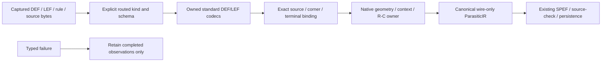

# RoutedInputPreparation

## Purpose and Scope

Own the host boundary from captured standard-cell DEF/LEF and explicit routed
configuration to the Native routed extraction owner. Parent:
[NativeBackend](../DESIGN.md). No children. The Native neutral geometry interface is fixed; preparation is verified independently
of numerical extraction. A successful source load alone is not an extraction result.

## Responsibilities and Boundaries

Decode exact standard bytes with the owned DEF/LEF codecs, retain source identities,
bind selected layers/instances/pins/nets/corners and compose the Native result with
existing canonical standard exporters. Do not implement rule parsing, interpolation,
geometrical context partition, coupling, R/C accumulation, Boolean proof or STA.
Native is the primary numerical backend; external OpenRCX is correlation evidence.

## Related Designs

| Design | Relationship | Contract Used | Summary | Cautions |
|---|---|---|---|---|
| [NativeBackend](../DESIGN.md) | parent | Measured invocation/cancellation/evidence | In-process execution | No external fallback |
| [NativeInput](../../../PEXCore/NativeInput/DESIGN.md) | depends on | Discriminated exact captured references | Configuration identity | URLs are availability |
| [LogicDesign codec](../../../../../LogicDesign/Sources/LogicDesignSerialization/Codec/DESIGN.md) | depends on | StructuralVerilogSourceDecoding | Owned flat structural syntax and alias components | Source facts do not grant functional proof authority |
| [OpenRCXRules](../../../PEXParsers/OpenRCXRules/DESIGN.md) | depends on | Exact-source compiler/validation | Source tables | No analytical conversion |
| [GroundCapacitance](../../../PEXNative/GroundCapacitance/DESIGN.md) | depends on | Explicit LEF area/boundary model | No table-fringe fit, qualification or inferred height |
| [RectilinearSheetNetwork](../../../PEXNative/RectilinearSheetNetwork/DESIGN.md) | depends on | Finite-volume sheet/contact network and mandatory positive caller span | Span is an explicit operational profile requiring separate measurement qualification |
| [RoutedRuleExtraction](../../../PEXNative/RoutedRuleExtraction/DESIGN.md) | depends on | NativeRoutedPEXInput, limits and calculating protocol | Numerical owner | Queries alone do not prove routed extraction |
| [PEXRuntime](../../../PEXRuntime/DESIGN.md) | used by | Corner admission, source checking, persistence | Public API/CLI | Preserve same-input replay |

## Architecture

## Contracts and Invariants

`routedOpenRCXV1` requires DEF and a matching routed configuration schema. Mask
configuration and source tables cannot be silently substituted. Before numerical
work, verify all selected artifact digests/counts and retain full declared
references for authority-bearing equality. The DEF design name, database-unit
scale, placed master names, pin identities and net connections bind the selected
standard-cell LEFs and requested top/source. No generated name, missing terminal,
LEF property, contact or geometry is guessed from a cell name.

Use `DEFLibraryReader`/`LEFLibraryReader`; do not add a second standard parser.
Host projection preserves integer DBU geometry and exact source-derived layer
width, pitch, direction, resistance, cut/via and instance-pose facts. The Native
owner defines and validates NativeRoutedPEXInput. The host uses actual route
rectangles, per-cut resistance and independent via landing boxes; Native owns
context geometry, graph splitting and canonical R/C values. Coincident distinct source pins retain distinct names and actual contact facts;
Native owns their deterministic electrical-equivalence topology. Internal coordinate
nodes are reused, without collapsing source terminal identities. Whole-file SourceFact
ranges identify the exact decoded bytes without inventing field byte positions.

Every requested RC corner has one explicit source selection. Selected process,
profile, rule table, technology LEF and required library LEFs must be captured.
No nominal fallback, RC/MOS corner-name inference, hidden PVT scaling or analytical
height model is permitted. The explicitly selected routed algorithm is `native-union-sheet-area-boundary-v1`:
Native owns physical conductor union, finite-volume sheet/contact resistance and
independent LEF area/boundary ground capacitance. Original pinned OpenRCX source
selection remains the separate coupling authority, over-cell false and zero coupling
threshold. No intrinsic pin capacitance is added. The old per-record centerline R/C
law is not a fallback for missing new inputs or failed numerical admission.

The Native owner returns the actual canonical network and evidence. The host does
not recompute coefficients or repair missing topology. Same-candidate functional
proof and STA remain consumer gates, independent of successful extraction. Existing
Runtime source-terminal checking and exact captured inputs remain required.

### Declared configuration and source roles

NativeRoutedPEXConfiguration schema 3 contains PEXRoutedInputSources, mandatory
algorithm `.unionSheetAreaBoundaryV1`, mandatory positive Int32
`maximumCellSpanDatabaseUnits`, explicit NativeRoutedPEXLimits,
PEXOpenRCXCompilationLimits and NativeRoutedPEXPreparationLimits. No mesh-span
default is inferred from width, source pitch, fixture dimensions or old budgets.
The caller chooses that finite operational profile; convergence and numerical
qualification are separately measured. Schemas 1 and 2 are refused, never silently
reinterpreted as the new law.
Construction and JSON decode are declarations, not qualification.
NativeRoutedPEXInputPreparing.prepare(context:requiredCornerIDs:isCancelled:) returns
a non-Codable PreparedNativeRoutedPEXInput containing the projected Native input,
compiled original coupling source model, exact full source references and
extraction limits, plus the selected-corner `PEXRoutedGroundCapacitanceModel` and
the explicit maximum cell span. The Native composition owner consumes those values
through its new required contract and records algorithm/source/model identity.
DefaultNativeRoutedPEXInputPreparer uses only the owned standard readers and rule
compiler. The result is preparation evidence; Native must still admit and calculate
the geometry. Configuration validation and projection share one call-local host
budget. Exact source bytes are loaded once per content identity.

The initial standard-cell profile admits Manhattan routed rectangles and fixed
explicit via cut/landing rectangles. Generated-only vias without explicit geometry,
nonzero macro ORIGIN, polygon/path pin ports and polygon DIEAREA fail explicitly.
LEF numeric coordinates must reconstruct the parsed source value exactly from the
integer DEF DBU value; no geometry tolerance is applied. The mandatory routedTechnologyLEF is the saved route geometry authority. Actual
used layer units, WIDTH, PITCH and DIRECTION must agree with every selected full
corner technology; numerical sheet/cut resistance remains the explicit corner law
and is not forced equal to a nominal route view. Used fixed via cut/landing geometry
must match actual full-source rectangles, not merely a matching via name.
Cell LEF files without a
UNITS declaration inherit the explicitly selected technology LEF unit scope; an
explicit declaration must agree with that scope. Component orientation uses the
owned DEF orientation convention and SIZE-normalized placement. Source top ports
use their declared placement frame. End extensions retain actual declarations or
the standard half-width default. Source endpoints within the actual contact are preferred; a wire-interior terminal
uses an actual contact/centerline intersection. No terminal is placed at a guessed
pin center. The pinned Native single pitch uses the original LEF X/first pitch,
including anisotropic PITCH; both axes remain checked in source geometry joins. Source admission
requires positive finite limits, injective corner IDs and cell-LEF identities, exact
selection-to-rule/technology IDs, SHA-256 positive-length source identities and
complete requested-corner coverage. Every distinct source identity has one full
declared reference; conflicting descriptors for the same content are refused.
Original request executionInputArtifacts are forwarded unchanged into execution
context. When an ID has caller authority, the full declared reference must equal
that authority. Captured generic input descriptors only establish content identity;
they are not fabricated source descriptors. Configuration references alone remain
caller declarations, not external qualification. Additional corners remain retained
for selective retry. Limits separately cap per-source and aggregate raw bytes, host
work visits, retained projected records and string bytes; they do not derive opaque
codec allocation bytes from record counts. Qualified pin concatenations and generated
node/wire/via identifiers reserve checked UTF-8 lengths before construction, without
charging the resulting value a second time. Charging after concatenation would
allow a large admitted source component name to allocate another projected name
after the cumulative string reservation is exhausted. This ordering guarantee is
not an allocator or RSS measurement.

Runtime and Native dispatch select routedOpenRCXV1 explicitly and require the
owned structural decoder plus complete source join before calculation. They cannot
decode its bytes as mask configuration or call TechnologyIR.electricalModel(for:)
for that branch. Missing evidence or required standard output fails publication.

### Exact corner LEF ground calibration

Each requested corner uses its own captured `technologyLEF` full reference and
selection. The existing `LEFLibraryReader` supplies `unitDeclarations`, routing-layer
`capacitance`, `edgeCapacitance` and optional `thickness`; no new parser, coefficient
fit, nominal fallback or R/C calculation is introduced. Require explicit
`CAPACITANCE PICOFARADS 1`, exactly one routing layer for each of the six selected
names in source selection order, positive finite area and edge values, and absent
or positive finite original thickness. Missing or unsupported facts fail before
Native execution. The model selection technology ID equals the decoded full source
ID and its `cornerID` equals the requested corner. Route-geometry LEF and cell LEF
are not substituted as corner RC authority.

Preserve raw area/edge values and thickness without arithmetic. Unit and layer
source ranges are the exact existing whole-file decoded source range within the
selected technology artifact. This range is provenance of decoded bytes, not an
invented field position. Original bytes retain unprojected HEIGHT and other raw
facts; absent height is never assigned zero, and this explicit 2D model does not
claim process applicability from height. Native owns units conversion, conductor
area/perimeter, accumulation, ground-C attachment and all numerical admission.

The ground source projection shares the call-local host preparation budget with
geometry and source joining. Charge each source/layer visit, copied name and retained
record before scans/growth; charge the six model layers and range entries before
append. The immutable DTO retains exact source selection and COW source ranges.
No global cache, unchecked concurrency, unsafe view or separate budget reset is added.

## Runtime Flows

Runtime captures existing input roles first. Routed admission selects the explicit
law and validates total corner/source coverage without invoking
`TechnologyIR.electricalModel(for:)`. Adapter loading decodes captured bytes,
prepares source tables and standard geometry, calls Native once per selected
corner, retains source/topology/query evidence and returns the canonical result.
Existing Runtime exporters produce wire-only SPEF. Reload/retry uses captured
bytes and retained kind/profile/corner bindings; source deletion or location
changes cannot switch the law or inputs.

## State, Ownership, and Lifecycle

Preparation is call-local and retains immutable source owners through calculation
and evidence publication. Existing adapter task-group cancellation and joined
monitor lifetime are preserved. No new global cache, shared mutable state or
independent shutdown owner is introduced.

## Failure, Concurrency, and Constraints

Per-file and aggregate byte ceilings apply before materialization. Strict DEF
readForRoutedPEX requires an explicit, unique positive integer UNITS declaration.
This initial profile refuses omitted units rather than choosing between ordinary
codec default 1000 and the pinned consumer default 100. It rejects unrepresented
clauses affecting routing, connectivity or roles while leaving irrelevant metadata
unqualified. Token ranges are not byte ranges. LEF/DEF opaque allocations remain
input-byte bounded; host work/record/string ceilings do not claim managed RSS.
Bounded-reader cancellation retains its operative typed `.cancelled` classification
through configuration and source loading. Other read/decode errors retain their
existing `.sourceDecode` diagnostics. Cancellation polling excludes uninterruptible
hashing/encoding and LEF decoding. Native source/geometry/query limits must be checked before
their own growth/work, with cumulative cancellation and no partial successful IR.
Missing/duplicate/foreign references, corner gaps, incompatible DBU/layer/master
bindings, unsupported geometry, absent law contexts and source/domain failures
remain typed failures. Required evidence/export failure cannot publish success.

## Verification and Change Impact

Focused tests must execute actual DEF/LEF/rules through public API and CLI, source
identity/corner/terminal refusals, missing/modified captured bytes, unsupported
geometry, resource/cancellation failure and captured-only reload/retry. Existing
mask-native regression protects compatibility. Numerical context/coupling/via
tests belong to Native; exact source-table tests belong to Parsers. Host tests independently
compare all three original corner LEFs to projected area/edge/thickness/unit facts,
reject missing/unit/foreign/ambiguous layer/model inputs, and preserve budget and
cancellation failures. Synthetic source fixtures explicitly declare their own ground
coefficients and operational span; they do not modify original Sky130 sources. Integrated
same-candidate proof plus requested STA and all RC corners remain task-level
completion evidence. Direct DEF/LEF and Parsers product dependencies require a
coherent manifest change after the lower interface is fixed.

### Structural source join and decoder resource boundary

Routed preparation requires structural Verilog through the LogicDesignSerialization
owned source-only decoder. Its flat scalar DTO preserves actual top, port direction,
instance/master names, named connections, binary constants and directional aliases,
with lower-owned canonical alias components and exact source byte positions. The
host adds no Verilog lexer/parser or functional truth inference. Every DEF component
matches exactly one source instance/master. Every non-PG top port and placed-cell
pin must match the same canonical source electrical net as the complete saved DEF
terminal set. Distinct DEF signal nets cannot silently partition one source alias
component. PG/reference roles remain derived from actual LEF/DEF USE, independent
of functional source connectivity. Missing, foreign, rewired or extra source/DEF
signal terminals fail; unused declared source nets alone do not fabricate geometry.

The public preparation cancellation callback is `@Sendable`; lower checkpoints
observe it and Task cancellation under one immutable call-local control owner. No
unchecked capture or target-specific weakening is admitted. The source decoder
uses the remaining host work/record/string ceilings under one synchronous kernel
context. There is no concurrent host charging during decode; actual lower usage is
charged back once before further host work. Exhaustion is checked by the lower
context before work/allocation. Schema 2 adds mandatory positive
`maximumNetlistManagedStorageBytes` and `maximumNetlistAllocationBytes` to preparation
limits. These bound the decoder's exact logical reservations/allocation volume,
not opaque LEF allocations, the whole host managed heap or RSS. Three lower storage
reservations are the decoder's published operation contract. Other unused kernel
resources are disabled at one, without guessed allocation-to-record conversions.
Old schema 1 configuration is refused rather than receiving invented byte caps;
old schema 2 is additionally refused instead of inventing a new-law algorithm or mesh span.
