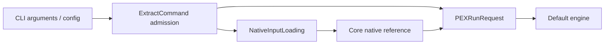

# PEXCLICore

## Purpose and Scope
Owns developer-facing command admission, typed requests, and structured result presentation. Parent: [PEXEngine](../../DESIGN.md). No children. Existing commands remain module entry points.

## Responsibilities and Boundaries
CLI resolves project-relative paths and validates explicitly supplied input types. Core owns native reference schema; Persistence owns bounded local reads and later immutable capture; Runtime and adapters own execution and numerical interpretation.

## Related Designs
| Design | Relationship | Contract Used | Summary | Cautions |
|---|---|---|---|---|
| [PEXEngine](../../DESIGN.md) | parent | Default engine composition | Command execution | Admission alone does not prove extraction |
| [NativeInputLoading](../PEXRuntime/NativeInputLoading/DESIGN.md) | depends on | Shared typed reference/backend admission | Native request admission | Four MiB reference ceiling |
| [Core NativeInput](../PEXCore/NativeInput/DESIGN.md) | depends on | PEXNativeInputReference | Schema and budgets | Preserve decoded availability URLs |
| [Persistence](../PEXPersistence/DESIGN.md) | depends on | Bounded local read | Read and capture failure | No success fallback on failed reads |
| [PEXParsers](../PEXParsers/DESIGN.md) | depends on | Portable electrical export and standard parsing | SPEF emission and round-trip | Pinless coordinates may be omitted; full comparison must reject loss |

## Architecture

## Contracts and Invariants

The routed-native additive kind uses the existing `--native-input` /
`inputs.nativeInput` path and
[NativeInputLoading](../PEXRuntime/NativeInputLoading/DESIGN.md) admission. Its
[source-law contract](../PEXCore/NativeInput/DESIGN.md) requires an explicit kind,
DEF format and total RC-corner/source bindings; CLI spelling or corner names never
select a numerical law implicitly. Routed execution requires explicit structural
Verilog format and the owned source semantic join. `--source-netlist-format` accepts
`spice`, `cdl`, or `verilog` and overrides `inputs.sourceNetlistFormat` in config
mode. Both absent retain the historical SPICE default; filename extensions never
select a source language. Typed `PEXProjectConfig.InputPaths.sourceNetlistFormat`
uses the same default and is forwarded by PEXConfigMapper. Unknown format spellings
fail before execution. Real CLI routed tests must execute the actual decoder,
Native calculation, source and standard export gates.
Native requests require explicit nonempty unique corner IDs and a native input reference. `--native-input` overrides `inputs.nativeInput`; the config value resolves against the config directory, while the CLI value resolves against the process working directory. Shared Runtime loading rejects native selection without a reference and non-native backends with a supplied native reference. Explicit wrong types, empty corners, duplicate corners, invalid finite numbers and overflowing integers fail with typed PEXError. Omitted external corners retain their existing default. Numeric JSON values never coerce to booleans.

## Runtime Flows
Configured executable file paths resolve against the configuration document
directory. Absolute paths and direct-CLI caller-selected paths are preserved.

Extract arguments/config -> resolve reference file -> bounded read -> Core JSONDecoder admission -> typed request -> engine capture/execution -> persisted results -> CLI output. Direct request construction throws when admission fails.

`write-spef` emits the portable electrical profile defined by [PEXParsers](../PEXParsers/DESIGN.md). The profile retains scoped electrical identity and operators; pinless-net coordinates have no admitted standard connection record and are omitted. `--round-trip` requires full semantic equivalence, including coordinate presence and values, so such loss is rejected with typed `PEXError.invalidInput` rather than reported as a successful round-trip. Without `--round-trip`, report status `passed` certifies successful file output and IR validation; it does not certify preservation of all metadata. The command retains the existing strict comparator and does not reconstruct coordinates from shadow annotations.

## Verification and Change Impact
PEXNativeExtractCommandTests owns direct/config admission and failure behavior. Existing PEXCLITests owns external defaults and option interpretation. Adapter integration tests and the parent task own actual native extraction through the default engine. Changes to reference schema or bounded reads require checking the linked lower contracts.

WriteSPEFCommandTests owns the CLI export boundary: a net with a real pin exercises actual `*P` and `*N` coordinate round-trip records, while the original pinless coordinate fixture must fail full semantic comparison with two coordinate violations. The same pinless fixture may emit a file without a round-trip claim.

## Developer Instructions
Run `pexengine extract --backend native` with the usual direct layout/netlist/top-cell/technology flags, explicit repeated `--corner`, and `--native-input <path>`. In config mode set `backendID` to native, supply `corners`, and put the reference JSON path in `inputs.nativeInput`. Serialize the actual Core `PEXNativeInputReference`; every budget field and local file URL is required. Referenced configuration/calibration URLs are used exactly as decoded; the CLI does not rewrite them relative to the reference file. Numerical configuration and calibration physics are validated by native execution.

For `write-spef`, use `--round-trip` when full metadata equivalence is required. The portable electrical profile cannot retain coordinates of a net without pins; the strict round-trip check reports that loss as typed failure. Successful output without that flag is an electrical export result, not a full metadata equivalence proof.

Failure exits flush any already-emitted structured result before process termination. Actual failed-extract JSON remains readable through pipes and supports artifact-only retry from the same executable image.
