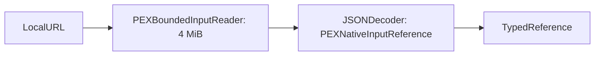

# NativeInputLoading

## Purpose and Scope
Owns bounded loading of a CLI-selected native reference document. Parent: [PEXCLICore](../DESIGN.md). No children.

## Responsibilities and Boundaries
Read and decode one local reference document. Native configuration interpretation, calibration verification, artifact capture, and extraction remain with their owners.

## Related Designs
| Design | Relationship | Contract Used | Summary | Cautions |
|---|---|---|---|---|
| [PEXCLICore](../DESIGN.md) | parent | Extract request admission | File path selection | Config and CLI bases differ |
| [Core NativeInput](../../PEXCore/NativeInput/DESIGN.md) | depends on | Codable reference initializer | Required fields and validation | No alternate schema or URL rewriting |
| [NativeInputCapture](../../PEXPersistence/NativeInputCapture/DESIGN.md) | depends on | PEXBoundedInputReader | Regular local file bounded read | Read/close errors remain failures |

## Architecture

## Contracts and Invariants
Reference document size is at most four MiB; document and decoded input locations are local files. Core decode enforces all budgets and calibration identities. Decode failures become invalidInput PEXError; reader errors preserve their typed failure. No alternate schema, implicit budgets, success fallback, or availability mutation is introduced.

## Failure, Concurrency, and Constraints
Loading is synchronous, stateless, and owns the reader scope. The reader closes its handle on success and failure. Only the reference document is read here; later capture validates referenced content against its declared budgets.

## Verification and Change Impact
PEXNativeExtractCommandTests exercises real local document reads, preservation of URLs, malformed/missing/nonlocal/budget failures and the document ceiling. Changes to Core decoding or the Persistence reader affect this contract.
