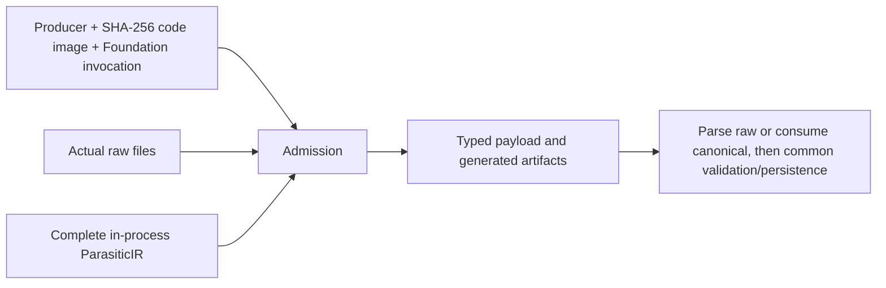

# BackendExecution

## Purpose and Scope
Owns public backend execution/result/failure values. Parent: [PEXCore](../DESIGN.md). No children. It does not measure code images, perform extraction, parse files, access storage or qualify tools.

## Responsibilities and Boundaries
PEXExtracting executes through one protocol. An adapter returns either actual raw file output requiring parsing or a complete in-process canonical ParasiticIR. Foundation ExecutionInvocation distinguishes in-process calls from external processes; raw output itself does not imply an external process (test or other in-process generators can produce genuine files). Native canonical output does not require or fabricate a raw file.

## Related Designs
| Design | Relationship | Contract Used | Summary | Cautions |
|---|---|---|---|---|
| [PEXCore](../DESIGN.md) | parent | Canonical IR and request values | Public domain boundary | Values do not establish measured execution or process trust |
| [PEXRuntime](../../PEXRuntime/DESIGN.md) | used by | Admitted output and execution identity | Common corner dispatch and persistence | Runtime must bind producer and exact corner to context |
| [PEXNative](../../PEXNative/DESIGN.md) | used by | In-process canonical output | Native composition boundary | Registration and measured image provider remain separately owned |
| [CircuiteFoundation](../../../../CircuiteFoundation/DESIGN.md) | depends on | Producer, digest, invocation, environment | Shared provenance vocabulary | In-process invocation has no executable/arguments/working directory |

## Architecture

## Contracts and Invariants
The code-image digest uses SHA-256 and equals the producer build identity; decoding repeats constructor validation. The adapter owns actual image/version/environment measurement and checks stable image identity over execution. No fabricated external executable identifies an in-process call.
Raw payloads require a nonempty list of local file URLs; actual availability/content is checked by runtime/persistence. Canonical payloads require an in-process invocation, canonical SI units, a finite/nonnegative structurally valid graph and no validation errors. Empty physical designs may have an empty graph; missing source design data is separately rejected by input owners. Constructor and decoding enforce the same rules. Generated artifacts belong to the producing adapter and are retained on later failure.
Runtime checks exact returned corner and actual producer identifier/kind against the executing backend. An expected producer must match the returned identity for every backend. Multi-corner execution cannot mix invocation modes or in-process entry points even when producer/image digests match.
Canonical validation warnings are derived at construction and recomputed on decode. Runtime reuses this admission evidence over the immutable graph instead of repeating the same full validation. The derived cache is omitted from encoding, equality and hashing.

## Runtime Flows
Adapter measures identity, performs its work, constructs an admitted payload, and publishes result. Runtime captures generated evidence, parses only raw output, consumes canonical output directly, verifies exact corner and graph, then persists through the same run lifecycle. Failure carries available artifacts and observed identity independently of success payload.

## State, Ownership, and Lifecycle
Immutable Sendable values retain their own graph/artifact identities. This component owns no shared state or async resources. Adapter prepare/execute/cleanup lifetime remains owned by runtime.

## Failure, Concurrency, and Constraints
Typed result admission errors reject missing/nonlocal raw files, canonical/external identity mismatch, noncanonical units and invalid graph values/references. Domain resource admission belongs to extraction; file/JSON limits belong to capture and storage. No fallback between canonical and raw branches is permitted.

## Verification and Change Impact
PEXCoreTests/PEXBackendOutputTests covers construction/decoding parity and malformed identities/payloads. PEXRuntimeTests/PEXCanonicalExecutionTests exercises public run/persistence/reload with a fileless in-process adapter, parser absence, exact-corner/producer failures and mixed invocation rejection. These contract tests do not qualify the actual native calculator/backend or loaded-image measurement, which require their own runtime evidence.
