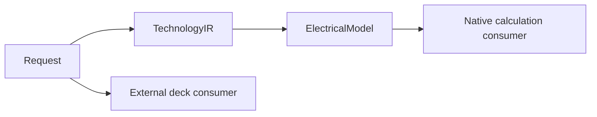

# PEXCore

## Purpose and Scope

Public extraction values and protocol contracts. Parent: [PEXEngine](../../DESIGN.md).
Children: [ElectricalModel](ElectricalModel/DESIGN.md) [BackendExecution](BackendExecution/DESIGN.md) and [NativeInput](NativeInput/DESIGN.md).

## Responsibilities and Boundaries

Owns technology, corner, request and canonical parasitic values. Backend execution,
file availability, trust decisions and release authorization are outside this module.

## Related Designs

| Design | Relationship | Contract Used | Summary | Cautions |
|---|---|---|---|---|
| [PEXEngine](../../DESIGN.md) | parent | Captured execution inputs | Runtime composition | Preserve content-based request identity |
| [ElectricalModel](ElectricalModel/DESIGN.md) | child | Exact-corner electrical admission | Native calculation inputs | No inference from external metadata |
| [BackendExecution](BackendExecution/DESIGN.md) | child | Admitted raw/canonical results and execution provenance | Backend boundary | Identity values do not measure code images or qualify tools |

| [NativeInput](NativeInput/DESIGN.md) | child | Native configuration/calibration references and budgets | Captured native inputs | Schema and file I/O remain outside Core |

## Architecture

## Contracts and Invariants

`PEXProjectConfig` owns the version-1 persisted project input paths shared by
Studio and the CLI. `InputPaths.nativeInput` is an optional native reference
document path. Codable preserves the supplied path; Runtime resolves it against
the actual configuration document directory. It does not encode or rewrite the
configuration and calibration URLs inside `PEXNativeInputReference`. A missing
path is meaningful only for a non-native backend; backend admission is Runtime's
responsibility. No legacy schema or implicit native reference is supplied.

The native consumer selects an admitted electrical model by exact process and corner.
External deck metadata does not establish a native electrical model. Immutable values
retain calibration content identity independently of file availability or trust.

`PEXRequestHash` owns the canonical request projection. Retry comparison projects
only the requested corner selection; it retains each selected corner's PVT and
parameters, all base/per-corner technology, native configuration and calibration
content references and budgets, options, backend configuration, process/deck
content, and declared execution input references. Input roles/descriptors remain
part of identity. Capture locations and run IDs are availability, not meaning.
Historical records without new role associations keep their request hash encoding. Measured backend
implementation identity is checked separately through BackendExecution, because
it is an observation rather than an input-content identity.

Process-profile input associations are semantic values, not source-path provenance.
`PEXProcessProfileInputRole` distinguishes the primary deck, an exact corner deck,
and an exact required-view key. Each logical role has one artifact record; a view
uses `processProfileViewInput` while a deck uses `processProfileDeckInput`.
`PEXArtifactRecord.processProfileInputRole` is optional for historical inspection,
but new role-based reconstruction requires it. Kind/role mismatches and invalid
role tokens are rejected at the record boundary, including decoding. Canonical
input identity includes the association; absence preserves the historical hash
encoding. The reserved `PEXProcessProfileReference.qualificationProfileViewRole`
is the required-view key used by the host qualification consumer; qualification
semantics remain with that consumer.

## Verification and Change Impact

PEXProjectConfigTests owns native path JSON round-trip and field-type refusal.
PEXRuntimeTests owns actual document-relative loading and backend admission;
PEXNativeExtractCommandTests owns the explicit CLI override. Studio persistence
must preserve this field through its project-view/document-view projection.

Electrical model behavior is owned by `PEXCoreTests/PEXElectricalModelTests`;
captured decoding is owned by `PEXRuntimeTests/PEXElectricalModelResolutionTests`.
Changes affect request hashing, runtime resolution and future native calculation.

### Explicit source language

`PEXProjectConfig.InputPaths.sourceNetlistFormat` is an additive typed language
declaration, defaulting to SPICE for historical configuration documents. Unknown
encoded enum values fail decoding. Runtime forwards the declaration unchanged;
file extensions do not select the grammar or turn Verilog bytes into SPICE.
