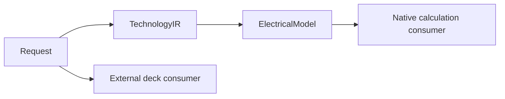

# PEXCore

## Purpose and Scope

Public extraction values and protocol contracts. Parent: [PEXEngine](../../DESIGN.md).
Child: [ElectricalModel](ElectricalModel/DESIGN.md).

## Responsibilities and Boundaries

Owns technology, corner, request and canonical parasitic values. Backend execution,
file availability, trust decisions and release authorization are outside this module.

## Related Designs

| Design | Relationship | Contract Used | Summary | Cautions |
|---|---|---|---|---|
| [PEXEngine](../../DESIGN.md) | parent | Captured execution inputs | Runtime composition | Preserve content-based request identity |
| [ElectricalModel](ElectricalModel/DESIGN.md) | child | Exact-corner electrical admission | Native calculation inputs | No inference from external metadata |

## Architecture

## Contracts and Invariants

The native consumer selects an admitted electrical model by exact process and corner.
External deck metadata does not establish a native electrical model. Immutable values
retain calibration content identity independently of file availability or trust.

## Verification and Change Impact

Electrical model behavior is owned by `PEXCoreTests/PEXElectricalModelTests`;
captured decoding is owned by `PEXRuntimeTests/PEXElectricalModelResolutionTests`.
Changes affect request hashing, runtime resolution and future native calculation.
