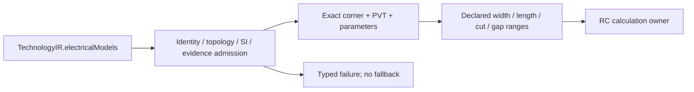

# ElectricalModel

## Purpose and Scope

Explicit SI electrical inputs for calibrated rectilinear-sheet extraction.
Parent: [PEXCore](../DESIGN.md). No children.

## Responsibilities and Boundaries

Owns model law, exact process/corner/PVT identity, declared dimensional applicability,
coefficient admission and calibration artifact identity. Does not load calibration
files, invent coefficients, qualify a process, solve a field, or select a fallback.
Calibration identity alone is not evidence of calibration correctness: retained bytes,
independent correlation and trust admission remain runtime/ToolQualification concerns.

## Related Designs

| Design | Relationship | Contract Used | Summary | Cautions |
|---|---|---|---|---|
| [PEXCore](../DESIGN.md) | parent | TechnologyIR, PEXCorner | Exact model selection | Legacy temperature is Celsius; convert explicitly to kelvin |
| [PEXEngine](../../../DESIGN.md) | used by | Captured inputs and request hash | Decode and retain model inputs | A model is not a successful extraction |

## Architecture

## Contracts and Invariants

The only law is `rectilinearSheetV1`: isotropic sheet resistance `rho / thickness`
in ohms per square; ground capacitance `areaCoefficient * unionArea +
perimeterCoefficient * exposedPerimeter`; per-cut via resistance; pair capacitance
`areaCoefficient * facingOverlapArea + sidewallCoefficient * parallelLength / gap`.
The model is an explicitly calibrated approximation, not an electromagnetic solver.
Calculation must use exact union coverage, distinguish exposed from internal edges,
respect the calibrated dimensional ranges and reject unsupported geometries. These
calculation obligations are B3.2.3-owned and not established by this input component.

| Input | Unit / admission |
|---|---|
| Temperature / supply | kelvin > 0 / volts >= 0, finite; exact requested PVT when supplied |
| Metal thickness / resistivity | meters / ohm meters > 0, finite, finite positive quotient |
| Metal bottom height | meters >= 0, finite; nonoverlapping height intervals in stack order |
| Ground area / perimeter coefficients | farads per square meter / farads per meter >= 0, finite |
| Via coefficient | ohms per individual cut > 0, finite; no aggregate-via shortcut |
| Pair area / sidewall coefficients | farads per square meter / farads >= 0, finite |
| Dimensional interval | closed meter interval, finite positive ordered endpoints |
| Calibration artifacts | distinct nonempty SHA-256 ArtifactID content identities with nonzero byte counts |

Models must name exactly the technology process and a unique nonempty corner.
Every stack layer is either a modeled conductor or a declared cut layer; each via
names an existing cut strictly between its bottom and top conductors in stack order.
Every declared technology via has exactly one electrical model. Every unordered
conductor pair, including self pairs, declares coefficients explicitly; zero is a
declared coefficient, never a missing-value substitute. Parameter dictionaries match
the requested corner exactly. Unknown pairs, layers, vias, corners or ranges fail.

`TechnologyIRValidator` exposes semantic issues to the CLI; `TechnologyResolver`
admits supplied electrical models on both inline and captured JSON paths; native
selection repeats admission for direct library callers. Missing models remain valid
external-deck metadata but cannot satisfy native selection. Unused ambiguous thickness,
resistivity and aggregate via-resistance APIs are removed; JSON containing those keys
fails decoding. There is no automatic unit conversion or compatibility fallback.
The Xcircuite/studio callers still pinned to the previous PEX revision migrate with
the exact dependency update during B3.3 composition, before cumulative integration.

## State, Ownership, and Lifecycle

All public model values are immutable and Sendable. Validation sets and dictionaries
are call-local. No shared mutable state, target-conditioned isolation or lifecycle
resource is introduced. Calibration artifact identities are content values, not paths.

## Failure, Concurrency, and Constraints

Admission returns typed errors with model/field identity. No partially admitted model
or default corner escapes. Pair completeness is checked by counting unique known
unordered pairs, avoiding an additional quadratic enumeration. Input collection and
calculation work limits are enforced by their execution owners, not inferred here.

## Verification and Change Impact

`PEXCoreTests/PEXElectricalModelTests` covers SI arithmetic, PVT/parameter selection,
missing models, duplicate/unknown topology, invalid coefficients/ranges, explicit
pair coverage, JSON round-trip and coefficient/calibration request-hash invalidation.
`PEXRuntimeTests/PEXElectricalModelResolutionTests` rejects invalid inline and JSON
models before backend execution. Verification is native CPU only. This evidence does
not qualify a foundry process, WASM/Embedded target or native extraction backend.
