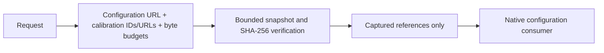

# NativeInput

## Purpose and Scope
Owns explicit native configuration and calibration file references with caller-selected finite capture budgets. Parent: [PEXCore](../DESIGN.md). No children. Standard layout geometry and native configuration schema remain with their domain owners.

## Responsibilities and Boundaries
A PEXNativeInputReference identifies one native configuration file and an injective set of calibration content identities with local availability. Identity excludes location. PEXPersistence captures and verifies bytes; the mask native owner interprets its existing configuration, while the routed host owner binds the additive routed schema to Native numerical extraction. Identity capture does not qualify calibration physics.

## Related Designs
| Design | Relationship | Contract Used | Summary | Cautions |
|---|---|---|---|---|
| [PEXCore](../DESIGN.md) | parent | Request and artifact identity | Public input boundary | Layout dependencies remain outside Core |
| [PEXRuntime](../../PEXRuntime/DESIGN.md) | used by | Native file references and calibration IDs | Captured execution | Selected model IDs must be present before callbacks |
| [NativeInputCapture](../../PEXPersistence/NativeInputCapture/DESIGN.md) | used by | Bounded local files and exact identities | Capture and reload | Availability paths never contribute to request identity |
| [PEXNative](../../PEXNative/DESIGN.md) | used by | Configuration availability | Domain schema consumer | This reference is not native backend implementation proof |

## Architecture

## Contracts and Invariants
Configuration and calibration URLs are local. Calibration identities use SHA-256, have positive byte count, are unique and fit per-artifact and aggregate ceilings. Budgets are positive and finite; defaults are admission policy only. Constructor and decode repeat validation. Request hashing includes budgets and content IDs but excludes locations. Captured requests, retry and execution preserve references. Runtime selects the exact corner model and requires every selected calibration ID in captured input artifacts. Additional declared calibration artifacts are retained and hashed, allowing selective-corner retry without losing prior capture context.

### Routed source-law branch contract

The additive configuration kind distinguishes `maskGeometry` from
`routedOpenRCXV1`. Existing references without a kind decode as `maskGeometry`;
that case does not add a field to the historical canonical request-hash projection.
The routed case is explicit, hashed, and preserved by `replacingLocations`, capture
and reload. A configuration's declared law/schema must agree with its reference
kind. No malformed routed document is retried as mask configuration.

The routed configuration binds the exact DEF and source-netlist identities,
the mandatory routedTechnologyLEF reference defining the saved DEF geometry,
ordered standard-cell LEF references, per-corner full technology LEF references and a total explicit
requested-corner-to-OpenRCX-source selection. Execution context forwards the exact
requested corner ID list to preparation; a directly constructed single-corner
context declares its selected corner when no wider matrix is supplied. It retains full ArtifactReference
values wherever the caller supplies authority-bearing references; byte capture
matches their ArtifactID digest/count through existing calibration associations.
All auxiliary files use the existing bounded calibration capture path. Availability
URLs never substitute for identity. Valid extra captured sources remain retained
for selective retry; selected sources may not be absent or silently substituted.

Each RC selection binds the pinned v1 profile and original rules/technology source.
RC nominal/minimum/maximum are independent of MOS PVT. Callers explicitly bind the
requested matrix; no corner-name matching, source interpolation or temperature
scaling is inferred. Routed selection never manufactures an analytical electrical
model. Host configuration/codec binding is owned by
[RoutedInputPreparation](../../PEXAdapters/NativeBackend/RoutedInputPreparation/DESIGN.md).
The numerical geometry interface and its explicit limits are owned by
[RoutedRuleExtraction](../../PEXNative/RoutedRuleExtraction/DESIGN.md); reference construction alone
does not assert successful routed extraction or qualification.

## Verification and Change Impact
PEXNativeInputCaptureTests executes public run, actual bounded capture and reload; source deletion/mutation cannot alter captured configuration/calibration, missing/tampered data and budget violations fail. Lower configuration interpretation and actual native extraction are separately verified.
