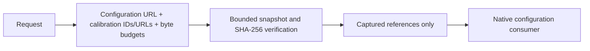

# NativeInput

## Purpose and Scope
Owns explicit native configuration and calibration file references with caller-selected finite capture budgets. Parent: [PEXCore](../DESIGN.md). No children. Standard layout geometry and native configuration schema remain with their domain owners.

## Responsibilities and Boundaries
A PEXNativeInputReference identifies one native configuration file and an injective set of calibration content identities with local availability. Identity excludes location. PEXPersistence captures and verifies bytes; PEXNative owns configuration interpretation and numerical extraction. Identity capture does not qualify calibration physics.

## Related Designs
| Design | Relationship | Contract Used | Summary | Cautions |
|---|---|---|---|---|
| [PEXCore](../DESIGN.md) | parent | Request and artifact identity | Public input boundary | Layout dependencies remain outside Core |
| [PEXRuntime](../../PEXRuntime/DESIGN.md) | used by | Native file references and calibration IDs | Captured execution | Selected model IDs must be present before callbacks |
| [NativeInputCapture](../../PEXPersistence/NativeInputCapture/DESIGN.md) | used by | Bounded local files and exact identities | Capture and reload | Availability paths never contribute to request identity |
| [PEXNative](../../PEXNative/DESIGN.md) | used by | Configuration availability | Domain schema consumer | This reference is not native backend implementation proof |

## Architecture

## Contracts and Invariants
Configuration and calibration URLs are local. Calibration identities use SHA-256, have positive byte count, are unique and fit per-artifact and aggregate ceilings. Budgets are positive and finite; defaults are admission policy only. Constructor and decode repeat validation. Request hashing includes budgets and content IDs but excludes locations. Captured requests, retry and execution preserve references. Runtime selects the exact corner model and requires every selected calibration ID in captured input artifacts. Additional declared calibration artifacts are retained and hashed, allowing selective-corner retry without losing prior capture context.

## Verification and Change Impact
PEXNativeInputCaptureTests executes public run, actual bounded capture and reload; source deletion/mutation cannot alter captured configuration/calibration, missing/tampered data and budget violations fail. Lower configuration interpretation and actual native extraction are separately verified.
