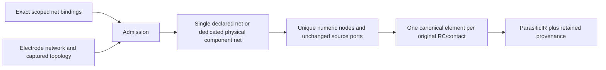

# CanonicalProjection

## Purpose and Scope
Owns bounded projection of an immutable electrode network to ParasiticIR. Parent: [PEXNative](../DESIGN.md). No children. It does not execute a backend, grant qualification, persist artifacts or qualify standard exporters.

## Responsibilities and Boundaries
The caller explicitly binds every captured occurrence-scoped net UUID to an injective canonical NetName. Declared pin nets must match their source terminal's NetName. No leaf-name inference or label-induced wire is added. The component maps every original numeric node, resistor, capacitor, port and contact exactly once, retaining the original electrode network and normalized bindings as provenance.

## Related Designs
| Design | Relationship | Contract Used | Summary | Cautions |
|---|---|---|---|---|
| [PEXNative](../DESIGN.md) | parent | Native geometry/terminal composition | Canonical native result construction | Projection alone is not a completed extraction run |
| [ElectrodeConstruction](../ElectrodeConstruction/DESIGN.md) | depends on | Explicit finite contacts and isolated ports | Terminal boundary truth | Ports must never be tied merely by NetName |
| [SheetExtraction](../SheetExtraction/DESIGN.md) | depends on | Numeric RC operators and physical components | SI values and original topology | Capacitance does not establish DC continuity |
| [PEXCore](../../PEXCore/DESIGN.md) | depends on | ParasiticIR, NodeRef and canonical units | Domain value schema | Net totals are operator inventory, not effective resistance |

## Architecture

## Contracts and Invariants
Bindings cover exactly the captured references; missing, extra, duplicate references and noninjective NetNames fail. Each reference is the pair of occurrence index and UUID. A component with exactly one declared reference owns its internal nodes in that bound net. Unlabelled components and components claimed by multiple references receive dedicated generated physical-component nets; the latter retain the captured short facts rather than selecting one logical claimant. Disconnected components sharing a reference retain different numeric nodes in one net. Source ports retain their exact NodeRefs, including repeated leaf names scoped to different nets.
Generated names avoid all explicit net names and all source node names. They are deterministic for the retained snapshot and independent of input binding order. Pin and internal-node namespaces cannot collide. Coordinates of numeric nodes are cell centers in canonical micrometers; source port coordinates and instance paths remain absent rather than inventing annotation-derived identity. Exact pin occurrence/source identity remains in the retained network.
Original resistor and contact values are unchanged positive ohms. Ground capacitors retain a nil endpoint meaning the model reference, whose configured name is recorded in metadata. Every non-ground capacitor retains both physical endpoints as coupling, including cross-net and floating endpoints. Each element is emitted once. Per-net inventory totals are charged to nodeA's net once, including cross-net elements; per-net and whole-graph sums must remain finite and match original operator inventories within floating-point summation rounding. Individual operator values remain unchanged. These totals do not represent terminal effective resistance.

## Runtime Flows
Admit input records and identifier bytes, enumerate exact captured references, validate injective bindings and pin agreement, assign component ownership, reserve collision-free node identities, emit all numeric nodes and source ports, emit original/contact RC operators and checked inventory totals, then publish atomically. JSON preserves the exact canonical graph; standard exporter topology and independent process qualification are separate verification owners.

## State, Ownership, and Lifecycle
All mutable maps, arrays and counters are local to projection. Original network arrays remain retained by value without rematerialization. The result retains the exact input network, normalized bindings and one canonical NodeRef per original numeric node. No pointers, shared state or asynchronous resources are introduced.

## Failure, Concurrency, and Constraints
Caller limits bound input records including inspected identifier UTF-8 bytes, output nodes, output elements and work visits. Collection admission precedes allocation, and identifier admission precedes validation/hash operations. Generated collision probes and output emission have cancellation/work checks. Defaults are admission policy, not scale qualification. Missing or contradictory identity, invalid graph endpoints, unrepresentable positive values/totals, limits and cancellation fail with typed errors and no partial result.

## Verification and Change Impact
[NativePEXProjectionTests](../../../Tests/PEXNativeTests/NativePEXProjectionTests.swift) must compare every emitted endpoint/value against the retained operators, prove that repeated scoped leaf names and separate islands do not acquire a resistive path, preserve actual shorts/floating coupling and isolated ports, verify canonical JSON round-trip and validator admission, deterministic collision handling and bounded atomic failure/cancellation. Backend composition, captured calibration/resume and standard exporters must verify their own assumptions before accepting a complete native run.
