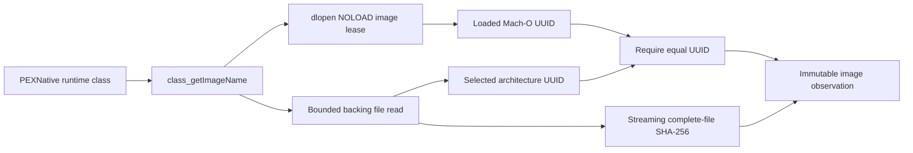

# CodeImage

## Purpose and Scope
Measures the backing Mach-O file selected by the Objective-C runtime for an anchor compiled into PEXNative. Parent: [PEXNative](../DESIGN.md). No children. This is a macOS host adapter; it does not claim portable runtime capability.

## Responsibilities and Boundaries
Owns loaded-image discovery, loaded/file UUID agreement and bounded streaming SHA-256. The digest identifies the complete backing binary, including a host executable when statically linked. It is not a digest of relocated memory, a signature/trust verdict, or identity of every operating-system dependency. NativeBackend owns invocation and before/after stability.

## Related Designs
| Design | Relationship | Contract Used | Summary | Cautions |
|---|---|---|---|---|
| [PEXNative](../DESIGN.md) | parent | Actual native implementation | Anchor resides with numerical code | Rebuild changes backing digest |
| [BackendExecution](../../PEXCore/BackendExecution/DESIGN.md) | used by | SHA-256 code identity | Actual loaded-image backing observation | Not process qualification |
| [NativeBackend](../../PEXAdapters/NativeBackend/DESIGN.md) | used by | Before/after image measurement | Run identity owner | Replaced or missing backing file fails |

## Architecture

## Contracts and Invariants
Only a currently loaded image is eligible. The native 64-bit Mach-O architecture and UUID must match its backing file, including selection from universal files. Reads and load-command traversal have explicit byte bounds and reject malformed/truncated records. File UUID agreement detects ordinary replacement/rebuild; it does not authenticate an adversarial same-UUID replacement. Native extraction records this observation rather than claiming memory attestation.

## State, Ownership, and Lifecycle
The Objective-C class is immutable runtime metadata. A dlopen NOLOAD reference pins the image through scoped header/command inspection and is released exactly once. The loader owns initialized, read-only header bytes; validated command lengths bound the copied view; pointers never escape the inspection function. FileHandle is closed on success and failure; hash state and buffers are call-local. No shared mutable state or target-specific synchronization branch exists.

## Failure, Concurrency, and Constraints
Missing image/file, UUID/architecture disagreement, unsupported Mach-O, malformed commands and byte-limit exhaustion throw typed errors. The caller selects a positive image byte ceiling; a 512 MiB default is admission policy and can be raised with corresponding runtime proof. Streaming chunks cap temporary file-read buffers at 256 KiB, excluding a bounded command-table copy.

## Verification and Change Impact
NativePEXCodeImageTests compares actual measured loaded-file SHA-256 independently and checks byte exhaustion and malformed/architecture/UUID admission. Backend tests prove the observed identity is retained in public successful and failed runs. Changed image discovery affects NativeBackend and its provenance. No WASM/Embedded, signature, memory-attestation or physics qualification is inferred.
