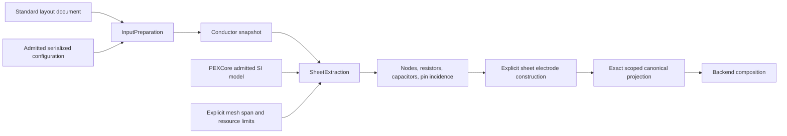

# PEXNative

## Purpose and Scope

Native CPU sheet/cut electrical calculation over owned, occurrence-exact layout facts.
Parent: [PEXEngine](../../DESIGN.md). Children: [SheetExtraction](SheetExtraction/DESIGN.md), [ElectrodeConstruction](ElectrodeConstruction/DESIGN.md), [CanonicalProjection](CanonicalProjection/DESIGN.md), [InputPreparation](InputPreparation/DESIGN.md), [CodeImage](CodeImage/DESIGN.md), [RoutedRuleExtraction](RoutedRuleExtraction/DESIGN.md), [ConductorUnion](ConductorUnion/DESIGN.md), [RectilinearSheetNetwork](RectilinearSheetNetwork/DESIGN.md), and [GroundCapacitance](GroundCapacitance/DESIGN.md).
The module boundary keeps layout dependencies out of PEXCore.

## Responsibilities and Boundaries

Owns conforming discretization, numeric graph construction and explicit electrode contact construction. Canonical net assignment and ParasiticIR projection compose these lower contracts; standard file loading, adapter execution, artifact persistence, process qualification and release gates remain separately owned.

## Related Designs

| Design | Relationship | Contract Used | Summary | Cautions |
|---|---|---|---|---|
| [PEXEngine](../../DESIGN.md) | parent | Domain extraction ownership | Native calculation product | Calculation alone is not a successful backend run |
| [PEXCore](../PEXCore/DESIGN.md) | depends on | Exact-corner electrical inputs | Admitted SI law | Calibration identity does not establish trust |
| [ConductorCapture](../../../semiconductor-layout/Sources/LayoutVerify/ConductorCapture/DESIGN.md) | depends on | Owned integer coverage, units and contacts | Actual geometry input | No aggregate-via or net-label shortcut |
| [ElectrodeConstruction](ElectrodeConstruction/DESIGN.md) | child | Explicit exposed electrode faces and contact operators | Terminal boundary construction | Pin annotation alone cannot impose a potential |
| [CanonicalProjection](CanonicalProjection/DESIGN.md) | child | Exact net binding and complete canonical operators | ParasiticIR composition | Canonical graph admission is not standard exporter qualification |
| [SheetExtraction](SheetExtraction/DESIGN.md) | child | Bounded graph calculation | Numeric implementation | Resolution is an explicit input |
| [InputPreparation](InputPreparation/DESIGN.md) | child | Admitted durable selectors, standard-document preparation and actual resolved UUID bindings | Native run inputs | Projection consumes bindings resolved after capture; stored schema is not backend/image/process qualification |
| [RoutedRuleExtraction](RoutedRuleExtraction/DESIGN.md) | child | Pinned exact-source numerical queries | Routed rule-law evaluation | Query evaluation alone does not establish complete routed extraction |
| [RectilinearSheetNetwork](RectilinearSheetNetwork/DESIGN.md) | child | Material-independent union sheet/cut resistance | R-only shared conductor geometry | C and qualification are separate unresolved composition gates |
| [ConductorUnion](ConductorUnion/DESIGN.md) | child | Exact physical coverage and exposed boundary | Geometry shared by routed R and C | Contributor identity does not split physical geometry |
| [GroundCapacitance](GroundCapacitance/DESIGN.md) | child | Exact-corner LEF area/boundary model | Ground C over checked union | Source coupling remains a separate law |
| [CodeImage](CodeImage/DESIGN.md) | child | Loaded native backing-image observation | Actual implementation identity | Not relocated-memory attestation |

## Architecture

## Contracts and Invariants

The graph contains the actual union of captured metal and individual cut regions.
Coordinate scale comes from `snapshot.coordinateUnits`, not caller-supplied units
or the raw hierarchy grid. The capture owner may refine the band grid for stroke
half-width boundaries while retaining the original hierarchy units.
Every floating region and disconnected labeled component remains distinct. A graph
does not invent physical connections to satisfy a net label or pin name.

## Verification and Change Impact

[PEXNativeTests](../../Tests/PEXNativeTests) owns numerical operators, explicit electrode resistance, exact canonical projection and admission behavior. Actual backend composition and persisted terminal/topology evidence are owned by [NativeBackend](../PEXAdapters/NativeBackend/DESIGN.md); default registration/export/resume remains separately verified; independent correlation is B3.4/B8-owned.
All verification is native CPU. No Metal/WASM/Embedded or production trust is inferred.
