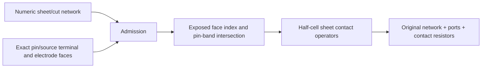

# ElectrodeConstruction

## Purpose and Scope
Owns explicit rectilinear sheet terminal boundary conditions over an immutable numeric network. Parent: [PEXNative](../DESIGN.md). No children. Canonical net assignment and ParasiticIR projection are a separate composition responsibility.

## Responsibilities and Boundaries
A pin annotation establishes positive-area physical incidence; it does not itself define an ideal conductor. The caller binds each captured pin to an exact source NodeRef and explicitly supplies the exposed metal faces forming its electrode. This component adds cell-center-to-boundary contact operators while retaining the original network and topology facts. It never merges metal cells or disconnected physical components.

## Related Designs
| Design | Relationship | Contract Used | Summary | Cautions |
|---|---|---|---|---|
| [PEXNative](../DESIGN.md) | parent | Numeric geometry and terminal composition | Direct native API | A boundary graph is not a successful backend run |
| [SheetExtraction](../SheetExtraction/DESIGN.md) | depends on | Owned conforming nodes, SI model, pin incidence | Original network is immutable | Interior centers are not electrode potentials |
| [ConductorCapture](../../../../semiconductor-layout/Sources/LayoutVerify/ConductorCapture/DESIGN.md) | depends on | Exact bands, units, occurrence and pin identity | Physical annotation truth | A pin crossing islands cannot impose one common potential |

## Architecture

## Contracts and Invariants
Each captured pin has exactly one binding. Source NodeRefs are explicit and unique; empty identifiers and missing/duplicate bindings fail. Faces use the network snapshot's integer coordinate units, an oriented sheet boundary, and a positive-length tangential interval. Requested coverage must be entirely exposed metal in the pin's band closure and its actual positive-area node incidence. Internal faces, wrong sides, missing coverage, duplicate/overlapping electrodes and nonfinite or unrepresentable resistance fail.
For each admitted face fragment, `Rcontact = Rsheet * halfNormalCellSpan / contactedFaceLength`. The dimensionless integer ratio is formed before SI arithmetic. No zero-ohm pin-to-center shortcut is introduced. Multiple disjoint fragments form explicit parallel contacts to the same port. The finite-volume approximation and resolution remain owned by SheetExtraction.
A pin contacting multiple components fails with an explicit ambiguous-contact error, even when the components share a net label. An uncontacted pin with no faces remains an isolated port; an uncontacted pin claiming faces fails. Open and short facts remain in the retained snapshot. Two distinct, disjoint electrodes on a physical short remain distinct ports connected through actual sheet/cut resistance.

## Runtime Flows
Admit limits and bindings, index the original metal faces, classify exposure, intersect selected faces with pin bands, verify complete requested coverage and single-component incidence, calculate positive finite contact resistors, then publish all ports and operators atomically. Cancellation is checked during indexing, probing and emission.

## State, Ownership, and Lifecycle
All mutable state is local to build. Original arrays are retained by their value owners without rematerializing sheet/cut or capacitance operators. The face index owns at most four entries per metal node, bounded before insertion. No pointers, async resources or shared mutable state are introduced.

## Failure, Concurrency, and Constraints
NativePEXElectrodeLimits bounds inspected input records (including identifier UTF-8 bytes), indexed/requested face records, output contacts and work visits. Identifier bytes are admitted with cancellation checks before Unicode validation or hashing. Invalid nonnegative bounds fail before work; defaults are caller admission policy, not qualified scale claims. Every probe and allocation boundary is charged. Typed errors identify pins, faces, conflicts and resource limits. Failed or cancelled construction publishes no partial result.

## Verification and Change Impact
[NativePEXElectrodeTests](../../../Tests/PEXNativeTests/NativePEXElectrodeTests.swift) solves the resulting resistor graph with a bounded independent dense Kirchhoff reference. Full opposite-face contacts recover `Rsheet * length / width` for a single cell, segmented/nonuniform and refined rectangles. Tests cover unconnected ports, disconnected-island rejection, real physical shorts, interior/uncovered/conflicting faces, determinism, limits and cancellation. Canonical projection must preserve these port/contact identities. Full native run, independent process correlation and other target qualification remain separate.
