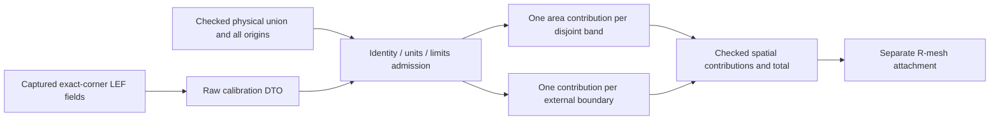

# Ground Capacitance

## Purpose and Scope

Own the explicit Native two-dimensional ground-capacitance law over a checked
physical conductor union. Parent: [PEXNative](../DESIGN.md). No children. This
component does not calculate coupling, qualify a process, or reproduce Calibre
or pinned OpenRCX per-record ground-capacitance totals.

## Responsibilities and Boundaries

The caller projects the existing LEF reader's independent `CAPACITANCE CPERSQDIST`
and `EDGECAPACITANCE` fields from its captured, exact corner technology artifact.
The raw Core calibration DTO is not source authority. Runtime source capture and
replay remain responsible for proving those values against original bytes. This
owner checks the exact selection/corner, units, six-layer inventory, source ranges,
finite arithmetic and aggregate resource limits before emitting a result.

## Related Designs

| Design | Relationship | Contract Used | Summary | Cautions |
|---|---|---|---|---|
| [PEXNative](../DESIGN.md) | parent | Native calculation composition | Ground-only numerical product | No complete extraction claim |
| [ElectricalModel](../../PEXCore/ElectricalModel/DESIGN.md) | depends on | Source selection and raw calibration values | Exact corner and original technology identity | Codable values do not establish source authenticity |
| [ConductorUnion](../ConductorUnion/DESIGN.md) | depends on | Checked disjoint bands, external boundaries and all contributors | Single physical-metal inventory | No re-union or R-mesh-derived C geometry |
| [RectilinearSheetNetwork](../RectilinearSheetNetwork/DESIGN.md) | used by | Spatial area/boundary contributions | Separate finite-volume attachment | Refinement cannot change total C |
| [RoutedRuleExtraction](../RoutedRuleExtraction/DESIGN.md) | coordinates with | Separate source-table coupling law | Complete routed composition | Neither table fringe nor legacy via base C is added again |

## Architecture

## Contracts and Invariants

The immutable `PEXRoutedGroundCapacitanceModel` belongs to Core. Its algorithm is
`native-lef-area-boundary-v1`, with exact `PEXOpenRCXSourceModel.Selection`, exact
requested `PEXCornerID`, explicit `CAPACITANCE PICOFARADS 1`, unit source ranges,
and all six ordered source layers. Each layer retains positive finite area and
edge coefficients, optional original thickness and original technology ranges.
Absent thickness is not zero. Original source bytes retain unprojected height and
other facts; no missing height is inferred or manufactured.

`NativeGroundCapacitanceCalculating.calculate` consumes the checked
`NativeConductorUnion`, raw model, independently expected selection/corner, explicit
limits and cancellation. `LEFAreaBoundaryGroundCapacitanceCalculator` implements
that protocol. The non-Codable result has an internal initializer and retains the
same immutable union and model. Contributions retain exact union band/boundary
indices and every contributor index. It returns no partial successful value.

For DEF scale `U` database units per micron, the law is:

`C_F = Ca_pF_per_um2 * (unionArea_DBU2 / U^2) * 1e-12`
`    + Ce_pF_per_um * (externalPerimeter_DBU / U) * 1e-12`.

Bands contribute area once. Only external oriented boundaries contribute edge C;
end faces and hole boundaries count, while shared internal faces do not. A boundary
coefficient multiplies the complete physical perimeter once, without another factor
of two. The checked union owns deterministic decomposition and contributor identity.
Artificial R mesh faces, record splitting, record insertion order and mesh span
cannot change these scalar totals. Via landing metal participates in the same union;
the old standalone highest-landing base C is not added on top of this law. Actual
cut resistance and coupling remain separate owners and are never replaced by ground C.

The LEF/DEF 5.8 language reference defines area C in pF/um2 and peripheral C in
pF/um, with rectangle formula `Ca*W*L + Ce*2*(W+L)`:
[Cadence language reference, LEF Syntax](https://coriolis.lip6.fr/doc/lefdef/lefdefref/LEFSyntax.html).
The reference's post-route tool branch additionally conditions peripheral use on
zero thickness or height. This explicit Native 2D model does not claim that branch
condition holds for the retained source; it preserves actual nonzero thickness
and does not interpret an absent height as zero.

Pinned OpenRCX rule `fringe` is combined pattern ground C per length, not an
independently identified pure perimeter coefficient. Its one-width source cannot
uniquely recover area/edge coefficients. This model uses the independent original
LEF values and never fits or subtracts a residual from table fringe. Algorithm
identity and result evidence distinguish it from legacy per-record OpenRCX C.

## State, Ownership, and Lifecycle

All ledgers and output buffers are call-local. The result shares immutable/COW
union and calibration storage; no source strings, bands or source-fact arrays are
rematerialized per contribution. Contributor arrays retain immutable COW values.
There is no I/O, unsafe memory, asynchronous resource or shared mutable state.

Routed composition uses an internal overload with `accounting: inout any
NativeConductorResourceAccounting` and a Sendable cancellation predicate. One
call-local owner temporarily holds that existing ledger and writes it back with
`defer` on success, cancellation and every throw. Input, string, output and work
charges forward immediately to the common `inputRecords`, `stringBytes`,
`graphElements` and `workVisits` resources. The call's counters measure usage;
they do not reset or replace the common ledger's remaining allowances. Common
ledger failures retain their typed original cause. Public standalone calculation
continues using its explicit Ground limits and the same numerical implementation.

## Failure, Concurrency, and Constraints

Explicit limits bound calibration/source/contributor visits, output records and
total work. Every growth is admitted before allocation and every traversal polls
cancellation. The returned usage lets composition debit the same remaining run
allowance without resetting it. A failed operation publishes nothing. These are
logical record/work ceilings, not a claim about allocator overhead or RSS.

Missing/mismatched source selection, corner, units or layer coverage, invalid ranges,
nonpositive/nonfinite coefficients, unrepresentable dimensions, overflow, positive
underflow, exhausted limits and cancellation fail with typed errors. Genuine
coupling unavailable elsewhere cannot be converted to zero or ground capacitance.

## Verification and Change Impact

`Tests/PEXNativeTests/NativeGroundCapacitanceTests.swift` owns independent rectangle,
L-union actual 35-DBU witness, holes and disconnected coverage, record split/order/
duplicate invariance, all-origin retention, exact corner/units/source refusal,
positive arithmetic, quota and cancellation tests. The area/perimeter expectations
are computed independently of the calculator. R mesh span is not a calculator
input; attachment conservation/refinement belongs to its consumer.

Each positive contribution must remain finite and nonzero through its physical
coefficient/geometry products. Aggregate accumulation uses Neumaier compensated
binary64 summation. A contribution smaller than the current sum's ULP remains in
the spatial contribution inventory and is not an error merely because one rounded
addition does not increase the sum. The final binary64 sum may round that correction
away; exact-real arithmetic or a universal relative error bound is not claimed.
Nonfinite sums/corrections and true individual positive underflow still fail.
Tests include a true tiny disconnected island and many independently positive
islands whose accumulated contribution changes the compensated total while naive
addition absorbs every island term.
The internal composition tests also check cumulative remaining allowances across
successful calls and preservation of spent resources after refusal/cancellation.

Original three-corner source coefficient identity is distinct from independent
accuracy qualification. Calibre/OpenRCX correlation, complete coupling, API/CLI
persistence, same-candidate proof and STA delay/slew remain separate required
evidence. Source algebra correctness alone does not satisfy those gates.
