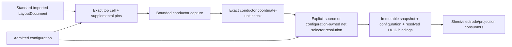

# InputPreparation

## Purpose and Scope
Owns admitted native JSON configuration and preparation of a standard-imported LayoutDocument for exact conductor capture. Parent: [PEXNative](../DESIGN.md). No children. Standard codec loading remains LayoutIO-owned; file capture remains PEXPersistence-owned.

## Responsibilities and Boundaries
Configuration owns LayoutTechDatabase layer/via metadata, injective physical-to-electrical layer bindings, explicit supplemental cell pins, durable net selectors and captured-pin/electrode bindings, expected conductor coordinate units, mesh resolution and every lower calculation/capture/electrode/projection admission ceiling. It does not own or replace standard conductor geometry. Preparation chooses the requested top cell exactly, adds declared pins without overwriting existing source pins, captures physical coverage, verifies coordinate units and resolves selectors against that actual source generation before calculation. CanonicalProjection owns exact snapshot-local UUID binding admission.

## Related Designs
| Design | Relationship | Contract Used | Summary | Cautions |
|---|---|---|---|---|
| [PEXNative](../DESIGN.md) | parent | Native numerical composition | Input preparation owner | Preparation alone is not a successful backend run |
| [NativeInput](../../PEXCore/NativeInput/DESIGN.md) | used by | Bounded configuration file reference | Persisted JSON availability | Constructor and decoder enforce the same admitted schema |
| [ConductorCapture](../../../../semiconductor-layout/Sources/LayoutVerify/ConductorCapture/DESIGN.md) | depends on | Exact hierarchy, physical coverage and coordinate units | Geometry truth | Half-grid paths may change conductor units independently of source units |
| [LayoutVerify](../../../../semiconductor-layout/Sources/LayoutVerify/DESIGN.md) | depends on | Public bounded full-material context capture | Device owner separates ACTIVE channel slabs while retaining raw hierarchy | Complete caller material set must match; custom cancellation is checked before/after the lower call, which owns internal Task cancellation |
| [LayoutIO](../../../../semiconductor-layout/Sources/LayoutIO/DESIGN.md) | depends on | Declared source net names and document-local imported net UUIDs | Standard bytes remain source authority | Independently imported documents remint net UUIDs; stored configuration must not use an observed imported UUID as durable identity |
| [SheetExtraction](../SheetExtraction/DESIGN.md) | used by | Layer names, mesh span and calculation ceilings | Numeric operator input | Exact selected electrical model validates layer roles |
| [ElectrodeConstruction](../ElectrodeConstruction/DESIGN.md) | used by | Complete explicit pin/face bindings | Terminal contact input | Pin labels do not create contact operators |
| [CanonicalProjection](../CanonicalProjection/DESIGN.md) | used by | Injective occurrence/UUID net bindings | Scoped output identity | Exact binding coverage is checked against captured topology |

## Architecture

## Contracts and Invariants
The schema is version 3 with required serialized `electricalContext` and explicit durable net selectors. Versions 1 and 2, missing contexts and unsupported selector cases are rejected without migration or fallback. Unsupported versions, nonpositive mesh span, negative lower ceilings, duplicate/unknown physical layer mappings, ambiguous standard layer numbers, invalid/duplicate supplemental pin identities/names, collapsed floating-point pin extents, invalid face intervals and duplicate terminal/net mappings fail at construction and decoding. Metadata records, selector-resolution inspections and identifier bytes inspected by schema/preparation have one finite aggregate ceiling. Lower technology records and shape geometry are bounded separately by forwarded capture ceilings; bounded serialized configuration bytes are owned by NativeInputCapture. Defaults inherit lower owner defaults and represent admission policy, not qualified scale. Every lower capture field is serialized and forwarded unchanged. Configuration stores no conductor shapes or guessed net connectivity.

Each durable input net binding supplies one injective output `NetName` and exactly one selector:

| Selector | Authority and resolution |
|---|---|
| Source-declared net | Explicit occurrence index, expected source cell name and exact declared source net name. After actual import and capture, the occurrence's source cell must match; exactly one `LayoutNet` with that name supplies its current document-local UUID. |
| Configuration-owned supplemental net | Explicit occurrence index, expected source cell name and net UUID already declared by a supplemental pin in that configuration cell. The UUID is preserved from configuration bytes into the appended pin and actual capture; no source `LayoutNet` or inferred name is required. |

Selectors address the owner occurrence of a resolved captured net reference. Child terminal aliases remain exclusively LayoutVerify-owned; preparation does not infer an alias from a pin name, target `NetName`, label, geometry or a different occurrence. Missing or ambiguous declared names, a wrong occurrence/cell, undeclared supplemental UUIDs and duplicate selectors fail explicitly. Resolution never substitutes one selector case for another. `NativePEXPreparedInput` retains the actual snapshot, unchanged configuration and call-local resolved `NativePEXNetBinding` values. Only those resolved values enter CanonicalProjection; its missing, extra, duplicate, noninjective and terminal-net mismatch refusals remain unchanged.

The selector's occurrence index is interpreted only against the actual captured standard input, with an expected source cell-name guard. Captured input and configuration content identities are bound together by the existing request/manifest owners. Reimported transient net UUIDs remain execution observations, not semantic request identity. Existing electrode pin indices retain their exact-input/code ordering contract; this change does not replace electrode selectors or introduce synthetic pins.
`conductiveLayers` is exactly the layer bindings marked conductive. `geometric` capture projects onto that selected material set. Device-aware contexts delegate original hierarchy capture, channel separation and full material selection to the public `DeviceExtractor.captureConductors` owner. Preparation rejects a selected material set that differs from the caller configuration before publishing. No device algorithm or material projection is reproduced by PEX. SheetExtraction separately requires the complete captured conductor set to equal the exact electrical model conductor set. Each context is an explicit interpretation, with no fallback; original source hierarchy remains retained. The required context bytes are captured and digest-bound by NativeInputCapture before native publication.
Pin positions/sizes use LayoutCore micrometer semantics and are transformed by the existing hierarchy owner. Faces/mesh span use the captured conductor coordinate units, checked against the explicit expected scale; raw source units are never substituted. Occurrence/pin indices refer to deterministic captured ordering under exact input bytes and measured backend code identity. Net label annotation does not connect islands; lower contracts retain opens/shorts.

## Runtime Flows
Decode admitted configuration from bounded captured bytes. Prepare the standard document by exact top name and explicit supplemental pins, reject duplicate/missing cells or pins, dispatch to the exact declared geometric or Device-owned capture context, compare complete conductor material sets and conductor units, then resolve durable net selectors against the captured occurrence and its actual source cell. Publish one prepared value only after resolution succeeds. Lower calculation/electrode consumers use the unchanged configuration; projection consumes the prepared resolved bindings. Adapter registration, actual image measurement and retained native run evidence remain separately owned.

## State, Ownership, and Lifecycle
Configuration/prepared input are immutable Sendable values. Preparation mutates a call-local COW document copy; source shapes/paths/vias/labels and original document remain unchanged. Imported UUIDs belong to that document/capture; supplemental net UUIDs belong to the immutable configuration. Resolved bindings belong only to the prepared generation and retained execution evidence. No global state, pointer, stream or external callback exists. Cancellation is inspected before preparation, throughout metadata and selector resolution and by geometric capture. Device-aware capture inspects Task cancellation internally; injected callbacks are checked before and after its bounded call. Failure publishes no prepared result.

## Failure, Concurrency, and Constraints
Typed configuration/preparation errors retain failing fields, missing/duplicate source identities, invalid occurrence/cell selection, missing/ambiguous source net names, undeclared configuration-owned UUIDs, coordinate-unit mismatch and actual lower capture/hierarchy errors. The metadata ceiling includes configuration records/identifier bytes, examined document cell/pin/net metadata and selector-resolution work. Inspected collection sizes are charged before allocating lookup/output storage; identifier bytes and each resolution traversal are charged before inspection and cancellation is checked throughout. Lower hierarchy/decomposition/technology/footprint/contact budgets apply through their owner. Source file/JSON byte budgets and reading lifetime belong to NativeInputCapture.

## Verification and Change Impact
NativePEXConfigurationTests decodes the real schema, prepares standard-imported geometry, executes capture/calculation/electrode/projection with all forwarded fields and proves analytical RC, duplicate/missing/invalid schema and source rejection, half-grid unit mismatch, low budgets and cancellation. Encode/decode alone is not native backend or process qualification evidence. `NativePEXDevicePreparationTests` proves full original two-MOS hierarchy and material retention, four separated root ports, five same-size raw contacts resolved to both bottom alternatives, public calculation/electrodes/projection and canonical artifact round-trip. A geometric control retains its channel shorts; a metal-only declaration fails before publication.

Changes to any lower ceiling or binding contract require this component and actual backend composition to be rechecked.

`NativePEXSourceBindingTests` owns successful public standard-GDS export, two imports of the same retained bytes, configuration encode/decode and actual capture/calculation/electrode/canonical projection without supplemental pins. Success requires the source-declared net and source terminal to survive reimport through resolved bindings; merely observing UUIDs or accepting a schema is not proof. Focused selector tests cover both authorities, wrong occurrence/cell, missing/ambiguous source names, undeclared supplemental UUIDs, strict projection coverage, old-version refusal, metadata exhaustion and cancellation. Existing analytical/operator, repeated-cell supplemental, device-aware and actual adapter proofs remain valid only after migrating their configuration construction to the explicit selector contract.
