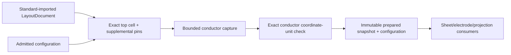

# InputPreparation

## Purpose and Scope
Owns admitted native JSON configuration and preparation of a standard-imported LayoutDocument for exact conductor capture. Parent: [PEXNative](../DESIGN.md). No children. Standard codec loading remains LayoutIO-owned; file capture remains PEXPersistence-owned.

## Responsibilities and Boundaries
Configuration owns LayoutTechDatabase layer/via metadata, injective physical-to-electrical layer bindings, explicit supplemental cell pins, exact occurrence/net and captured-pin/electrode bindings, expected conductor coordinate units, mesh resolution and every lower calculation/capture/electrode/projection admission ceiling. It does not own or replace standard conductor geometry. Preparation chooses the requested top cell exactly, adds declared pins without overwriting existing source pins, captures physical coverage and verifies coordinate units before calculation.

## Related Designs
| Design | Relationship | Contract Used | Summary | Cautions |
|---|---|---|---|---|
| [PEXNative](../DESIGN.md) | parent | Native numerical composition | Input preparation owner | Preparation alone is not a successful backend run |
| [NativeInput](../../PEXCore/NativeInput/DESIGN.md) | used by | Bounded configuration file reference | Persisted JSON availability | Constructor and decoder enforce the same admitted schema |
| [ConductorCapture](../../../../semiconductor-layout/Sources/LayoutVerify/ConductorCapture/DESIGN.md) | depends on | Exact hierarchy, physical coverage and coordinate units | Geometry truth | Half-grid paths may change conductor units independently of source units |
| [SheetExtraction](../SheetExtraction/DESIGN.md) | used by | Layer names, mesh span and calculation ceilings | Numeric operator input | Exact selected electrical model validates layer roles |
| [ElectrodeConstruction](../ElectrodeConstruction/DESIGN.md) | used by | Complete explicit pin/face bindings | Terminal contact input | Pin labels do not create contact operators |
| [CanonicalProjection](../CanonicalProjection/DESIGN.md) | used by | Injective occurrence/UUID net bindings | Scoped output identity | Exact binding coverage is checked against captured topology |

## Architecture

## Contracts and Invariants
The schema is version 1; unsupported versions, nonpositive mesh span, negative lower ceilings, duplicate/unknown physical layer mappings, ambiguous standard layer numbers, invalid/duplicate supplemental pin identities/names, collapsed floating-point pin extents, invalid face intervals and duplicate terminal/net mappings fail at construction and decoding. Metadata records and identifier bytes inspected by schema/preparation have one finite aggregate ceiling. Lower technology records and shape geometry are bounded separately by forwarded capture ceilings; bounded serialized configuration bytes are owned by NativeInputCapture. Defaults inherit lower owner defaults and represent admission policy, not qualified scale. Every lower capture field is serialized and forwarded unchanged. Configuration stores no conductor shapes or guessed net connectivity.
`conductiveLayers` is exactly the layer bindings marked conductive. Capture projects
onto that selected material set, and SheetExtraction admits it only when it equals
the conductor set in the selected electrical model. Unselected material geometry is
outside this numerical input; registered contact alternatives do not expand it.
Pin positions/sizes use LayoutCore micrometer semantics and are transformed by the existing hierarchy owner. Faces/mesh span use the captured conductor coordinate units, checked against the explicit expected scale; raw source units are never substituted. Occurrence/pin indices refer to deterministic captured ordering under exact input bytes and measured backend code identity. Net label annotation does not connect islands; lower contracts retain opens/shorts.

## Runtime Flows
Decode admitted configuration from bounded captured bytes. Prepare the standard document by exact top name and explicit supplemental pins, reject duplicate/missing cells or pins, capture through LayoutConnectivityExtractor, compare conductor units, then publish one prepared value. Lower calculation/electrode/projection consume the stored configuration directly. Adapter registration, actual image measurement and retained native run evidence remain separately owned.

## State, Ownership, and Lifecycle
Configuration/prepared input are immutable Sendable values. Preparation mutates a call-local COW document copy; source shapes/paths/vias/labels and original document remain unchanged. No global state, pointer, stream or external callback exists. Cancellation is inspected before preparation, throughout metadata traversal and by capture; failure publishes no prepared result.

## Failure, Concurrency, and Constraints
Typed configuration/preparation errors retain failing fields, missing/duplicate source identities, coordinate-unit mismatch and actual lower capture/hierarchy errors. The metadata ceiling includes configuration records/identifier bytes and examined document cell/pin metadata. Lower hierarchy/decomposition/technology/footprint/contact budgets apply through their owner. Source file/JSON byte budgets and reading lifetime belong to NativeInputCapture.

## Verification and Change Impact
NativePEXConfigurationTests decodes the real schema, prepares standard-imported geometry, executes capture/calculation/electrode/projection with all forwarded fields and proves analytical RC, duplicate/missing/invalid schema and source rejection, half-grid unit mismatch, low budgets and cancellation. Encode/decode alone is not native backend or process qualification evidence. Changes to any lower ceiling or binding contract require this component and actual backend composition to be rechecked.
