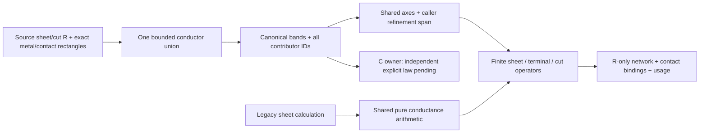

# Rectilinear Sheet Network

## Purpose and Scope

Own material-independent, bounded resistance discretization over exact rectangular
metal unions and individual explicit cut rectangles. Parent:
[PEXNative](../DESIGN.md). No children. This component produces an R-only numerical
network over shared canonical conductor geometry. It does not produce capacitance,
a complete routed extraction result, characterization or process qualification.

## Responsibilities and Boundaries

The caller supplies positive source sheet resistance and cut resistance, integer
geometry, exact net/layer identities, source record identities, and actual terminal
contact areas. No TechnologyIR, thickness, height, dielectric or analytical
capacitance model is fabricated. Rectangle union and contributor attribution belong to
[ConductorUnion](../ConductorUnion/DESIGN.md); routed R and C consumers use the
same immutable geometry without re-normalization.

Terminal contact areas impose an explicit ideal equipotential external-terminal
boundary condition. This is a numerical assumption over the admitted physical
contact intersection, not a claim that arbitrary pin centers or internal faces
are exposed electrodes. The existing exposed-face ElectrodeConstruction contract
is unchanged. Disconnected terminal regions cannot be joined by a net label.

## Related Designs

| Design | Relationship | Contract Used | Summary | Cautions |
|---|---|---|---|---|
| [PEXNative](../DESIGN.md) | parent | Native numerical ownership | R-only product | No extraction or qualification authority |
| [SheetExtraction](../SheetExtraction/DESIGN.md) | coordinates with | Finite half-cell sheet/cut operators | Shared pure conductance arithmetic | Legacy analytical model/composition and rounding order remain unchanged |
| [ElectrodeConstruction](../ElectrodeConstruction/DESIGN.md) | coordinates with | Existing exposed-face semantics | Separate terminal model | Contact-area Dirichlet does not reinterpret internal faces as exposed |
| [RoutedRuleExtraction](../RoutedRuleExtraction/DESIGN.md) | used by | Exact source geometry, source IDs and cumulative ledger | Source-bound R/C composition | GroundCapacitance owns the area/boundary law; old per-record C is not a fallback |
| [MaskGeometry](../../../../swift-mask-data/Sources/MaskGeometry/DESIGN.md) | depends on | Bounded rectilinear union bands | Canonical disjoint integer coverage | Band grouping is not multisource provenance; contributor attribution is separately charged |

## Architecture

## Contracts and Invariants

`NativeSheetResistanceCalculating` is the public protocol;
`RectilinearSheetResistanceCalculator` is its implementation.
`calculate(input:maximumCellSpanDatabaseUnits:limits:isCancelled:)` accepts
`NativeSheetResistanceInput`, a strictly positive caller-selected Int32 mesh span,
and mandatory finite `NativeSheetResistanceLimits`, returning
`NativeSheetResistanceResult` or `NativeSheetResistanceError`.

The input contains material keys and positive finite Rsheet, source-identified
rectangles grouped by exact net/layer, individual cut rectangles with lower/upper
material keys and positive finite source ohms, and terminal NodeRefs with actual
contact rectangles. Geometry lies in checked integer domains. Identifiers and
record identities are admitted before hashing. Conflicting material declarations,
duplicate source identities, malformed geometry or foreign references fail.

Canonical union coverage is disjoint and deterministic under input reordering and
exact duplicate metal records. All original source contributors remain attached
to each covered region; selecting one record never discards another's authority.
Different-net conductive contact is an explicit short. Corner-only contact does
not establish sheet conduction. Every disconnected physical region remains so.

Mesh axes include actual union, terminal-contact and cut boundaries. Every interval
is subdivided to the caller span with checked arithmetic. No resolution or runtime
cutoff is inferred from a successful fixture. A mesh cell exists only within actual
metal. Shared-face neighbors use
`R = Rsheet * (normalSpanA + normalSpanB) / (2 * sharedFaceLength)`.
A nonterminal cell adjacent to a Dirichlet contact region uses only its own finite
half-normal span to the actual interface. Contact-region cells share their explicit
port potential; no arbitrary point-to-center zero-ohm edge is emitted. Distinct
terminal references remain in the port assignment inventory, including proven
coincident equipotential contact assignments. A pin whose contacts belong to more than one disconnected physical
metal/cut component fails rather than imposing an internal ideal connection.

The rectangles of one terminal are available contact surfaces, not independent
routing obligations. For each layer, the electrode is the positive-area
intersection of their union with the actual same-net routed conductor union.
At least one such occupied cell is required for the terminal as a whole; an
untouched rectangle does not fail admission. Every selected cell must still be
in the same physical metal/cut component, and any foreign-net cell intersecting
any declared surface is refused. All original contact rectangles remain in the
retained input. An unused patch creates no cell, ideal link, pin-body resistance,
or pin capacitance. This distinction does not add the PORT body to the physical
union or infer a connection between disconnected route islands.

Each individual cut must have its complete physical area covered on both admitted
metal layers. Its finite cut-center-to-layer operators use the existing area law:
`Rhalf = sourceCutOhms / 2 * cutArea / fragmentArea`. Thus full equipotential plates
recover the source resistance of that cut; multiple cuts remain individually
source-attributed. Positive material and finite dimensions never become missing
or zero resistance. These are explicit finite-volume approximations, not a field
solver or proof of physical accuracy.

The result retains canonical union bands and contributor identities, occupied
mesh-cell bounds and potentials, finite positive resistors with source attribution,
all terminal assignments, refinement span and usage. It is R-only. A numerical
failure, exhausted budget, cancellation, short or incomplete cut/terminal contact
returns no partial successful network.

C consumes the shared physical union through
[GroundCapacitance](../GroundCapacitance/DESIGN.md). The explicit new area/boundary
law is independent of the old source-table combined fringe column; coupling
composition and qualification remain separate gates. Running
old per-record bbox C on top of union R, counting a via landing twice, interpreting
combined source fringe as a pure perimeter coefficient, or treating arbitrary mesh
panel boundaries as physical fringe is not a supported composition. No routed
success guard is removed until that C contract is implemented and verified.

## State, Ownership, and Lifecycle

All mutable arrays, dictionaries and union/mesh work are invocation-local; returned
values own immutable geometry and numerical records. There is no global cache,
unsafe pointer owner, Task spawning, actor or shared mutable state. Standalone
execution uses a concrete finite ledger. The internal numerical entry point accepts
a shared admission protocol; routed composition adapts its existing cumulative
ledger without resetting counters. Geometry retained for C is reused rather than
re-normalized.

## Failure, Concurrency, and Constraints

Limits independently bound inspected records, identifier bytes, canonical union
and contributor records, coordinate values, mesh cells, output nodes/resistors and
work visits. Every growth and checked arithmetic operation is admitted before the
corresponding allocation or traversal. Lower union calls receive only admitted
remaining budgets and retain spent work on failure; the outer ledger consumes that
work without a fresh budget. Cancellation is polled through the same admission
boundary. Logical record/storage ceilings do not measure allocator overhead or RSS.

Errors distinguish malformed inputs, arithmetic overflow, resource and cancellation
failure, actual shorts, ambiguous/disconnected terminals and incomplete cut contact.
No unavailable C or physical parameter receives a default value. Public DTOs and
serialized numerical results do not establish checked source or process authority.

## Verification and Change Impact

`NativeSheetResistanceOracleTests.swift` additionally compares the exported pure-R
network against optional independent ngspice DC solves and analytic rectangle
values with a fixed relative tolerance of `1e-8`. Required-oracle mode refuses a
missing tool. Actual L refinement compares this declared numerical model; it does
not establish physical accuracy or foundry qualification.

`Tests/PEXNativeTests/NativeSheetResistanceTests.swift` owns isolated rectangle
`Rsheet*L/W`, square symmetry, L-junction physical overlap and turn connectivity,
actual 35-DBU source witness, split/reorder/duplicate union invariance, individual
cut area conservation, finite contact operators, disconnected/short refusal, checked
limits and cancellation. A separately implemented bounded nodal solve checks the
network. Multiple explicit refinement spans demonstrate numerical convergence;
no unmeasured universal tolerance or production accuracy is inferred.

Legacy sheet tests validate unchanged shared arithmetic and ordinary model behavior.
Routed C/source-law, API/CLI persistence/reload, all RC corners, same-candidate proof,
delay/slew correlation and independent process/oracle qualification remain separate
required evidence. R-only success cannot satisfy those gates.
