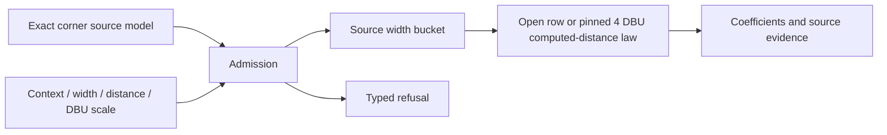
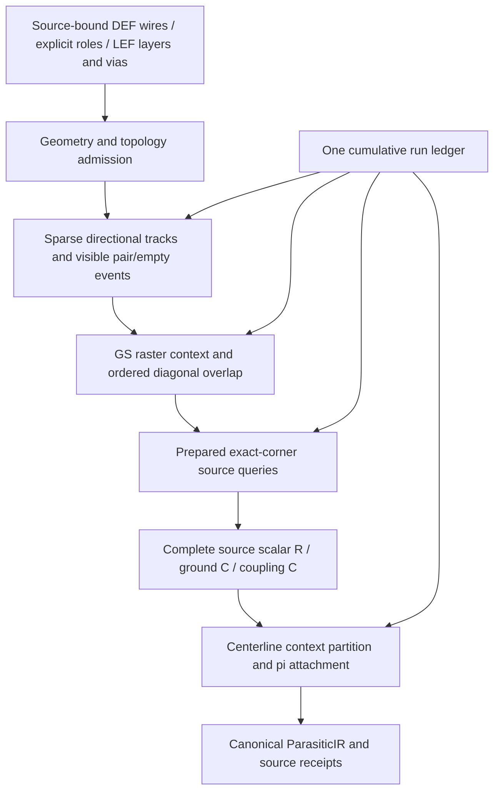

# RoutedRuleExtraction

## Purpose and Scope

Owns the numerical query law and source-bound routed RC graph calculation for
the pinned OpenRCX v1 rule source. Parent: [PEXNative](../DESIGN.md). No children.
Runtime source decoding/authenticity and independent qualification remain
separate ownership boundaries.

## Responsibilities and Boundaries

Prepares an immutable indexed numerical owner once from the admitted source model from
[PEXCore](../../PEXCore/DESIGN.md), an explicit context, positive physical width,
explicit open or finite distance and the exact DEF database-units scale. Returns
selected width/table/sample evidence and numerical coefficients. Does not parse
rules, select a corner, infer missing contexts, qualify a PDK or produce a routed
network from incomplete geometry.

## Related Designs

| Design | Relationship | Contract Used | Summary | Cautions |
|---|---|---|---|---|
| [PEXNative](../DESIGN.md) | parent | Native numerical product | Source-law numerical evaluation | Query success alone is not postroute extraction |
| [PEXCore](../../PEXCore/DESIGN.md) | depends on | Immutable exact-source rule records | Owns syntax/source identity and supported profile | Serialization does not establish checked authority |

## Architecture



## Contracts and Invariants

The reference law is OpenROAD commit
`435b3fb7a540d8206f99d894e0fab14251e95c7a`, `src/rcx/src/extRCmodel.cpp`:
`readRC`, `getWidthIndex`, `readRules`, `interpolate`, `getComputeRC`,
`getFringeRC` and `getDiagUnderCC`. Source distances and widths are rounded to DEF
DBU exactly as `round(dbFactor * 1000 * micronValue)`; coefficients are converted
from fF/nm to F/DBU with the same scale. Widths below/above the family map to the
first/last bucket. The pinned Sky130 family has one width bucket: a positive
physical width selects that source bucket, including wider via landings. Arbitrary
multiple-width map synthesis is outside the admitted pinned profile.

Open distance selects the last source row. Finite distance at/below the first row
selects the first row. Ordinary tables select the last row at/above
`UInt32(lastDistance) &- 4 DBU` (including unsigned wrap below four); interior queries select computed bucket `floor(distance / 4)`. Each source
interval writes rows starting at its own lower source distance in 4 DBU steps;
later intervals overwrite earlier rows in the same bucket. Evaluation reproduces
that final writer and its linear interpolation, including unaligned source rows. Literal 100000 and
99000 DBU sentinels preserve the pinned far-distance branch: beyond the last finite
row up to twice its distance, fringe stays at that finite row and coupling decays
as `coupling * finiteDistance / queryDistance`; above that interval the final
source row applies. Source resistance interpolation is retained as query evidence
but routed resistance belongs to exact techLEF under the selected profile.

An absent family, absent active context, empty active table, unsupported width
family, unsupported resistance-only query, invalid dimension/scale, inconsistent
sample order or unrepresentable arithmetic fails explicitly. No unavailable query
becomes a zero capacitance. Genuine source zero coefficients remain valid.

The result retains the exact selected source table and bracketing rows; caller
source binding remains necessary. DIAGUNDER's physical coupling coefficient is its
source fringe column, as the pinned consumer selects; it is not the source coupling
column. No interpolation occurs between nominal, minimum and maximum files.

Explicit LEF wire resistance is `Rsheet * actualLength / actualWidth`. Pinned
`netRC.cpp::getViaResistance_b` averages all explicit cut-layer resistances and
divides that average by the individual cut count. The evaluator preserves this
law even for unequal entries; it does not substitute a parallel-network solve.
Native evaluates decimal source values in Double. The consumer's Float average
and Float final division are not deliberately reproduced, and bitwise consumer
R identity is not claimed. Independent scalar comparisons propagate finite
per-operation Float rounding uncertainty for their actual inputs; they do not
fit a universal tolerance. The 9.3-ohm/two-cut fixture separately proves the
Double result and its discrepancy within the propagated half-ULP bounds.
Physical/distributed accuracy remains separate required evidence.
Missing, zero or nonfinite layer/cut R is a typed refusal. Caller source binding
proves that these values came from the selected exact technology LEF.

The executed v1 `Ext::extract -> extMain::run -> makeNetRCsegs -> getShapeRC ->
getViaCapacitance -> addToSumRCtable -> addRSeg` path computes via landing base C
when `-lef_res=true` and `-lef_rc=false`. It selects each routing layer's longest
landing rectangle, uses its min/max dimensions as width/length, and assigns
`2 * length * sourceFringe`. This assignment overwrites earlier layer values;
the final highest selected landing layer remains. Independent via enclosure
rectangles are excluded from GS/search occupancy. Route endpoint extensions
remain actual wire geometry. A future complete route result must retain the
selected landing layer and rectangle/source ranges, and must not sum layer
landing C while claiming parity with this pinned consumer.

## State, Ownership, and Lifecycle

The evaluator is immutable. Query arrays and arithmetic are call-local; output
retains immutable source evidence. No shared mutable state, actor, Mutex, unsafe
memory, I/O or asynchronous resource is introduced.

## Failure, Concurrency, and Constraints

The non-Codable prepared owner validates and indexes immutable records once. Query
execution does not reparse or revalidate the entire source. Caller limits bound
preparation source records and query work visits separately. Admission and lookup visits are charged
before work, and cancellation is checked on each visit. Failure returns no partial
result. Limits are caller admission policy, distinct from pinned algorithm
parameters. Numeric intermediates must be finite and representable; positive
physical lengths must not round to zero.

## Verification and Change Impact

[PEXNativeTests](../../../Tests/PEXNativeTests) owns focused rule-law behavioral
checks: width mapping, open/finite distinction, quantized interpolation, ordinary
last-row behavior, far sentinels, explicit missing/empty refusal, genuine source
zero, diagonal column selection, arithmetic, budgets and cancellation.
`RoutedRuleSourceCorpusTests` consumes the parser-owned original nominal/minimum/
maximum rule fixtures, verifies their exact digests through compilation, then
checks prepared numerical width/open/first-row/diagonal queries and source ranges.
The techLEF identity is retained from fixture provenance; this does not verify
LEF resistance intake. Tests establish source-law correlation only. Full routed geometry partition,
via-landing capacitance, coupling accumulation and runtime source binding require
their separate completion evidence before postroute success can be reported.

## Routed Geometry Contract

The routed implementation owns a Native engineering no-merge graph. It uses
the pinned rule/context law without reproducing OpenRCX's internal `dbRSeg`
optimizer grouping or identifiers. `PinnedRoutedPEXCalculator` implements the
`NativeRoutedPEXCalculating` protocol over immutable `NativeRoutedPEXInput`.

| Input | Owner and exact meaning |
|---|---|
| Source selection | Exact compiled Core selection, original DEF identity and admitted original LEF/macro source identities |
| Database scale and die bounds | Original DEF integer units and exact DIEAREA |
| Routing layers | Ordered level/name, exact LEF default WIDTH/PITCH/DIRECTION and positive sheet R, with original byte-range evidence |
| Search origins | Per-axis DEF first track center minus half default WIDTH; explicit die-lower-left derivation only when the pinned missing-grid/direction condition holds |
| Net roles | Exact canonical net identity and caller-bound signal/reference role; names and OBS never infer reference identity |
| Wire records | Stable source ID/ordinal, layer/net, direction, exact source bbox including real endpoint extensions, exact centerline electrical endpoints and source ranges |
| Via records | Exact electrical endpoints, individual explicit cut-layer R facts, and all separate noncut landing rectangles with source ranges |
| Terminal records | Exact net/node and instance identity bound to actual admitted conductor incidence |
| Limits | Caller-owned aggregate work, input records, split nodes, elements and receipt ceilings; separate from pinned algorithm parameters |



Mutable computation is run-local. One ledger charges geometry searches, source
queries, coordinate partitions, graph emission and evidence receipts cumulatively.
Each query receives the remaining run work ceiling and returns exact
`workVisitsConsumed`; the run subtracts that value before another query.
Standalone query limits do not stand in for whole-run resource bounds. Output is
published only after all required contexts and graph operators complete.
The source-artifact collection is admitted by array count against input-record
and work budgets, including cancellation, before allocating or constructing its
identity Set. Each artifact consumes one input record; Set construction and
subsequent artifact validation are separate charged work passes. Duplicate or
malformed oversized arrays cannot bypass this preallocation admission by failing
identity validation before the quota checks.

### Context Construction

The single layer pitch is the pinned consumer's `dbTechLayer::getPitch()` value,
which returns `pitch_x_` independently of preferred direction. The LEF reader
stores a scalar PITCH in both axes and stores XY PITCH in the original X/Y order
(`src/odb/src/lefin/lefin.cpp` 637-640; `src/odb/src/db/dbTechLayer.cpp` 1908-1943).
`extFlow.cpp` 296 consumes that single X pitch for search and GS setup. Anisotropic
LEF pitch is admitted; selecting Y pitch for horizontal routes would change this
source law. DEF first-track origins remain independently bound on both axes.

Same-layer directional search uses ordered pitch tracks and physical-base
subtracks, including the pinned inclusive high-edge clones. Each source begins
with its complete longitudinal interval. Nearer target tracks consume only their
visible positive-overlap intervals; farther targets see the remaining intervals.
Diagonal context is anchored to the actual pitch-track head: the first placement
of a wire uses its physical base, while higher-track clones use the pitch-track
base. The head is the minimum of all such placed subtrack bases in that track,
independent of insertion order. The original wire's physical bbox remains intact;
using its base for every clone or using pitch base for every original changes
which diagonal targets are visible.
A gap at or above `lateralContextTracks * sourceLayerPitch` does not form a pair.
The ordinary high-direction pass emits pairs and empty intervals; the all-net
reverse pass emits empty intervals only. Same-net geometric pairs remain in the
search and apply the pinned numerical same-net flag. Cross-net positive physical
contact is an explicit geometry error, not a missing-capacitance case.

GS occupancy is separate from lateral search. Signal wires parallel to the current
query direction do not occupy GS; perpendicular signal shapes do. Explicit supply
nonvia shapes occupy GS in both directions. Independent via enclosure rectangles
are absent from GS/search; actual wire endpoint extensions remain present.

GS plane resolutions are `(pitch, defaultWidth)` for preferred vertical layers and
`(defaultWidth, pitch)` for preferred horizontal layers, anchored to die-derived
integer lattices with the pinned rotated vertical-pass mapping. Source bbox pixel
start/end division and clipping paint both endpoint pixels inclusively. Query
upper-pixel correction, inclusive run end `origin + (endPixel + 1) * resolution - 1`,
and black length `upper - lower` are preserved. A continuous half-open rectangle
union is not interchangeable with this source law.

The actual `measureDiagFullOU` flow partitions source longitudinal intervals by
nearest over/under occupancy, visiting upper planes and then remaining lower
planes with the explicit context-depth limit. Each resulting interval selects
OVER, UNDER or OVERUNDER; uncovered physical length selects substrate OVER.
Unavailable active tables fail with the exact interval/context/source receipt.
Pinned finite-pair `OverSubRC_dist` uses effective substrate length
`2 * eventLength - coveredLength` because v1 `measureRC` passes zero
`srcCovered`; the open-side `OverSubRC` uses `eventLength - coveredLength`.
Native preserves these source computed scalar quantities. The context-specific
contributions retain their exact GS intervals, while the aggregate substrate
remainder is distributed over the complete source event span under the declared
Native pi attachment. It is not silently replaced by a generic one-times
uncovered-length capacitance formula.

Diagonal context uses same-orientation search grids, not GS or perpendicular
context. Ordered neighboring tracks, clone-to-original deduplication, source-track
callback order and the per-context overlap cursor lifetime are preserved. The
consumer `Track::couplingCaps` initialization callback resets diagonal target
cursors at each subtrack/direction pass; cursors advance across source callbacks
inside that pass and reset before the reverse pass. Pitch-track lifetime alone
would lose or misattribute the reverse-side overlap when both source edges lie
inside one pitch track.
`computeDiagOU` visits `0,+1,-1,+2,-2,+3,-3`, subtracting covered intervals before
farther tracks. DIAGUNDER consumes its fringe source column. Pinned `extmain.cpp::initDgContextArray` sets diagonal context depth to three
layers, distinct from the five-layer GS context option. The v1 `run` calls this
initializer unconditionally and passes the arrays/depth to `extMeasure` before
`couplingFlow`; the diagonal track array has `2 * lateralContextTracks + 1` slots.

### Native Graph and Capacitance Attachment

Each signal wire centerline is split at all context-interval boundaries and
admitted terminal, junction and via coordinates. The executed `getShapeRC` wire
branch overwrites point-distance length with the exact source bbox maximum
dimension and uses its minimum dimension as width. Native therefore computes
`Rtotal = LEF_Rsheet * bboxMaximumDimension / bboxMinimumDimension`, including
actual source endpoint extensions, then assigns
`Rpiece = Rtotal * centerlinePieceLength / completeCenterlineLength`. The piece
sum preserves the source scalar R exactly within finite Double arithmetic. A
positive complete centerline span is required; degenerate wire records fail with
source geometry identity. This distribution is an explicit Native engineering
spatial attachment, not a physical exactness claim. True end/T junctions share
an exact node; positive-length duplicate collinear centerlines refuse with the
actual offending source IDs rather than creating artificial parallel resistance.
Cross-net same-layer contact likewise reports its source geometry. Independent
via cut resistance remains a no-merge graph edge.

Each complete ground-C interval contributes half to each endpoint of its
corresponding centerline interval. A coupling interval contributes `C/2` between
its aligned low endpoints and `C/2` between its aligned high endpoints. Both wires
are partitioned at that same longitudinal boundary. Source bbox C beyond a
centerline endpoint attaches to the nearest endpoint; endpoint extensions do not
create a second resistance contribution beyond the already included source bbox
Rtotal. Explicit reference targets convert pair C to signal
ground C. For a diagonal reference target, Native grounds positive DIAGUNDER C
on the signal owner even where the consumer's nil-target RSeg emission drops it.
This is an explicit Native engineering correction: coefficient/context/source
selection are retained, every positive quantity is accounted once, and bitwise
consumer aggregate parity is not claimed for that omission. Independent
physical/reference validation must justify this corrected emission. Same-net table coupling is suppressed and same-net fringe uses the
pinned half-fringe flag. Same-net DIAGUNDER fringe follows the source consumer's
explicit target-ground fallback, rather than discarding that positive quantity. Positive source C is emitted once into the resulting
network, with exact source-query receipts.

Via base C preserves the executed consumer overwrite law described above and
attaches to the selected highest landing-layer endpoint. The result identifies
that exact layer, selected rectangle and source ranges. It does not claim
independent via-to-wire coupling absent from the selected pinned profile.

The output retains canonical `ParasiticIR`, exact source selection, all consumed
source facts, context/query evidence and via-landing selection receipts. Pin
capacitance remains absent; receiver Liberty pin capacitance belongs to STA.

### Routed Verification Ownership

Numerical fixtures must disprove incorrect nearest-visible intervals, threshold
equality, reverse-pass duplication, GS inclusive boundaries, diagonal ordering,
missing active contexts, via-landing overwrite and explicit PG handling. Graph
fixtures must prove terminal/junction connectivity, wire-path R sums, exact
accounting of all ground and coupling C, deterministic partition, actual
geometry-specific short/duplicate refusal, aggregate limits and cancellation.

Original three-corner source scalar correlation and independent distributed
resistance/delay/slew validation are required before production/qualification.
Native pi discretization is an explicit engineering choice; matching internal
OpenRCX topology or passing structural/type checks is not its completion proof.

`RoutedPEXCalculationTests` exercises isolated and interacting graphs, nearest
partial visibility, threshold equality, deterministic input reordering, actual
T-junction connectivity, diagonal signal/reference targets, explicit cut R and
highest landing overwrite, offending short/duplicate geometry, unavailable active
queries, cancellation and cumulative run limits. Input internal node identities must be normalized per net/layer/coordinate.
Distinct real terminal identities may share that coordinate only after each
terminal proves actual contact with the admitted same-net conductor. At most one
nonterminal node may belong to that same-point group; multiple internal aliases
remain ambiguous and fail. Native retains every terminal NodeRef, chooses the
existing internal junction or creates a deterministic internal junction, and emits
an explicit zero-ohm connection from each distinct terminal to that junction.
This zero denotes proven topological electrical equivalence at one point, not
an approximation of unmeasured resistance. It adds no wire/via R or C. Cross-net
contact and missing terminal contact still fail with actual source identities.
SPEF serialization must preserve every pin identity and zero-ohm equivalence.
Conductive contacts outside the admitted centerline/junction contract fail rather
than inventing electrical connectivity.

### Explicit Union-Sheet Execution Contract

Schema-3 host execution selects `unionSheetAreaBoundaryV1`, supplies a mandatory
positive `maximumCellSpanDatabaseUnits: Int32`, and calls the protocol requirement
`calculate(input:model:groundCapacitanceModel:maximumCellSpanDatabaseUnits:cornerID:limits:isCancelled:)`.
The default requirement explicitly refuses unsupported conformers. It never calls
the legacy numerical method. `UnionSheetRoutedPEXCalculator` composes union R,
exact source area/boundary C, spatial attachment and source-bound coupling.
Failures in any component refuse the complete result.

[ConductorUnion](../ConductorUnion/DESIGN.md) owns shared physical coverage,
[RectilinearSheetNetwork](../RectilinearSheetNetwork/DESIGN.md) owns R, and
[GroundCapacitance](../GroundCapacitance/DESIGN.md) owns the new source LEF area and
external-boundary C law. The combined OpenRCX fringe column is not reinterpreted
as a pure perimeter coefficient. The new numerical geometry/algorithm identity
is distinct from source-table consumer identity and grants no qualification.

`PinnedRoutedPEXCalculator` remains explicitly named and deprecated for existing
source-law/legacy comparison tests. It does not implement the new required overload
and cannot serve as the schema-3 default. Removal waits for independent comparison
and qualification evidence sufficient to retire those retained comparisons. Old
numerical evidence is not union-sheet evidence; no silent compatibility selection
or successful empty/zero coupling fallback is provided.

#### Composite Numerical Model

The preceding source-bbox/centerline description applies to the explicitly named
legacy calculator. The new composite identity is
`native-union-sheet-area-boundary-v1`. Its independent submodels are
`finite-volume-sheet-cut-area-dirichlet-v1`, `lef-area-boundary-v1`, and
`canonical-union-band-openrcx-empirical-cc-v1`. None asserts full-field accuracy,
foundry qualification, or equivalence to the pinned bbox consumer.

```text
admitted original DEF/LEF rectangles, cuts and actual PORT regions
 -> exact net/layer conductor union (wire plus landing metal)
 -> finite sheet/cut R with explicit area-Dirichlet PORT assumption
 -> source LEF union area/external-boundary ground C
 -> canonical-band empirical CC queries -> actual facing cell intervals
 -> canonical IR + source/query/attachment observations
```

Canonical query rectangles are the checked geometry-only union bands. Their long
axis is the query direction, with a fixed horizontal tie; layer preference does
not rotate geometry. Original record partition, order, duplicates and mesh span
do not select that partition. The pinned table evaluator and context traversal
are reused on these rectangles as an explicitly new empirical approximation.
Actual query width and selected table width are both retained. Source IDs/facts
refer to all original contributors, not an arbitrarily selected first record.

Only actual lateral coupling coefficients and the existing diagUnder coupling
coefficient are consumed. Combined fringe and the legacy highest-landing ground
law are not emitted. A signal-to-reference coupling is explicitly converted to
signal ground with role and query provenance; a signal-to-signal coupling remains
an unordered inter-net operator. Same-net potential differences are owned by R,
not modeled as inter-net capacitance. Missing active tables remain typed failures.

The checked union's external-boundary inventory is the single face-eligibility
owner for same-layer lateral pairs and diagonal pairs with disjoint normal
projections. Before a target consumes visibility or advances a diagonal cursor,
the shared positive longitudinal interval is clipped to both canonical bands'
actual facing external boundaries. Internal partition faces consume no interval.
A later exposed landing band therefore retains its own canonical rectangle,
long axis, physical width, gap, source query and receipt; a coefficient queried
at a hidden face is never reassigned to a different face. Partially eligible
candidates consume only their eligible intervals, leaving the rest for later
candidates in the existing track order. Diagonal cursors discard only an expired
prefix, so an overlapping hidden candidate cannot suppress a later exposed one.
Projected-overlap interlayer operators retain their existing footprint-area law
and do not acquire a lateral-face eligibility requirement. Source empty events
remain available to that area law. Legacy source-bbox execution has no checked
union exposure inventory and retains its original traversal.

Spatial attachment consumes common positive longitudinal intervals of actual
facing cell ports, clipped by the operator and the same exposed-boundary inventory
used before query selection. It does not spread a scalar over an indiscriminate Cartesian
product of cells. Interlayer projected-overlap ports use the exact common cell
footprint area; diagonal nonoverlapping projections use the nearest exposed
lateral faces. No absent height is replaced by zero. Area ground is apportioned by exact band/cell overlap area;
edge ground by exact boundary/cell-face length. Positive weights sum exactly in
checked UInt64 arithmetic. The largest weight (first on ties) receives the final
remainder; other shares retain their individually rounded positive values.
The remainder uses the separate Neumaier high sum and correction, not their
already rounded combined value. Its high part is directed downward by adjacent
representable values, with a work/cancellation visit before every adjustment,
until the remaining compensated tail is nonnegative. A positive tail is retained
as a second parallel capacitor on that same cell/port. This is a representation
of one contribution, not added physical capacitance. Both operators retain the
same spatial/source identity. No emitted positive share is discarded to make the
total match. The recomputed compensated total must equal the original Double
scalar exactly; there is no tolerance or epsilon expansion. Every emitted scalar
must be finite and strictly positive; unrepresentable shares, overflow, missing
coverage or failed conservation refuse the whole calculation. Allocation records
and both remainder operators are charged before retained growth. Mesh cuts do
not create physical fringe. Every real terminal identity/instance path is kept;
zero-ohm links denote only equivalence imposed by the explicit ideal PORT region,
never an unmeasured wire or cut.

`NativeUnionSheetPEXEvidence` records the exact source/contributor union, mesh
cells, source cut and original via identities, all numerical resistance element
IDs, and every spatial attachment including source/reference band and actual
longitudinal interval. The separate captured input artifact retains original
terminal/contact/source facts. Codable observations grant no checked authority.
The legacy `viaLandingReceipts` field is empty for this law because the removed
highest-landing ground operator is not performed; landing metal is instead fully
present in the union/ground/CC evidence, not omitted from calculation.

The routed ledger is cumulative. Union bands/boundaries use `trackEntries`,
contributors use `inputRecords`, mesh cells and numerical nodes use `graphNodes`,
and emitted operators/attachment records use `graphElements`. Source, coordinate,
string, query and work limits retain their named counters. The same borrowed
ledger is returned on failure. Finite logical caps are not allocator/RSS evidence.
Legacy shared half-cell algebra retains its arithmetic order and failure contract.

`NativeUnionSheetRoutedPEXTests` owns analytic rectangle/contact R and union C,
the actual short L/via contact, subdivision/order/duplicate invariance, refinement
conservation, reciprocity, explicit reference conversion, and failure budgets.
The actual met3 landing/LI witness verifies that the buried 3890-DBU partition
face cannot consume the 17335..<17415-DBU interval: the exposed 3905-DBU landing
band is queried with its own 525-DBU gap, then attaches to its own real cell ports.
Partial source/target exposure, projected-overlap preservation and reordered
source records exercise the same admission boundary.
Existing source-law and legacy analytical tests remain comparison/regression
evidence only. Independent RC/delay/slew qualification and actual same-candidate
PEX/STA remain separate required gates.
