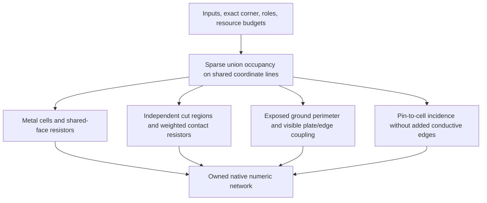

# SheetExtraction

## Purpose and Scope

Bounded sparse conforming finite-volume sheet graph with cut resistors and the
declared rectilinear capacitance law. Parent: [PEXNative](../DESIGN.md). No children.

## Responsibilities and Boundaries

Owns union coverage, numeric nodes and edges, dimensional admission, pin incidence
and deterministic output. Uses the [electrical model law](../../PEXCore/ElectricalModel/DESIGN.md).
Does not perform a Maxwell solve, qualify coefficients, reinterpret topology, select
a default corner or merge physical islands through terminal names.

## Related Designs

| Design | Relationship | Contract Used | Summary | Cautions |
|---|---|---|---|---|
| [PEXNative](../DESIGN.md) | parent | Calculation product | API and dependency boundary | Final electrode observables are separate |
| [ElectricalModel](../../PEXCore/ElectricalModel/DESIGN.md) | depends on | SI coefficients and ranges | One admitted exact corner | No extrapolation outside declared domains |
| [ConductorCapture](../../../../semiconductor-layout/Sources/LayoutVerify/ConductorCapture/DESIGN.md) | depends on | Integer bands and physical components | Geometry truth | Pins label contacts and are not conductors |

| [InputPreparation](../InputPreparation/DESIGN.md) | used by | Codable calculation admission ceilings | Exact serialized configuration | Decoded limits preserve all fields and defaults remain owner policy |

## Architecture

## Contracts and Invariants

Mesh endpoints are all source metal/cut and pin band endpoints, subdivided by the
explicit positive maximum span in database units. Occupancy is sparse; no array is
allocated for the Cartesian product of all coordinates. Overlapping source footprints
write one physical cell and must agree on the captured component. Source bands and
holes remain exact; subdivision changes numerical resolution, not physical coverage.
Band coordinates and the explicit cell span use `snapshot.coordinateUnits`.
Raw hierarchy units describe source data and cannot convert refined path bands.
Changing the capture grid must preserve physical dimensions and numerical values
after conversion through this owned scale.

Sheet nodes represent cell-center potentials. A shared positive-length face gives
`Rsheet * centerNormalDistance / sharedFaceLength`; corners do not conduct. Conductor
applicability is checked on occupied horizontal/vertical run lengths rather than the
artificial mesh-cell width. This preserves applicability under harmless subdivision.
Ground area is counted once and ground perimeter includes only exposed faces.

A connected cut region must be rectangular, covered completely by its declared
bottom and top metal, and match one applicable calibrated via model. Cut regions
remain independent even when one layout via contains several of them. One cut-center
node connects each contacted metal cell with `Rcut / 2 * cutArea / contactArea`,
preserving total per-cut conductance. Partial contact, conflicting/unknown definitions,
nonrectangular cut regions and ambiguous raw-cut model selection fail explicitly.

The capture contract permits one cut/top landing with alternative bottom materials.
Those alternatives conduct only at actual positive-area incidence. PEX retains the
selected model's exact conductor set, and its current cut law has exactly one modeled
bottom/top pair. Before emitting a cut operator, every actual captured contact for
that cut must belong to that modeled pair. An additional selected material with
actual electrical contact fails with `ambiguousCutModel`; it cannot disappear from
the numeric network. This admission uses public footprint/contact facts and
`LayoutConductorSnapshot.hasElectricalContact`, never capture adjacency internals.
The snapshot must already be admitted by the lower selected-topology contract.
Unselected geometry lies outside this admitted numerical input; edge-only or
nonincident selected material does not constitute an additional cut contact. Contact probes are charged to the
existing aggregate work budget. No electrical equation or second topology is added.

Coplanar coupling pairs nearest exposed opposing edges along each grid row/column;
metal in the gap screens more distant edges. Interlayer plate coupling uses adjacent
occupied metal planes in each projected cell; intermediate metal screens deeper planes.
Area and facing-patch perimeter are counted once. For interlayer fringe, the model's
parallel edge length is the exposed perimeter of the visible facing patch and gap is
the vertical dielectric distance. This is the declared calibrated approximation,
not a general electromagnetic field solution or independent physical qualification.

For `singlePlaneCoplanarGroundV1`, admission occurs before mesh allocation and
requires one modeled conductor, no cuts/vias, and every reachable source shape on
that conductor. The reference is a continuous implicit plane. All source inventory
is checked, including unselected geometry retained by the capture hierarchy.
`analyticalRectilinearV1` is a separate explicit law; its independent ground and
visible interlayer approximation cannot act as a fallback for unsupported screened
inputs. Existing layered analytical fixtures select that law explicitly.

One nearest-neighbor partition of exposed faces owns both coplanar pair capacitance
and the two owners' ground fringe fractions. Each face begins fully exposed to the
reference; an admitted pair with physical `0 < gap < interactionHaloMeters` records
`s = 0.6366 * atan(groundFringeInverseMeters * gap)` on its two opposing faces.
The pair emits full `sidewallFarads * physicalLength / (gap + offsetMeters)` once.
Ground emission follows partitioning and uses `areaCoefficient * unionArea` plus
the nonnegative face remainders. It does not subtract aggregate values after graph
publication or force ground loss to equal pair capacitance. At/beyond the halo,
faces remain unblocked and no pair is emitted. Gap applicability is checked only
for admitted interacting pairs. Connected components and logical net names do not
remove capacitance between distinct resistive numeric nodes.

The shared coordinate lines partition partial facing edges exactly. Sorting occupied
cells into rows/columns identifies only adjacent occupied cells, avoiding all-pairs
search and empty Cartesian allocation. Face-fraction storage is bounded by occupied
metal cells, charged to existing mesh/work budgets; pair and ground emission use the
existing network-element budget. Every visit is cancellable and failures publish no
partial network. Positive numeric intermediates must remain representable; overflow
and underflow fail explicitly. Nonnegative branch capacitances preserve passivity;
including the reference in the capacitance matrix preserves row sums and charge.
Neither a fixed sum of scalar capacitances nor `groundLoss == pairCapacitance` is
a conservation law.

Pin incidence records positive-area overlap with metal cells, matching the captured
annotation contract; edge/corner-only annotations add no contact. It adds no resistor/ideal wire.
Finite-volume nodes are not terminal electrodes: [ElectrodeConstruction](../ElectrodeConstruction/DESIGN.md) must construct
and verify the explicitly requested sheet boundary conditions before reporting terminal
resistance or canonical port connectivity. Opens and shorts remain captured facts.

## State, Ownership, and Lifecycle

All mutation is call-local. Output retains immutable input snapshot, selected model,
resolution and numeric graph. No async resources, shared state or unsafe memory exist.
Output is published only after every operator and pin contact completes.

## Failure, Concurrency, and Constraints

Caller limits bound input records, coordinate values, mesh nodes, network elements,
work visits and pin incidence. Defaults are host admission policy, not scale proof.
Every fill/probe/emission and cancellation boundary is charged before work.
Memory grows with admitted coordinates, occupied cells, elements and pin contacts,
not the full empty grid. Checked SI arithmetic rejects overflow, underflow of positive
physical terms and nonfinite values. Failure or cancellation publishes no partial graph.

## Verification and Change Impact

[PEXNativeTests](../../../Tests/PEXNativeTests) proves union area/exposed perimeter, analytical cell-center sheet R,
independent cut conductance, visible plate/sidewall C, shielding, floating/island and
pin incidence, exact corner/units, deterministic mesh and typed limits/cancellation.
Mesh/physics changes invalidate native graph evidence; backend terminal projection and
qualification additionally require their own end-to-end and independent evidence.
`NativePEXScreenedCapacitanceTests` verifies isolated and paired strips, both source-law
observables at two gaps, three-strip and partial-edge shielding, halo boundary,
refinement/coordinate units, same-net distinct nodes, source-inventory rejection,
bad model/numerics, budgets and cancellation through the public preparation and
calculation path. Analytical layered tests continue to prove only the explicit
facing-patch approximation. Source algebra correlation is not foundry qualification.
`NativePEXContactAdmissionTests` prepares the real selected configuration, captures
same-cut/same-top alternative contacts, checks public actual-contact queries and runs
the calculator. Metal-only selection preserves the analytical cut R and ground C;
selected third-material positive incidence rejects without publishing a network,
while edge-only incidence leaves that material as a separate captured component.

`standardOASISSignedCapsPreserveAnalyticalRC` enters through LayoutIO using independent standard bytes, then actual conductor capture and numeric calculation. Signed endpoint retention and refined units must reproduce the analytical rectangle capacitance and sheet operators. This does not qualify complete terminal resistance, native run composition or a foundry process.
