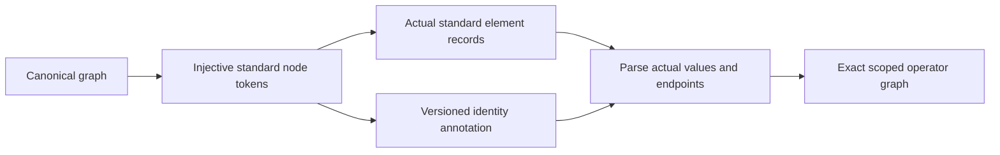

# PEXParsers

## Purpose and Scope

Own standard parasitic parsing, canonical lowering and deterministic export.
Parent: [PEXEngine](../../DESIGN.md).
Child: [OpenRCXRules](OpenRCXRules/DESIGN.md) owns the separate bounded technology-rule compiler.

## Responsibilities and Boundaries

Own lexical conversion and exact electrical endpoint identity. Do not infer that
equal leaf names or a resistor imply equal canonical net ownership. Standard
outputs describe the actual operator graph, not an independently serialized IR.

## Related Designs

| Design | Relationship | Contract Used | Summary | Cautions |
|---|---|---|---|---|
| [PEXEngine](../../DESIGN.md) | parent | Standard artifact output | Composed runtime | Typed export rejection must remain failure |
| [OpenRCXRules](OpenRCXRules/DESIGN.md) | child | Checked original OpenRCX source tables | Direct Native source intake | Compilation does not qualify extraction |
| [PEXCore](../PEXCore/DESIGN.md) | depends on | NodeRef, ParasiticIR | Scoped canonical graph | Nil capacitor endpoint means the explicit model reference |
| [CanonicalProjection](../PEXNative/CanonicalProjection/DESIGN.md) | used by | Scoped endpoints and reference metadata | Native physical graph | Cross-net short resistors must never merge logical scopes |

## Architecture

## Contracts and Invariants

SPICE tokens are injective under SPICE case folding. Global node `0` is reserved
for the configured implicit reference only; explicit canonical nodes named `0`
or `gnd` remain ordinary scoped nodes. A nonzero reference is an explicit
subcircuit terminal. Mandatory versioned comments carry endpoint ownership and
operator kind, while the actual element lines own values and endpoints. Generated
SPICE parsing validates annotation membership and never runs resistance union.
The composer matches original external terminal names and rejects ambiguous scoped
leaf bindings instead of connecting distinct terminals together implicitly.

SPEF uses a mandatory versioned name-map identity annotation, globally injective
pin tokens and net:number internal tokens. Actual CAP/RES/INDUC records own
values and endpoints; lowering restores exact scoped leaf names and node kinds.
Existing nil-instance terminal encodings remain unchanged. Explicit
`SPEFWriterOptions.TerminalTokenProfile.canonical` uses each pin's exact canonical
NodeName as its standard terminal token, with no caller-supplied replacement map.
Instance pin ownership is retained in an optional identity-node instancePath. A
pin with a source instancePath is emitted as standard *I and is excluded from
*PORTS; a nil path remains *P. Canonical tokens must exactly have the declared
instance path followed by the header delimiter and a nonempty pin leaf. The
encoded profile uses a deterministic encoded instance prefix plus its prior
injective pin token. Generated lowering cross-checks exact *I/*P role, token/path
agreement, one connection per annotated pin and the complete top-port inventory
before restoring the path. Missing or conflicting roles and fabricated paths fail.
The shared standard identity lowerer restores only an explicit verified path map
supplied by that checked SPEF branch. Its default map is empty; generated SPICE
annotations cannot introduce instance paths and preserve their previous nil-path
semantics. sourceFormat strings confer no authority.
Legacy annotations omit the optional field and retain nil-path behavior. This
change preserves pin identity and zero-ohm electrical-equivalence operators; it
does not reconstruct arbitrary internal-node instance metadata. Ordinary external
SPEF parsing retains its existing separate standard inference path.

Global pin/internal/reserved-reference collisions and unsupported literal
backslash spellings fail export. A canonical pin may share its token with its own
net root: top port `a` on net `a` remains the exact scoped node `(a,a)`, not a
second node or a renamed terminal. A token naming another net root, or an internal
node colliding with any net root, remains ambiguous and fails. Generated lowering
checks the same owner/kind condition against the identity annotation and actual
net block. Canonical tokens and net names must start with a
letter, underscore, dollar or hash and remain in the existing parser's lossless
identifier subset; numeric-leading and leading punctuation spellings and the
reserved identity-annotation prefix fail rather than normalize the source name.
Supported special characters use the existing
name map without changing canonical identity. The canonical program marker retains
the mandatory identity annotation with `canonicalTerminals: true`; the default
annotation omits that optional field and keeps its original encoded bytes. Marker
and flag must agree. Any annotation presence requires the generated marker, so
marker stripping cannot downgrade to heuristic lowering. Duplicate NAME_MAP IDs,
including identical repeated values, fail before dictionary publication. Generated
lowering additionally requires each
pin token to equal its annotated canonical name and declared owner. Duplicate,
missing or conflicting annotations fail. A standard timing consumer reads these
actual terminal tokens/operators without decoding the private PEX annotation.
That consumer does not claim PEX metadata restoration or annotation authenticity.
Internal coordinates are emitted only in net blocks with a declared pin connection,
because the portable grammar requires at least one *P/*I before *N. A pinless
net retains every scoped node and operator but omits coordinates. The profile
guarantees electrical identity/operators rather than complete node metadata.
The portable intra-net SPEF profile rejects cross-net resistors/inductors
and nonzero implicit reference nodes. These inputs cannot be silently rewritten
into an intra-net or global-ground operator. Representable capacitor endpoints
must resolve to their exact declared owner. All writers reject dangling endpoints,
duplicate identities and invalid operator values before publishing output.

SPEF `D_NET` totals are an export projection of the actual CAP graph, normalized
to the declared output unit. Ground CAP contributes to its endpoint's net;
cross-net CAP contributes once to each incident net; same-net two-endpoint CAP
contributes once to that net. Parallel physical CAP operators each contribute.
Canonical nodeA-owned inventory totals remain unchanged and are not the source
of these headers. CAP records retain their original endpoints, values and single
nodeA-owned listing; lowering reads these records and preserves each physical
operator once rather than using the header as an electrical load. Nonfinite
input inventories remain invalid; nonfinite normalized values, incident sums or
output-unit totals throw typed writer failures before output publication.
Positive capacitance that underflows to zero at either unit-conversion boundary
is unrepresentable and throws a typed writer failure; original zero CAP remains
valid and is retained in the output graph.

### Lossless Hyphen Identity

Canonical net and terminal names retain their exact semantic spelling. A hyphen
is emitted as `\-` in NAME_MAP values; map keys and identity annotations retain
the unescaped name. The lexer decodes that scoped escape before parser/lowering
identity checks. Raw integer suffixes such as `net-0` remain one identifier;
an unescaped letter suffix such as `net-name` is outside this lexical profile.
Signed numeric values retain the existing number branch. Literal backslash plus
hyphen names are rejected rather than given two possible semantic identities.
Existing successful output spellings remain unchanged, including the default
generated terminal dialect. Injectivity, owner, internal-token, reserved-prefix
and annotation checks remain authoritative after escape decoding.

`Tests/PEXParsersTests/SPEFHyphenIdentityTests.swift` owns exact standard-profile
IR round trips, canonical terminal/net identity, raw and escaped NAME_MAP syntax,
negative numeric lexing, R0, coupling, collision and map-tampering rejection.
Arbitrary native provenance metadata is bound separately and is not an additional
SPEF schema. This lexical contract follows the pinned
[OpenSTA lexer](https://github.com/The-OpenROAD-Project/OpenSTA/blob/536061898d5ba3af6e6d09cd99bb4baa88db70ab/parasitics/SpefLex.ll):
hyphen is a special escaped character and INTEGER is allowed within IDENT.
Runtime Timing consumption and the actual candidate are upper integration
verification responsibilities; parser round trip does not establish extraction
or manufacturing qualification.

## State, Ownership, and Lifecycle

All maps and parsing state are call-local. No shared mutable storage, async
resource, platform-conditioned synchronization or process is owned here.

## Failure, Concurrency, and Constraints

File writers publish complete encoded output atomically; failed publication does not replace the previous complete file. Writers throw typed export errors and parsers throw typed parse failures. Invalid
or missing generated identity annotations cannot fall back to heuristic parsing.
Optional human-readable node-map comments do not disable the identity contract.

## Verification and Change Impact

`Tests/PEXParsersTests/ScopedStandardOutputTests.swift` owns repeated leaf names,
case folding, explicit `0`/`gnd` nodes, custom reference, cross-net operators,
annotation rejection and composer ambiguity. Existing writer/parser tests own
standard syntax, units and source-deck composition. Changes affect runtime export
and CLI writers through their existing public entrypoints; package verification
is coordinated at the task owner after the shared source snapshot stabilizes.

Scoped standard-output and writer tests own raw `D_NET` incident totals,
orientation/order independence, same-net and parallel CAP, declared inventory
disagreement, unit conversion, invalid inventories and overflow. These changes
do not alter canonical inventory or require native extraction requalification.
The incident-total intent is corroborated by
[OpenRCX SPEF export](https://github.com/The-OpenROAD-Project/OpenROAD/blob/master/src/rcx/src/extSpef.cpp)
and the pinned raw [OpenROAD fixtures](../../Tests/PEXParsersTests/Fixtures/OpenROAD/PROVENANCE.md),
not by a claim of complete IEEE specification qualification.

The profile boundary follows [OpenSTA SpefReader](https://github.com/The-OpenROAD-Project/OpenSTA/blob/master/parasitics/SpefReader.cc):
`makeResistor` resolves both endpoints with `local_only=true` and reports cross-net
connections, whereas two-endpoint `makeCapacitor` uses `local_only=false`. Its
[grammar](https://github.com/The-OpenROAD-Project/OpenSTA/blob/master/parasitics/SpefParse.yy)
accepts `GROUND_NETS` without assigning a named reference binding; ground CAP
records accumulate implicit ground charge. This is a portable-reader profile
restriction, not a claim that the grammar universally forbids two cross-net names.
External STA qualification and matching the encoded terminal namespace to a
logical design are composition responsibilities, not established by round-trip.
