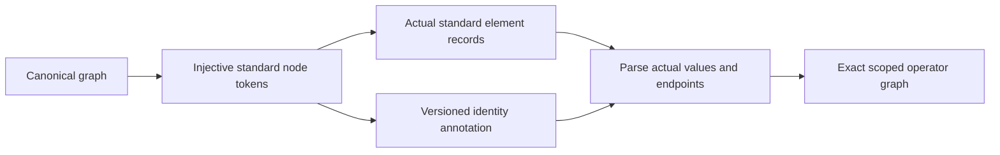

# PEXParsers

## Purpose and Scope

Own standard parasitic parsing, canonical lowering and deterministic export.
Parent: [PEXEngine](../../DESIGN.md). No children.

## Responsibilities and Boundaries

Own lexical conversion and exact electrical endpoint identity. Do not infer that
equal leaf names or a resistor imply equal canonical net ownership. Standard
outputs describe the actual operator graph, not an independently serialized IR.

## Related Designs

| Design | Relationship | Contract Used | Summary | Cautions |
|---|---|---|---|---|
| [PEXEngine](../../DESIGN.md) | parent | Standard artifact output | Composed runtime | Typed export rejection must remain failure |
| [PEXCore](../PEXCore/DESIGN.md) | depends on | NodeRef, ParasiticIR | Scoped canonical graph | Nil capacitor endpoint means the explicit model reference |
| [CanonicalProjection](../PEXNative/CanonicalProjection/DESIGN.md) | used by | Scoped endpoints and reference metadata | Native physical graph | Cross-net short resistors must never merge logical scopes |

## Architecture

## Contracts and Invariants

SPICE tokens are injective under SPICE case folding. Global node `0` is reserved
for the configured implicit reference only; explicit canonical nodes named `0`
or `gnd` remain ordinary scoped nodes. A nonzero reference is an explicit
subcircuit terminal. Mandatory versioned comments carry endpoint ownership and
operator kind, while the actual element lines own values and endpoints. Generated
SPICE parsing validates annotation membership and never runs resistance union.
The composer matches original external terminal names and rejects ambiguous scoped
leaf bindings instead of connecting distinct terminals together implicitly.

SPEF uses a mandatory versioned name-map identity annotation, globally injective
pin tokens and net:number internal tokens. Actual CAP/RES/INDUC records own
values and endpoints; lowering restores exact scoped leaf names and node kinds.
Internal coordinates are emitted only in net blocks with a declared pin connection,
because the portable grammar requires at least one *P/*I before *N. A pinless
net retains every scoped node and operator but omits coordinates. The profile
guarantees electrical identity/operators rather than complete node metadata.
The portable intra-net SPEF profile rejects cross-net resistors/inductors
and nonzero implicit reference nodes. These inputs cannot be silently rewritten
into an intra-net or global-ground operator. Representable capacitor endpoints
must resolve to their exact declared owner. All writers reject dangling endpoints,
duplicate identities and invalid operator values before publishing output.

## State, Ownership, and Lifecycle

All maps and parsing state are call-local. No shared mutable storage, async
resource, platform-conditioned synchronization or process is owned here.

## Failure, Concurrency, and Constraints

Writers throw typed export errors and parsers throw typed parse failures. Invalid
or missing generated identity annotations cannot fall back to heuristic parsing.
Optional human-readable node-map comments do not disable the identity contract.

## Verification and Change Impact

`Tests/PEXParsersTests/ScopedStandardOutputTests.swift` owns repeated leaf names,
case folding, explicit `0`/`gnd` nodes, custom reference, cross-net operators,
annotation rejection and composer ambiguity. Existing writer/parser tests own
standard syntax, units and source-deck composition. Changes affect runtime export
and CLI writers through their existing public entrypoints; package verification
is coordinated at the task owner after the shared source snapshot stabilizes.

The profile boundary follows [OpenSTA SpefReader](https://github.com/The-OpenROAD-Project/OpenSTA/blob/master/parasitics/SpefReader.cc):
`makeResistor` resolves both endpoints with `local_only=true` and reports cross-net
connections, whereas two-endpoint `makeCapacitor` uses `local_only=false`. Its
[grammar](https://github.com/The-OpenROAD-Project/OpenSTA/blob/master/parasitics/SpefParse.yy)
accepts `GROUND_NETS` without assigning a named reference binding; ground CAP
records accumulate implicit ground charge. This is a portable-reader profile
restriction, not a claim that the grammar universally forbids two cross-net names.
External STA qualification and matching the encoded terminal namespace to a
logical design are composition responsibilities, not established by round-trip.
