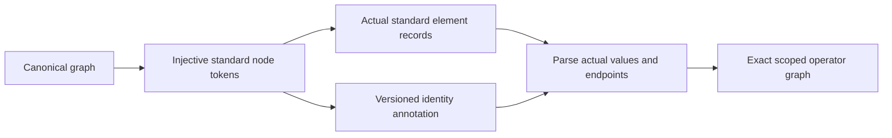
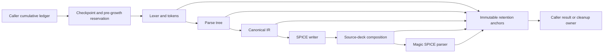

# PEXParsers

## Purpose and Scope

Own standard parasitic parsing, canonical lowering and deterministic export.
Parent: [PEXEngine](../../DESIGN.md).
Child: [OpenRCXRules](OpenRCXRules/DESIGN.md) owns the separate bounded technology-rule compiler.

## Responsibilities and Boundaries

Own lexical conversion and exact electrical endpoint identity. Do not infer that
equal leaf names or a resistor imply equal canonical net ownership. Standard
outputs describe the actual operator graph, not an independently serialized IR.

## Related Designs

| Design | Relationship | Contract Used | Summary | Cautions |
|---|---|---|---|---|
| [PEXEngine](../../DESIGN.md) | parent | Standard artifact output | Composed runtime | Typed export rejection must remain failure |
| [OpenRCXRules](OpenRCXRules/DESIGN.md) | child | Checked original OpenRCX source tables | Direct Native source intake | Compilation does not qualify extraction |
| [PEXCore](../PEXCore/DESIGN.md) | depends on | NodeRef, ParasiticIR | Scoped canonical graph | Nil capacitor endpoint means the explicit model reference |
| [CanonicalProjection](../PEXNative/CanonicalProjection/DESIGN.md) | used by | Scoped endpoints and reference metadata | Native physical graph | Cross-net short resistors must never merge logical scopes |

## Architecture



## Contracts and Invariants

SPICE tokens are injective under SPICE case folding. Global node `0` is reserved
for the configured implicit reference only; explicit canonical nodes named `0`
or `gnd` remain ordinary scoped nodes. A nonzero reference is an explicit
subcircuit terminal. Mandatory versioned comments carry endpoint ownership and
operator kind, while the actual element lines own values and endpoints. Generated
SPICE parsing validates annotation membership and never runs resistance union.
The composer matches original external terminal names and rejects ambiguous scoped
leaf bindings instead of connecting distinct terminals together implicitly.

SPICE element values use Swift's locale-independent binary64 round-trip decimal
representation after the existing SI unit conversion. Re-reading each emitted
R, C, coupling C or L token must recover the exact converted `Double` bits;
formatting introduces no further rounding. Decimal/exponent notation stays within
the existing SPICE parser grammar, with no engineering suffix or format option.
Both positive and negative zero remain accepted and retain their sign bit;
negative nonzero and nonfinite values retain their typed rejection. Unit conversion
still owns its existing arithmetic and representability policy. The public composer
embeds these same element records rather than reformatting their values.

SPEF uses a mandatory versioned name-map identity annotation, globally injective
pin tokens and net:number internal tokens. Actual CAP/RES/INDUC records own
values and endpoints; lowering restores exact scoped leaf names and node kinds.
Existing nil-instance terminal encodings remain unchanged. Explicit
`SPEFWriterOptions.TerminalTokenProfile.canonical` uses each pin's exact canonical
NodeName as its standard terminal token, with no caller-supplied replacement map.
Instance pin ownership is retained in an optional identity-node instancePath. A
pin with a source instancePath is emitted as standard *I and is excluded from
*PORTS; a nil path remains *P. Canonical tokens must exactly have the declared
instance path followed by the header delimiter and a nonempty pin leaf. The
encoded profile uses a deterministic encoded instance prefix plus its prior
injective pin token. Generated lowering cross-checks exact *I/*P role, token/path
agreement, one connection per annotated pin and the complete top-port inventory
before restoring the path. Missing or conflicting roles and fabricated paths fail.
The shared standard identity lowerer restores only an explicit verified path map
supplied by that checked SPEF branch. Its default map is empty; generated SPICE
annotations cannot introduce instance paths and preserve their previous nil-path
semantics. sourceFormat strings confer no authority.
Legacy annotations omit the optional field and retain nil-path behavior. This
change preserves pin identity and zero-ohm electrical-equivalence operators; it
does not reconstruct arbitrary internal-node instance metadata. Ordinary external
SPEF parsing retains its existing separate standard inference path.

Global pin/internal/reserved-reference collisions and unsupported literal
backslash spellings fail export. A canonical pin may share its token with its own
net root: top port `a` on net `a` remains the exact scoped node `(a,a)`, not a
second node or a renamed terminal. A token naming another net root, or an internal
node colliding with any net root, remains ambiguous and fails. Generated lowering
checks the same owner/kind condition against the identity annotation and actual
net block. Canonical tokens and net names must start with a
letter, underscore, dollar or hash and remain in the existing parser's lossless
identifier subset; numeric-leading and leading punctuation spellings and the
reserved identity-annotation prefix fail rather than normalize the source name.
Supported special characters use the existing
name map without changing canonical identity. The canonical program marker retains
the mandatory identity annotation with `canonicalTerminals: true`; the default
annotation omits that optional field and keeps its original encoded bytes. Marker
and flag must agree. Any annotation presence requires the generated marker, so
marker stripping cannot downgrade to heuristic lowering. Duplicate NAME_MAP IDs,
including identical repeated values, fail before dictionary publication. Generated
lowering additionally requires each
pin token to equal its annotated canonical name and declared owner. Duplicate,
missing or conflicting annotations fail. A standard timing consumer reads these
actual terminal tokens/operators without decoding the private PEX annotation.
That consumer does not claim PEX metadata restoration or annotation authenticity.
Internal coordinates are emitted only in net blocks with a declared pin connection,
because the portable grammar requires at least one *P/*I before *N. A pinless
net retains every scoped node and operator but omits coordinates. The profile
guarantees electrical identity/operators rather than complete node metadata.
The portable intra-net SPEF profile rejects cross-net resistors/inductors
and nonzero implicit reference nodes. These inputs cannot be silently rewritten
into an intra-net or global-ground operator. Representable capacitor endpoints
must resolve to their exact declared owner. All writers reject dangling endpoints,
duplicate identities and invalid operator values before publishing output.

SPEF `D_NET` totals are an export projection of the actual CAP graph, normalized
to the declared output unit. Ground CAP contributes to its endpoint's net;
cross-net CAP contributes once to each incident net; same-net two-endpoint CAP
contributes once to that net. Parallel physical CAP operators each contribute.
Canonical nodeA-owned inventory totals remain unchanged and are not the source
of these headers. CAP records retain their original endpoints, values and single
nodeA-owned listing; lowering reads these records and preserves each physical
operator once rather than using the header as an electrical load. Nonfinite
input inventories remain invalid; nonfinite normalized values, incident sums or
output-unit totals throw typed writer failures before output publication.
Positive capacitance that underflows to zero at either unit-conversion boundary
is unrepresentable and throws a typed writer failure; original zero CAP remains
valid and is retained in the output graph.

### Lossless Hyphen Identity

Canonical net and terminal names retain their exact semantic spelling. A hyphen
is emitted as `\-` in NAME_MAP values; map keys and identity annotations retain
the unescaped name. The lexer decodes that scoped escape before parser/lowering
identity checks. Raw integer suffixes such as `net-0` remain one identifier;
an unescaped letter suffix such as `net-name` is outside this lexical profile.
Signed numeric values retain the existing number branch. Literal backslash plus
hyphen names are rejected rather than given two possible semantic identities.
Existing successful output spellings remain unchanged, including the default
generated terminal dialect. Injectivity, owner, internal-token, reserved-prefix
and annotation checks remain authoritative after escape decoding.

`Tests/PEXParsersTests/SPEFHyphenIdentityTests.swift` owns exact standard-profile
IR round trips, canonical terminal/net identity, raw and escaped NAME_MAP syntax,
negative numeric lexing, R0, coupling, collision and map-tampering rejection.
Arbitrary native provenance metadata is bound separately and is not an additional
SPEF schema. This lexical contract follows the pinned
[OpenSTA lexer](https://github.com/The-OpenROAD-Project/OpenSTA/blob/536061898d5ba3af6e6d09cd99bb4baa88db70ab/parasitics/SpefLex.ll):
hyphen is a special escaped character and INTEGER is allowed within IDENT.
Runtime Timing consumption and the actual candidate are upper integration
verification responsibilities; parser round trip does not establish extraction
or manufacturing qualification.

## State, Ownership, and Lifecycle

All maps and parsing state are call-local. No shared mutable storage, async
resource, platform-conditioned synchronization or process is owned here.

## Failure, Concurrency, and Constraints

File writers publish complete encoded output atomically; failed publication does not replace the previous complete file. Writers throw typed export errors and parsers throw typed parse failures. Invalid
or missing generated identity annotations cannot fall back to heuristic parsing.
Optional human-readable node-map comments do not disable the identity contract.

## Verification and Change Impact

`Tests/PEXParsersTests/ScopedStandardOutputTests.swift` owns repeated leaf names,
case folding, explicit `0`/`gnd` nodes, custom reference, cross-net operators,
annotation rejection and composer ambiguity. Existing writer/parser tests own
standard syntax, units and source-deck composition.
`Tests/PEXParsersTests/PEXSPICERoundTripTests.swift` owns exact-bit public
composition/save/reparse for the saved-SPEF capacitance counterexample, finite
extremes/subnormals, adjacent doubles, both zeros, all R/C/coupling/L records and
post-conversion SI values. It also retains nonfinite/negative refusal checks.
Changes affect runtime export
and CLI writers through their existing public entrypoints; package verification
is coordinated at the task owner after the shared source snapshot stabilizes.

Scoped standard-output and writer tests own raw `D_NET` incident totals,
orientation/order independence, same-net and parallel CAP, declared inventory
disagreement, unit conversion, invalid inventories and overflow. These changes
do not alter canonical inventory or require native extraction requalification.
The incident-total intent is corroborated by
[OpenRCX SPEF export](https://github.com/The-OpenROAD-Project/OpenROAD/blob/master/src/rcx/src/extSpef.cpp)
and the pinned raw [OpenROAD fixtures](../../Tests/PEXParsersTests/Fixtures/OpenROAD/PROVENANCE.md),
not by a claim of complete IEEE specification qualification.

The profile boundary follows [OpenSTA SpefReader](https://github.com/The-OpenROAD-Project/OpenSTA/blob/master/parasitics/SpefReader.cc):
`makeResistor` resolves both endpoints with `local_only=true` and reports cross-net
connections, whereas two-endpoint `makeCapacitor` uses `local_only=false`. Its
[grammar](https://github.com/The-OpenROAD-Project/OpenSTA/blob/master/parasitics/SpefParse.yy)
accepts `GROUND_NETS` without assigning a named reference binding; ground CAP
records accumulate implicit ground charge. This is a portable-reader profile
restriction, not a claim that the grammar universally forbids two cross-net names.
External STA qualification and matching the encoded terminal namespace to a
logical design are composition responsibilities, not established by round-trip.


## Controlled Standard I/O

The additive controlled entry points below compose with a caller-owned cumulative
work and storage ledger. They do not create a budget or reset one between stages.
The existing unlabelled entry points retain their original semantics and resource
policy. The controlled implementation must not call an unaccounted legacy helper.

```swift
public enum PEXParserStorageKind: Sendable { case temporary, retained }

public protocol PEXParserResourceControlling: Sendable {
    func checkpoint(workUnits: UInt64) throws
    func reserveStorage(kind: PEXParserStorageKind, byteCount: UInt64) throws -> any Sendable
}

public struct PEXParserRetention: Sendable { /* immutable, nonpublic construction */ }
```

The returned reservation is an immutable release owner supplied by the caller.
The parser retains it for the admitted payload lifetime. The protocol has no
CoreSpice dependency. A host can bridge its existing source storage reservation
and cancellation/work checkpoints directly. Caller errors propagate unchanged;
resource refusal or cancellation cannot be recategorized as a source syntax error.
Checked size overflow throws `PEXParserResourceError.capacityOverflow`.
New controlled source/codec failures throw `PEXParserSourceFailure`, whose public
`cause: any Error` preserves the original typed source cause and whose public
`retention: PEXParserRetention` retains its admitted payload. The original bare
APIs keep their original thrown types. Each source failure is wrapped at its
actual construction boundary, after a lazy diagnostic builder has admitted the
proven UTF-8 payload and typed error fields before formatting. There is no
catch-all wrapper: caller checkpoint/reservation failures propagate exactly,
even if their dynamic type equals a parser error. Copies of the controlled
failure share its retention owner; callers inspecting or separately copying the
underlying cause must retain that anchor. The per-operation retained owner can
also keep admitted construction payload referenced by the diagnostic; temporary
scratch ends with the failing call. Opaque Foundation codec errors can be retained
as their original typed cause with statically bounded source context; formatting
an arbitrary error description before admission is not permitted.

| Existing owner | Additive controlled entry point | Existing semantic value |
|---|---|---|
| `SPEFLexer` | `static tokenize(source:fileName:control:) throws` | `[SPEFToken.Located]` |
| `SPEFParser` | `parse(tokens:control:) throws` | `SPEFParseTree` |
| `SPEFLowering` | `lower(_:cornerID:options:control:) throws` | `ParasiticIR` |
| `PEXSPICEWriter` | `write(_:control:) throws` | `String` |
| `PEXSPICEBackannotationComposer` | `compose(sourceNetlist:ir:control:) throws` | `String` |
| `MagicSPICEParasiticParser` | `parse(_:context:control:) throws` | `ParasiticIR` |

Each controlled entry returns `(value: ExistingValue, retention: PEXParserRetention)`.
The static lexer entry admits the character buffer before constructing a lexer;
adding control only to `tokenize()` after the legacy initializer would be too late.
The actual Physical path already owns the source deck String and captured SPEF
bytes. These caller-owned input payloads are borrowed/shared, not charged again.
The file-based Magic parser owns its read buffers and admits them before reading;
file growth beyond an admitted read size must refuse before appending more bytes.
Only the called in-memory writer/composer boundaries are added in this sprint;
legacy save and URL-composer APIs are unchanged.



### Admission and Lifetime

The budget measures logical managed payload, not allocator overhead or process RSS.
Opaque Foundation implementation workspace, allocator buckets and runtime metadata
are outside this ledger; explicit Data/String/Array values and codec intermediates
created by this module remain inside it. Owned scans check cooperatively; opaque
Foundation calls check immediately before and after, without claiming interruption
inside Foundation. Schema/grammar scans may preadmit a checked payload envelope,
then validate actual output counts against it. Such an envelope must follow the
actual transformations, including Unicode and decoded escapes, rather than an
arbitrary source-byte multiplier. Unused capacity offers are not copy work.
Each array capacity, dictionary/set key-value payload, string UTF-8 payload,
annotation encoding buffer and retained ownership metadata is admitted from
checked counts and actual element strides before construction or growth.
Collection growth admits simultaneous old and new logical buffers before copying;
this is a declared logical-capacity contract, not a claim about Swift allocator
bucket sizes. A source-byte multiplier is not a substitute for a derived payload
count. Known-capacity input scans can reserve a checked capacity before filling,
but virtual unused capacity offers do not incur fictitious copy work.

Call-local scratch reservations are released at the end of their admitted lexical
operation scope. A proven conservative coexistence envelope can retain fixed
construction/split/codec allowances until that return; this does not claim those
buffers physically coexist or report allocator/RSS measurements. A nested
`withTemporaryStorage` region can release a narrower scratch allowance earlier. Output
payload and ownership metadata reservations are transferred into the returned
immutable retention anchor. All shared semantic copies require that anchor:
copying `value` does not implicitly copy an unrepresented storage lease. A host
result must retain the exact anchors for every shared value it publishes, and a
cleanup/retry owner must retain anchors needed by its remaining state. Copies of
an anchor share its original reservations; final release refunds once. The host
must also retain upstream input owners while their shared strings/arrays remain
part of a later value. No returned value promises standalone accounting after its
anchor is discarded.

Nested composer/writer/identity operations use the same control. Their scratch,
fragment and final output coexistence is admitted before the next allocation.
Input, annotation, line/token splits, name-map expansion, case folding, generated
identity validation and canonical lowering are inside this boundary. The identity
codec must expose bounded scans/growth to the controlled path; wrapping an opaque
JSON encoder/decoder with an unproved byte multiplier does not satisfy admission.
Legacy identity bytes and decoding acceptance remain authoritative.

Every controlled loop checks the supplied control in bounded work batches.
Fallible checkpoints and reservations are followed by another cancellation check
before allocating or mutating; work is cumulative and never refunded. Failure
releases call-owned scratch/output reservations and publishes no success value.
Construction-only reservation lists share the original control through one private
operation scope. Retained and temporary lease lists use the same `Mutex` contract
on every target; the returned immutable anchor exposes no mutation entry point.
A payload reservation includes two lease slots per admission, covering simultaneous
old/new logical lease arrays during growth; list headers and owner fields are
admitted before constructing those owners. External reservation/checkpoint calls
and final release callbacks execute outside the lists' critical sections.
No external control callback runs while a parser mutex is held. No target-specific
raw state, new cache, controller replacement or unsafe shared state is introduced.

### Concrete Capacity Owners

| Path | Counts admitted before materialization | Lifetime |
|---|---|---|
| Lexer | Character/UTF-8 scan, one non-retaining token pass, then exact token count/text count before the filling pass | Character/scanner scratch is temporary; token payload is retained |
| Parser | Distinct parse-row strides bounded by consumed token count, plus actual token text and bounded numeric identifier spellings | Parse-tree payload is retained; old/new section and concatenation capacity is temporary |
| Ordinary lowering | Actual ports, connection/coordinate/endpoint occurrences, elements, resolved name-map spellings and distinct map/set/output shapes | Output IR is retained; old/new maps, node inventories and reciprocal-coupling scratch are temporary |
| Generated identity | Annotation bytes, decoded codec buffers, explicit JSON container/string counts and actual identity inventories | Returned identity/IR payload is retained; codec and validation scratch is temporary |
| Writer/composer | Actual inventory counts, text-fragment lengths and one final UTF-8 result builder | Construction arrays/fragments are temporary; final text is retained |
| Magic reparse | File size before read, bounded read chunks/growth probe, decoded text, tokens, connection inventories and lowered rows | Read/split/validation scratch is temporary; resulting IR is retained |

The lease lists are the only new shared mutable state. Native, WASM and Embedded
use the same `Mutex<[any Sendable]>` storage and reserve-only mutation entry.
Anchors read no mutable parser state. Final owner release drops its reservations
outside a critical section. This source-level contract does not establish target
availability for Foundation file/codec APIs or claim a WASM runtime qualification.

### Qualification and Change Impact

`Tests/PEXParsersTests/ControlledStandardIOTests.swift` owns the controlled pipeline.
Its behavioral gates cover exact passive bits and identity/ordering parity with
the original APIs, pre-allocation refusal on a valid two-net graph, cancellation
at inner growth and bounded scans, one cumulative owner across all operators,
old/new peak coexistence, malformed input propagation, failure cleanup and last
anchor-copy refund. The original exact-passive round-trip and scoped standard
output suites are affected compatibility owners. No extraction math, graph
ownership, node equivalence, unit conversion or public package dependency changes.
The controlled entry points have passed the focused Native arm64 macOS 27 / Swift
6.4.0 qualification: 38 declarations, 62 cases, five suites and zero skips,
including six new controlled declarations / 21 cases and 32 unchanged
compatibility declarations / 41 cases. One scoped source review closed without
findings. The tested implementation is unchanged except for removal of the six
qualification-pending comment blocks and these recorded facts.

A separate actual 21,437-passive captured SPEF gate checked the complete independent
r9 multiset (kind, both endpoints, binary64 bits and multiplicity), exact legacy
fragment/composed bytes, controlled reparsing, peak-minus-one refusal,
mid-scan cancellation and final anchor-copy release. The graph contains 10,580
resistors, 9,296 grounded capacitors and 1,561 coupling capacitors. The controlled
operation ledger observed 215,688,286 managed bytes at peak, 129,912,563 cumulative
work units and 1,281,682 reservations, all released after caller input release.
These logical payload figures exclude independent comparison inventories and
are not a hard RSS or allocator-overhead bound. The bounded actual driver linked
in 18.44 seconds and ran in 7.48 seconds including the comparison harness.
Receipts and external captured inputs remain qualification evidence outside the
source distribution, not embedded model or PDK fixtures.

Whole-circuit/source correspondence remains owned by the host and is not granted
by successful parsing or composition. No extraction physics, Native Flow,
all-history, process, WASM or Embedded runtime qualification is inferred.


### Fixed Standard-Library Case-Transform Bound

The controlled Unicode sizing pass uses the same scalar case mappings as Swift
6.4 `String.lowercased`/`uppercased`. In the exact
[6.4 String implementation](https://github.com/swiftlang/swift/blob/swift-6.4.0-RELEASE/stdlib/public/core/String.swift),
non-ASCII conversion appends each scalar's corresponding mapping; the ASCII fast
path has the same result. The
[scalar mapping implementation](https://github.com/swiftlang/swift/blob/swift-6.4.0-RELEASE/stdlib/public/core/UnicodeScalarProperties.swift)
returns a direct scalar or the UTF-8 special mapping. Its
[table reader](https://github.com/swiftlang/swift/blob/swift-6.4.0-RELEASE/stdlib/public/stubs/Unicode/UnicodeScalarProps.cpp)
reads that mapping's byte length from `UInt8`. Thus one mapping needs at most
`UInt8.max` bytes plus its String value, admitted before accessing the mapping.
The sizing pass charges/checks each scalar and sums the actual mapping lengths.
The whole transformed string is admitted before conversion, including its
initial input-sized capacity and possible final-capacity coexistence. The
result's actual UTF-8 count must equal the sized count. This is a representation
bound from the fixed standard library, not a three-scalar guess or an ASCII
restriction. A change to that standard-library conversion contract requires
requalification of the controlled path; legacy conversion remains unchanged.
