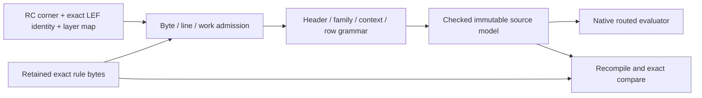

# OpenRCXRules

## Purpose and Scope

Compile the selected original calibre-family OpenRCX v1 source format into the
immutable [Core source model](../../PEXCore/ElectricalModel/DESIGN.md#openrcx-source-table-boundary).
Parent: [PEXParsers](../DESIGN.md). No children.

## Responsibilities and Boundaries

Own bounded ASCII grammar, counts, source ranges, row semantics and exact artifact
authentication/replay. Do not evaluate geometry, infer absent coefficients, parse
LEF through another implementation, scale temperature or grant qualification.
The caller selects one exact RC corner and matching technology LEF artifact plus
ordered routing-layer names. Runtime/input preparation validates the actual LEF
facts; their content identity is retained without pretending this parser read them.

## Related Designs

| Design | Relationship | Contract Used | Summary | Cautions |
|---|---|---|---|---|
| [PEXParsers](../DESIGN.md) | parent | Source lexical conversion | Direct compiler API | No external backend invocation |
| [ElectricalModel](../../PEXCore/ElectricalModel/DESIGN.md#openrcx-source-table-boundary) | depends on | Checked source values and fixed v1 profile | One model authority | Source admission is not numerical qualification |
| [Native](../../PEXNative/DESIGN.md) | used by | Immutable raw tables | Routed numerical consumer | No analytical-law fallback |

## Architecture

## Contracts and Invariants

`PEXOpenRCXCompiling.compile(bytes:selection:limits:isCancelled:)` verifies the
supplied rule artifact digest/count before publication. The selected grammar has
DIAGMODEL ON, six routing layers, DensityRate 1 0 and one DensityModel 0. Width
families with zero entries and DIST blocks with zero rows remain explicit values.
RESOVER has two spacing axes; capacitance families have distance/coupling/fringe/R
columns. Unknown grammar, wrong counts, nonfinite/negative values, duplicate or
missing contexts and contradictory source widths fail with typed errors.
`validate(model:bytes:limits:isCancelled:)` recompiles with the retained selection
and requires complete value equality, including profile, rows and source ranges.

The compiler borrows Data for the synchronous call. It scans source bytes once,
materializes only bounded current-line tokens for numeric conversion, and retains
only immutable output values/ranges. This one-time lexical conversion does not
occur in Native's repeated geometry-query path. A returned model does not borrow
the caller's buffer; Runtime retains exact source bytes independently.

## Failure, Concurrency, and Constraints

Caller-selected limits bound source bytes, line bytes, line count, output records,
output rows and work visits. Byte/hash inspection, line/token scanning and output
growth are charged before work/allocation. Cancellation is checked throughout.
Limits use checked arithmetic, have no unbounded defaults, and failures publish
no partial model. No global mutable state, I/O, async lifetime or unsafe pointer
exists in this component.

## Verification and Change Impact

[PEXParsersTests/PEXOpenRCXRulesTests](../../../Tests/PEXParsersTests/PEXOpenRCXRulesTests.swift)
owns original three-corner compilation, raw sample/range/count fidelity, empty
blocks, explicit source replay, altered-source/model refusal and caller quotas/
cancellation. Core structural tests cover malformed programmatic/decoded values.
Native owns width/distance/geometry calculations and independent oracle evidence;
Runtime owns captured exact LEF/DEF/rule reload and same-candidate joins. Changes
to source profile or row semantics invalidate those direct consumers' evidence.
