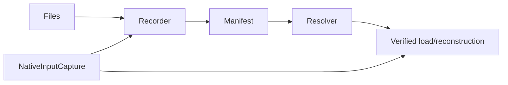

# PEXPersistence

## Purpose and Scope
Owns run-local immutable artifact capture, identity, manifest persistence, validated resolution and request/result reconstruction. Parent: [PEXEngine](../../DESIGN.md). Child: [NativeInputCapture](NativeInputCapture/DESIGN.md).

## Responsibilities and Boundaries
Recorder/store/resolver are module composition roots. They consume Core artifact and request contracts; extraction, parsing, process qualification and release decisions remain outside persistence.

## Related Designs
| Design | Relationship | Contract Used | Summary | Cautions |
|---|---|---|---|---|
| [PEXEngine](../../DESIGN.md) | parent | Run lifecycle | Storage owner | Storage integrity is not physical qualification |
| [NativeInputCapture](NativeInputCapture/DESIGN.md) | child | Bounded native file snapshots | Exact native input retention | Selected model coverage is Runtime-owned |
| [PEXCore](../PEXCore/DESIGN.md) | depends on | Artifact and request values | Canonical persisted contracts | Availability is separate from identity |
| [PEXRuntime](../PEXRuntime/DESIGN.md) | used by | Capture/load | Execution and retry | Captured requests never fall back to original native source paths |

## Architecture

## Contracts and Invariants
Available artifacts bind role, path, SHA-256 and byte count. Request reconstruction requires every input ID recorded by the captured request to exist and be available, rejects all integrity issues for those IDs (including missing files classified as partial availability), and reuses the existing completeness inspection before returning run-local availability. Native input references and byte budgets survive reconstruction exactly; source location is provenance only. Failed corners retain available canonical bytes for diagnostic loadIR access, but loadResult publishes IR only for successful corners, matching the live runtime result. Retained bytes cannot turn a required-export failure into completed output. Raw, log or process-evidence records provide retained failure evidence; fileless in-process execution is not required to invent external logs.

## Verification and Change Impact
PEXPersistenceTests owns immutable artifact/resolver/load behavior. Runtime capture tests own initial execution and retry. Native input changes require both boundaries to be verified; no target-dependent synchronization is introduced.
