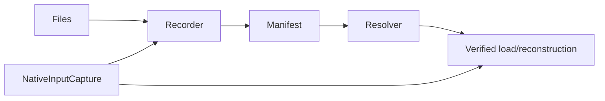

# PEXPersistence

## Purpose and Scope
Owns run-local immutable artifact capture, identity, manifest persistence, validated resolution and request/result reconstruction. Parent: [PEXEngine](../../DESIGN.md). Child: [NativeInputCapture](NativeInputCapture/DESIGN.md).

## Responsibilities and Boundaries
Recorder/store/resolver are module composition roots. They consume Core artifact and request contracts; extraction, parsing, process qualification and release decisions remain outside persistence.

## Related Designs
| Design | Relationship | Contract Used | Summary | Cautions |
|---|---|---|---|---|
| [PEXEngine](../../DESIGN.md) | parent | Run lifecycle | Storage owner | Storage integrity is not physical qualification |
| [NativeInputCapture](NativeInputCapture/DESIGN.md) | child | Bounded native file snapshots | Exact native input retention | Selected model coverage is Runtime-owned |
| [PEXCore](../PEXCore/DESIGN.md) | depends on | Artifact and request values | Canonical persisted contracts | Availability is separate from identity |
| [PEXRuntime](../PEXRuntime/DESIGN.md) | used by | Capture/load | Execution and retry | Captured requests never fall back to original native source paths |

## Architecture

## Contracts and Invariants
Available artifacts bind role, path, SHA-256 and byte count. Request reconstruction requires every input ID recorded by the captured request to exist and be available, rejects all integrity issues for those IDs (including missing files classified as partial availability), and reuses the existing completeness inspection before returning run-local availability. Native input references and byte budgets survive reconstruction exactly; source location is provenance only. Failed corners retain available canonical bytes for diagnostic loadIR access, but loadResult publishes IR only for successful corners, matching the live runtime result. Retained bytes cannot turn a required-export failure into completed output. Raw, log or process-evidence records provide retained failure evidence; fileless in-process execution is not required to invent external logs.

`captureProcessProfileInputs` records each declared Core role exactly once.
Aliased roles share one physical capture and content digest, with distinct truthful
deck/view descriptors referencing the same path and ArtifactID. The number of
records is bounded by the declared primary, corner and view entries, with no
discovery expansion. Capture/reconstruction and completeness checks reuse byte
integrity results within one invocation by `(relativePath, ArtifactID)`; descriptor
and role validation still applies to every record. No persistent validation cache
or additional copy is introduced for aliases.

`PEXArtifactStore.encodeManifest` owns the exact saved JSON representation, including
sorted pretty-printed keys and ISO8601 date precision. `saveManifest` writes those
same bytes. Consumers comparing live values to retained manifests use this codec;
they do not duplicate encoder settings or round timestamps independently.

`PEXArtifactResolver.processProfileInputRecord(for:)` selects exactly one available
record for the typed role and returns metadata only. Its caller must obtain byte
integrity through completeness inspection or `loadRequest`; lookup alone does not
prove byte integrity. Initial captured-request reconstruction and `loadRequest`
resolve every process-profile path by its exact typed association. Missing or
conflicting roles reject explicitly, without original-path or sanitized-ID fallback.
Old records remain inspectable with `loadResult`; missing role associations do not
authorize new execution or qualified-view consumption.

## Verification and Change Impact
Stored lineage loads verify each parent/child edge against the exact retained
requests and captured input references using Core's retry projection. Child
corners must be a nonempty subset of the parent's failed corners and observed
implementation identities must agree. A lineage without sufficient captured
request or image evidence fails explicitly; single-run historical result/IR
inspection remains available. The effective view cannot combine unrelated model,
calibration, configuration, source, or implementation histories.

PEXPersistenceTests owns immutable artifact/resolver/load behavior. Runtime capture tests own initial execution and retry. Native input changes require both boundaries to be verified; no target-dependent synchronization is introduced.
