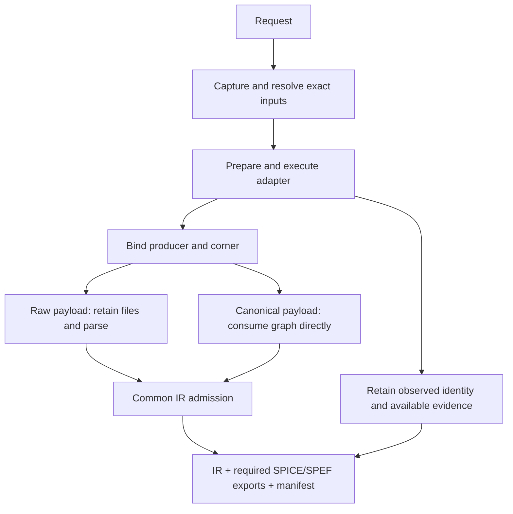

# PEXRuntime

## Purpose and Scope
Composes extraction request validation, captured-input resolution, backend corner execution, canonical admission, artifact persistence and run lineage. Parent: [PEXEngine](../../DESIGN.md). Child: [NativeInputLoading](NativeInputLoading/DESIGN.md).

## Responsibilities and Boundaries
PEXOrchestrator and PEXPipeline are module composition roots. They consume public backend/parser/persistence contracts, retain available evidence on failure and bind every successful result to its executing backend/corner. Numerical extraction, standard codec semantics, filesystem artifact integrity and process qualification remain with their owners.

## Related Designs
| Design | Relationship | Contract Used | Summary | Cautions |
|---|---|---|---|---|
| [PEXEngine](../../DESIGN.md) | parent | Run lifecycle and artifacts | Package composition | Complete native run requires captured native inputs/calibration |
| [BackendExecution](../PEXCore/BackendExecution/DESIGN.md) | depends on | Typed raw/canonical payload and identity | Corner execution boundary | Raw files do not imply external invocation |
| [PEXNative](../PEXNative/DESIGN.md) | coordinates with | Native canonical graph | Actual default native backend | NativePEXAdapterTests owns actual numerical execution proof |
| [PEXCore](../PEXCore/DESIGN.md) | depends on | Exact requests/corners and IR | Domain admission | Do not infer connectivity from name coverage |

| [NativeInputCapture](../PEXPersistence/NativeInputCapture/DESIGN.md) | depends on | Bounded native configuration/calibration capture | Exact run inputs | Model calibration coverage is checked after captured technology resolution |
| [NativeInputLoading](NativeInputLoading/DESIGN.md) | child | Shared native document/backend admission | Config mapper and CLI loading | Preserve decoded input URLs |

## Architecture

## Contracts and Invariants

Routed-native intake follows the discriminated source-law contract at
[NativeInput](../PEXCore/NativeInput/DESIGN.md) and host composition at
[RoutedInputPreparation](../PEXAdapters/NativeBackend/RoutedInputPreparation/DESIGN.md).
Its calibration admission requires complete explicit requested-corner source
coverage and never invokes the mask analytical-model selector. Existing mask
admission remains separate. The verified Native routed calculator supplies numerical execution. Public routed
success additionally requires the owned structural-source decoder and host exact
DEF/netlist semantic join; terminal-name coverage alone does not establish that join.
The complete requested corner IDs are forwarded into every execution context.
Each selected corner validates its explicit process/source selection without
analytical model construction. Required canonical and standard output publication,
source checking, captured-only reload and retry preserve their existing semantics.

PEXConfigMapper uses the actual configuration document URL as the base for every
persisted input path, including `inputs.nativeInput`. It delegates native backend
and document admission to the shared PEXNativeInputLoading service. Native
selection requires a nonempty reference path; other backends reject a supplied
native reference. The mapper forwards the complete admitted reference and its
capture budgets to PEXRunRequest. No frontend-specific base, schema, fallback,
or decoded-URL rewrite is introduced.
Configured executable file paths also resolve at the document base; absolute
paths remain unchanged. Explicit direct-CLI paths retain their caller-selected
base and are not reinterpreted as configuration paths.
Native input references are propagated through initial execution, exact retry and captured reload. Selected corner electrical-model calibration IDs must be a subset of actually captured calibration identities before adapter callbacks. No parser or synthetic raw file is required for canonical payloads. Actual raw files/logs are retained only for raw payloads; generated evidence remains retained in both paths. Exact corner mismatch and backend/expected-producer mismatch fail explicitly. Canonical graph admission validates once at the immutable backend-result boundary; runtime reuses its derived warning evidence. Canonical graph validation cannot be disabled by non-strict raw-parser options. Cross-corner producer/image identity and invocation mode/entrypoint remain consistent. Both SPICE backannotation and portable-profile SPEF are required run deliverables. Generation or recording failure fails the corner at persistence, retaining observed identity and all previously recorded canonical/topology/standard artifacts. The failed result publishes no successful IR; persisted canonical bytes remain diagnostic evidence, not completion. A missing-record entry retains the exact failure reason; failure to persist that entry is also explicit. Format-profile applicability belongs to PEXParsers, and is never silently relaxed by Runtime.

Process-profile capture delegates the full declared role inventory to Persistence.
Path aliasing must preserve every primary/corner/view association while capturing
the shared bytes once. Runtime consumes the returned captured paths and records;
it does not infer view roles from file names or private record identifiers.
Existing backend cancellation propagation and native byte budgets remain unchanged.

Native public run admission uses typed physical topology, independently of the legacy warn/disabled source policy. Opens, shorts and uncontacted terminals refuse same-design success after retaining complete canonical/topology and representable standard evidence. Direct adapter extraction remains a diagnostic graph operation. Source checking selects the requested parsed top boundary, requires all non-ground root terminals, and matches qualified instance/terminal identities only against parsed source occurrences; repeated leaf names do not establish identity. SPICE identifiers retain case-insensitive semantics; Verilog identifiers remain case-sensitive. Internal source nodes do not become required root terminals. Parsed named-port labels are occurrence terminals, never root nets. Source traversal has an operational ceiling of one million occurrences, one million identity visits, 256 MiB aggregate encoded identifier bytes and 1024 depth; ambiguity, recursion and exhaustion remain unproven. External warn/disabled diagnostic behavior remains supported. Unsupported or ambiguous source elaboration is explicitly unproven, never passed.

All input capture is bounded before whole-file materialization by Persistence-owned finite defaults (256 MiB per generic file), with caller-selected tighter native configuration/calibration ceilings preserved. The same retained file admission applies at reload. Task cancellation is checked between chunks; injected adapter polling does not claim a bound across capture or codec segments.

## Runtime Flows
Selective retry loads the exact retained parent manifest/request and verifies its
captured input integrity. The caller may supply the failed-corner subset or the
original full corner selection; every retried corner must have failed in the
parent. Before adapter callbacks, captured child inputs must match the parent's
Core-owned retry projection. A changed model/law, calibration, native configuration,
technology, shared source input, option, process/deck or selected PVT fails explicitly.
The retry requires the parent's measured producer even when the caller did not
declare an expected producer. Observed producer/image and invocation mode/entry
point must still match after execution, before a parent-linked manifest is published.
External invocation arguments and run-local working paths are not implementation
identity. Changed semantics require a new root run; historical artifacts are never
rewritten. The public orchestrator parent-ID entry point applies the same checks.
Parent links contain only a run ID, so publication requires the child's output
base to contain its retained parent. Changing only the child base is an explicit
availability failure before adapter callbacks. Relocating complete retained
history preserves meaning; source-byte relocation within a valid lineage base
also remains valid.

Validate/capture request, resolve captured technology, execute corners under existing concurrency policy, retain output evidence, select raw parsing or canonical graph by payload, validate, persist, aggregate exact execution identities and save manifest. Existing public load reconstructs canonical IR and an empty raw-output list for fileless results without depending on raw files.

## State, Ownership, and Lifecycle
Call-local run/corner state retains immutable input and output values. Artifact recording appends each verified record directly to the corner-owned retention buffer, so a later failure cannot discard an earlier record. Adapter cleanup follows success/failure. All corners join before unresolved process cleanup ownership is transferred as a live typed failure to the caller; it is not converted into a successful or ownerless persisted result. No new shared state, stream or resource lifetime is introduced by payload selection.

## Failure, Concurrency, and Constraints
Failed canonical admission retains generated evidence and observed identity and publishes a failed corner with no IR. Mixed identities fail whole-run aggregation. Existing bounded process/corner ownership remains unchanged. Cancellation and measured native-image retention are verified by the actual backend owner in subsequent composition work.

## Verification and Change Impact
NativePEXAdapterTests verifies default native execution, captured retry after source removal, and required SPEF failure retaining canonical/SPICE/topology evidence. PEXCanonicalExecutionTests proves real public orchestration/persistence/reload dispatch with a fileless in-process contract fixture and failure cases. Existing raw adapter/runtime tests prove raw parsing/evidence paths still execute. Changes to backend result types affect all adapters; native inputs, registration, standard exports, CLI and resume require cumulative integration after their own implementations converge.

The original request executionInputArtifacts are forwarded unchanged to each
PEXExecutionContext. Routed preparation consumes their full reference equality when
provided, and independently verifies each actual source digest/count. These caller
references do not by themselves confer external qualification.
